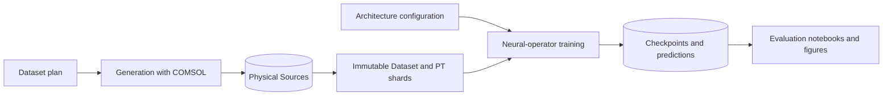

# GrainLegumes-PINO-Drying: Neural Operators for Porous-Bed Airflow and Drying
### *Specialization Project 2 (VP2) – MSE Data Science, Spring 2026*

**Master of Science in Engineering – Major Data Science**  
**Eastern Switzerland University of Applied Sciences (OST)**  
**Author:** Rino M. Albertin  
**Supervisor:** Prof. Dr. Christoph Würsch

---

## 📌 Project Overview

Drying grain legumes in a fixed bed couples airflow, heat transport and moisture exchange between air and grain. This project studies **neural operators** as fast surrogates for the two-dimensional COMSOL reference model of that process.

The project extends [GrainLegumes-PINO-Airflow (VP1)](https://github.com/Rinovative/grainlegumes-pino-airflow) from steady airflow to transient drying. A steady Darcy–Brinkman solution supplies the airflow field; the transient model then evolves four coupled state fields over physical time:

  **(T, φ, w_surf, w_int)ₙ, airflow, porosity, material, inlet schedule → (T, φ, w_surf, w_int)ₙ₊₁**

with temperature T, relative gas humidity φ, surface grain moisture w_surf and internal grain moisture w_int. Applied repeatedly, the learned step produces autonomous rollouts over the complete drying horizon.

The central research question is:

> How accurately and how stably can neural operators reproduce transient drying trajectories in heterogeneous porous beds, and how does the training protocol affect long autonomous rollouts?

<details>
<summary><strong>🎯 Research design and scope</strong></summary>

The project uses two learning tasks on one shared physical model:

1. **Steady flow**  
   The operator maps permeability κ, porosity ε and inlet pressure to pressure and velocity, `(κ, ε, p_bc) → (p, u, v)`. Supervised and physics-informed (PINO) variants carry the VP1 methodology into the new data pipeline.

2. **Transient drying**  
   The operator predicts the increment of the four state fields over one output interval. FNO, U-NO and RNO share one 28-channel input contract.

Transient training compares three protocols:

- **A0 (teacher forcing):** one-step training on reference states.
- **B (autonomous):** continues from A0 and trains on self-fed rollouts with a growing horizon.
- **A1 (matched teacher forcing):** continues from the same A0 checkpoint with the same measured training time as B, so that B and A1 differ only in the protocol.

Lentil and chickpea form the in-distribution material set; further legume and oilseed records support material-level out-of-distribution evaluation. The model is a two-dimensional porous continuum without resolved grains; airflow and drying are coupled sequentially.

</details>

The repository provides the complete research pipeline:

<details>
<summary><strong>🧩 Physical simulation</strong></summary>

Seeded Latin hypercube designs set material properties, heterogeneous permeability and porosity fields, initial moisture and time-dependent inlet temperature and humidity. COMSOL 6.4 solves the steady airflow and the transient drying model for each case through Slurm. Every case retains its inputs, solver outcome, timing and provenance, including failed attempts. Material parameters carry their literature evidence in versioned configuration.

</details>

<details>
<summary><strong>🗂️ Datasets</strong></summary>

One Dataset plan requests physical cases, selects successful ones and fixes Train/validation/ID-test membership before any model is trained. Published Datasets are immutable and identified by their content; PyTorch shards provide the tensor representation shared by all architectures. Exact source snapshots allow a Dataset to be inspected and rebuilt.

</details>

<details>
<summary><strong>🧠 Neural operators</strong></summary>

- **FNO** and **U-NO** for both tasks, built on the `neuraloperator` library
- **RNO** (recurrent neural operator) for transient sequences, with hidden state carried through a rollout
- **Physics-informed losses** for steady flow: dimensionless Darcy–Brinkman residual, cross-section flux-balance and pressure-boundary terms with physical-grid or spectral derivatives

</details>

<details>
<summary><strong>⚙️ Training framework</strong></summary>

- Architecture-first YAML configurations, validated before submission
- Train-only fitted scaling, reused unchanged for validation, test and inference
- Matched A0 → {B, A1} comparisons with measured training-time budgets, per-architecture A0 Optuna studies and a symmetric continuation-rate sweep for B and A1
- Exact checkpoint continuation from saved configuration and state
- Optuna studies and Weights & Biases tracking

</details>

<details>
<summary><strong>📋 Exploration and evaluation</strong></summary>

- **EDA notebooks** for Generation inputs and completed cases: fields, schedules, parameter coverage, target attainment and solver timing
- **Evaluation artifacts** with saved reference and predicted sequences for teacher-forced, autonomous and rolling-origin protocols
- **Evaluation notebooks** for one run or a comparison of compatible runs: physical-time and horizon error, field maps, physical plausibility, target time and surrogate speedup
- Explicit PDF export of the selected figure

</details>

## 📄 Project Report

The [VP1 airflow report](docs/Albertin_2026_PINO_Airflow_PorousMedia.pdf) documents the steady methodology and results on which this project builds.
## 📊 Visualization

<p align="center">
  
</p>

<p align="center">
<em>
VP1 pressure-field comparison of supervised and physics-informed neural operators against the reference solution.
</em>
</p>

<details>
<summary><strong>Outlier-case inspection</strong></summary>

<p align="center">
  
</p>

<p align="center">
<em>
VP1 field-level diagnostic of the best physics-informed model (PI-U-NO) on a challenging outlier case.
</em>
</p>

</details>

## 🧭 Data Flow Overview

<details>
<summary><strong>From physical cases to evaluated models</strong></summary>



A Dataset fixes membership before architectures are compared. Each run records its configuration, seed and stage; matched B and A1 branches share one recorded A0 checkpoint.

</details>

## ⚙️ Execution on ICE

The maintained deployment is the OST ICE cluster: **Python 3.12** with native **COMSOL 6.4** for Generation, **Slurm** for all computation and **Apptainer** for training and evaluation. Open the project root in VS Code Remote SSH; code, research data and environments live in separate sibling folders.

<details>
<summary><strong>Set up the project</strong></summary>

1. Create the project root and clone into `repo/`:

```bash
mkdir -p grainlegumes-pino-drying/{storage,runtime}
cd grainlegumes-pino-drying
git clone https://github.com/Rinovative/grainlegumes-pino-drying.git repo
cd repo
```

2. Provision the native environment inside a CPU allocation:

```bash
srun --partition standard --cpus-per-task 2 --mem 8G --time 01:00:00 \
  bash scripts/provision_native.sh
```

3. Check the environment and the ML container:

```bash
../runtime/venvs/native/bin/python --version
./scripts/generation --help
./scripts/slurm_ml.sh --mode cpu --partition standard --cpus-per-task 2 \
  --mem 4G --time 00:10:00 probe
```

`pyproject.toml` and `uv.lock` define the dependencies; [container/Apptainer.def](container/Apptainer.def) defines the ML image. Details are in [Setup and execution](docs/01_setup_and_execution.md).

</details>

<details>
<summary><strong>Build a Dataset, train and evaluate</strong></summary>

1. Preview and run the Dataset plan on the login node (the run freezes the source and submits its own CPU driver job):

```bash
../runtime/venvs/native/bin/python -m src.datasets.dataset_packages run \
  configs/02_datasets/transient_drying/lentil_chickpea_ref_range.yaml --preview
```

2. Train one architecture on the published Dataset:

```bash
./scripts/slurm_ml.sh --mode gpu --partition gpu --cpus-per-task 4 \
  --mem 32G --time 04:00:00 --gres gpu:rtx6000ada:1 train \
  configs/03_learning/transient_drying/experiments/architecture_comparison/fno_m64x80_h64_l3.yaml \
  --train-dataset DATASET_ID
```

`DATASET_ID` is the computed Dataset name printed by the preview (the directory below `storage/02_datasets/<task>/`).

3. Open `notebooks/04_eval_single_model.ipynb` or `notebooks/05_eval_comparison_models.ipynb` on a compute-node kernel.

The [documentation index](docs/README.md) lists all guides in reading order.

</details>

## 📂 Repository Structure

The checkout lives in `repo/`. The sibling `storage/` holds physical Sources, Datasets and Experiments, each level named from its content ([storage map](docs/01_setup_and_execution.md#storage-map)); `runtime/` holds environments, containers, caches and job logs.

<details>
<summary><strong>Show repository structure</strong></summary>

```text
.
├── .github/workflows/
│   └── quality.yml               # Lint, format, type, notebook and test checks
├── configs/
│   ├── README.md                 # Which config you edit for what, and how often
│   ├── 01_generation/
│   │   ├── execution.yaml        # Slurm resources, timeouts, retention
│   │   ├── physical_model/       # Grid, parameters, materials, operation, task profiles, bibliography
│   │   └── standalone/           # Source-only campaigns and the CPU core-scaling benchmark
│   ├── 02_datasets/              # Dataset plans per task (materials, counts, roles, split)
│   └── 03_learning/
│       ├── steady_flow/          # Shared base.yaml, experiments and Optuna searches
│       └── transient_drying/     # Shared base.yaml, experiments and Optuna studies
├── container/
│   └── Apptainer.def             # ML container definition
├── docs/                         # Guides 01–07, VP1 report, figures
├── notebooks/
│   ├── 01_eda_generation_inputs.ipynb    # Generation inputs before COMSOL
│   ├── 02_eda_datasets.ipynb             # Completed cases and Datasets
│   ├── 03_training_pipeline.ipynb        # Training plans and saved runs
│   ├── 04_eval_single_model.ipynb        # One saved run
│   ├── 05_eval_comparison_models.ipynb   # Compatible saved runs
│   └── 06_physics_diagnostics.ipynb      # Physics residuals and balances of reference fields
├── scripts/
│   ├── provision_native.sh       # Native environment from uv.lock
│   ├── generation                # Generation CLI entry point
│   ├── generation_node.sh        # Node-side Generation entry for Slurm jobs
│   ├── slurm_ml.sh               # Slurm wrapper for train, optuna, artifacts, probe
│   ├── apptainer_exec.sh         # Run a command inside the ML container
│   └── source_fingerprint.py     # Source snapshots and restore
├── simulation/
│   ├── steady_flow/              # COMSOL airflow template and digest
│   └── transient_drying/         # COMSOL drying template and digest
├── src/
│   ├── common/                   # Paths, identity and shared persistence
│   ├── domain/                   # Fields, equations and task contracts
│   ├── generation/               # Case sampling, COMSOL execution and Sources
│   ├── datasets/                 # Dataset selection, splits and PT shards
│   ├── experiments/              # Configuration, run orchestration and tracking
│   ├── learning/                 # Models, losses, training and inference
│   └── analysis/                 # EDA, evaluation artifacts and presentation
├── tests/                        # Contract and lifecycle tests per subsystem
├── LICENSE.md
├── README.md
├── pyproject.toml                # Package and dependency definition
└── uv.lock                       # Locked dependencies
```

</details>

## 📄 License

This project is released under the [Apache License 2.0](LICENSE.md).

## 📚 References

- R. M. Albertin, **GrainLegumes-PINO-Airflow**, VP1 project report, OST, 2026. [PDF](docs/Albertin_2026_PINO_Airflow_PorousMedia.pdf)
- Z. Li, N. Kovachki, K. Azizzadenesheli, B. Liu, K. Bhattacharya, A. Stuart, and A. Anandkumar, **“Fourier Neural Operator for Parametric Partial Differential Equations”**, ICLR, 2021. [arXiv:2010.08895](https://arxiv.org/abs/2010.08895)
- M. A. Rahman, Z. E. Ross, and K. Azizzadenesheli, **“U-NO: U-shaped Neural Operators”**, 2022. [arXiv:2204.11127](https://arxiv.org/abs/2204.11127)
- M. Liu-Schiaffini, C. E. Singer, N. Kovachki, S. C. Leung, H. J. Bae, K. Azizzadenesheli, and A. Anandkumar, **“Tipping Point Forecasting in Non-Stationary Dynamics on Function Spaces”**, 2023. [arXiv:2308.08794](https://arxiv.org/abs/2308.08794)
- Z. Li, H. Zheng, N. Kovachki, D. Jin, H. Chen, B. Liu, K. Azizzadenesheli, and A. Anandkumar, **“Physics-Informed Neural Operator for Learning Partial Differential Equations”**, 2021. [arXiv:2111.03794](https://arxiv.org/abs/2111.03794)
- J. Kossaifi et al., **“A Library for Learning Neural Operators”**, 2024. [arXiv:2412.10354](https://arxiv.org/abs/2412.10354)
- Material and transport evidence: [Physical model and parameters](docs/02_physical_model.md) and `configs/01_generation/physical_model/sources.yaml`.
