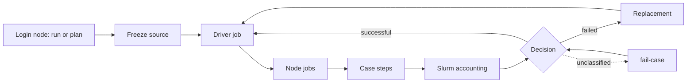
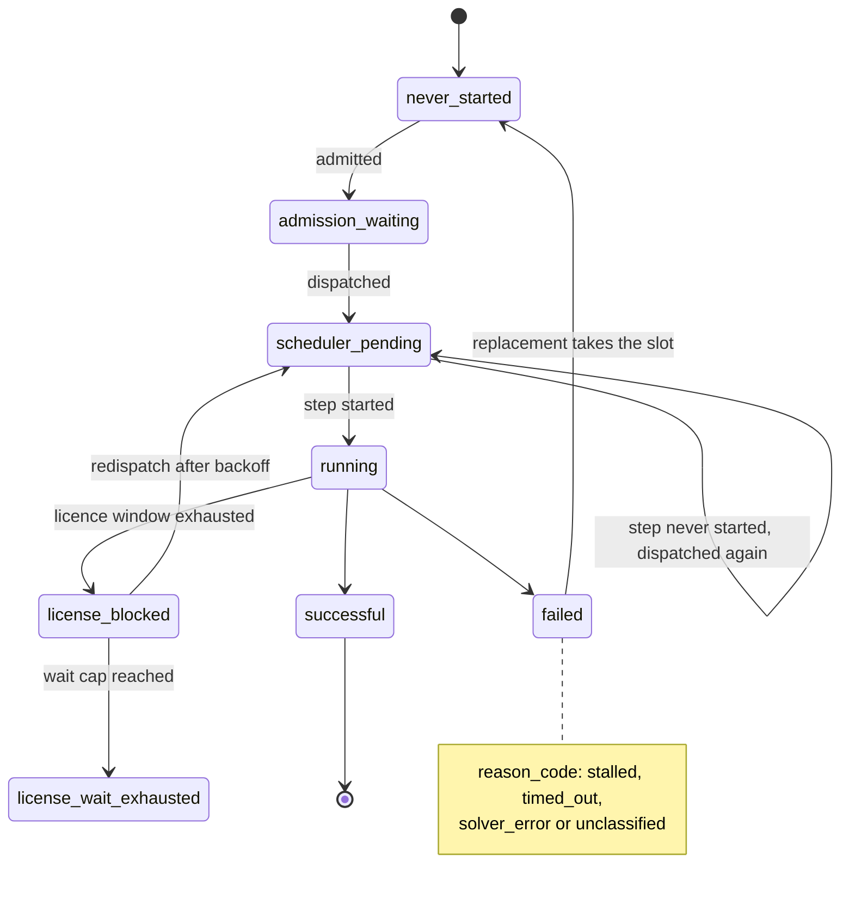

# Generation

> **Normal entry point:** a Dataset plan run ([Datasets](04_datasets.md#normal-workflow)) resolves its `generation` block into one Source campaign.
> This guide explains what runs inside it, how cases fail and are replaced, and what a Source stores.
> Physics and sampling: [Physical model](02_physical_model.md). Learning data: [Datasets](04_datasets.md).
> Notebook: [`01_eda_generation_inputs`](../notebooks/01_eda_generation_inputs.ipynb) shows the prepared inputs, design coverage and failures by parameter.

[Documentation index](README.md)

## Campaign driver

A Dataset plan run is the campaign entry: it resolves the plan's `generation` block into one physical Source campaign and runs it through the driver and node jobs below. Sources carry no Train, validation, test or OOD roles. `./scripts/generation run CONFIG` starts the same driver for a campaign YAML (`schema_kind: generation_source_campaign`) without a Dataset; the repository ships no such file. The resolved plan records the overrides and the effective values.



On the login node `run` freezes the source and submits the controller as its own CPU Slurm job (2 CPUs, 8 GB, `--driver-partition` `standard` or `long`, `--driver-time` default 06:00:00) that runs from the frozen tree, then prints the submission. `--dry-run` prints the resolved plan and checks execution readiness (node launcher, native imports and the COMSOL module) without starting work or freezing the source.

<details>
<summary>Printed submission</summary>

```json
{
  "job_id": "4711",
  "log_path": "RUNTIME/logs/generation/generation-transient_drying-4711.log",
  "status": "SUBMITTED",
  "tree_id": "COMMIT12-FINGERPRINT12"
}
```

</details>

Options of `run`: `--materials`, `--duration-hours`, `--revision`, `--max-admission-cases`, `--node-jobs`, `--cores-per-case`, `--case-timeout-seconds`, `--no-retry`, `--driver-partition`, `--driver-time`, `--continue-with-current-code`, `--dry-run`.

<details>
<summary>Options</summary>

| Option | Effect | Default when omitted |
| --- | --- | --- |
| `CONFIG` | Campaign YAML | required, no default |
| `--materials` | Material families (a subset of the campaign's; their design sizes stay as authored) | none: the campaign config's `materials` apply |
| `--duration-hours` | Physical horizon; regular output intervals must stay exact | none: the `time` horizon of `configs/01_generation/physical_model/common.yaml` applies |
| `--revision LABEL` | Source campaigns only: names the Source `SOURCE_NAME__rev-LABEL` beside the existing one when its science changed ([Revision rule](07_reproducibility_and_validation.md#revision-rule)) | none: no revision (unless the campaign config authors `revision`) |
| `--max-admission-cases` | Distinct fresh solver candidates, recorded and fixed; input preparation still covers the full design ([Replacements](#replacements)) | none: a campaign without a plan records `run.max_admission_cases` of `execution.yaml` (4); a Dataset plan run derives it from the plan rates; a value below 1 is refused |
| `--node-jobs` | Node-job slots the run may use (1 to 4; a per-user cap on the five shared 32-core nodes, so use 3 or 4 only when they are quiet); with `--cores-per-case` k it caps the concurrent cases at slots × floor(32/k) | `run.node_jobs` of `execution.yaml` (2) |
| `--cores-per-case` | CPUs per case (k) | `run.cores_per_case` of `execution.yaml` (4) |
| `--case-timeout-seconds` | Solver runtime limit | `run.timeout_seconds` of `execution.yaml` (3600) |
| `--no-retry` | No licence retries (neither the node wait nor the retry within an allocation) | off: `rules.license_wait.enabled` of `execution.yaml` (`true`) applies |
| `--driver-partition` | Partition of the driver job (`standard`, `long`) | `standard` |
| `--driver-time` | Time limit `[D-]HH:MM:SS` of the driver job | `06:00:00` |
| `--continue-with-current-code` | Continue an existing campaign with the current code instead of its bound source tree ([Source snapshots and frozen trees](07_reproducibility_and_validation.md#source-snapshots-and-frozen-trees)); refused with `--dry-run` | off: an existing campaign continues in its bound source tree |
| `--dry-run` | Print the plan and check readiness; start nothing | off: the run starts |

</details>

<details>
<summary><strong>Driver and node jobs</strong></summary>

- **Node-job slots:** one Slurm job per slot (`gen-seat-1` to `gen-seat-4`, Slurm singleton, at most `run.node_jobs` across all Generation runs of the user). Slurm picks a `standard` node with at least `site.cores_per_node` cores; node jobs are not exclusive, so the remaining CPUs of a larger node stay available to other jobs.
- **Node worker:** a generic worker inside each node job starts the cases as job steps of `cores_per_case` cores each, floor(32/k) at a time, and refills a free slot as soon as a step ends.
- **Dispatch:** the driver dispatches each case as a ticket into a node job and records the dispatch in `_record/execution/run.json` before the ticket exists. It reconciles every dispatch from the step's own Slurm accounting (state, exit code, times, node), so an out-of-memory or failed step is attributed to its case and a step that never started is dispatched again without consuming an attempt.
- **End of a node job:** when no case remains, the driver ends each node job with a stop ticket; an orphaned node job ends after 15 idle minutes.
- **Driver lifetime:** it runs until the campaign is complete, staged at its admission cap, or stopped by an error; its log is the `log_path`. Node jobs and `run.json` survive the driver, so rerunning the same command adopts the open node jobs and continues the campaign after an error or after the driver's time limit.
- **Monitoring and cancel:** `status` (one line per node job) and `cancel RUN_ID [--force]` run on the login node at any time; `--force` is off by default (graceful cancellation). A cancellation is a persisted desired state that every later driver call repeats until all node jobs have ended.
- **Core count:** `run.cores_per_case` is 4. It was chosen on 2026-10-28 from the measured node throughput per core count (k = 2 to 32): about 15 successful cases per node-hour at k = 4 against about 11 at k = 8.

Case states (names from `src/generation/generation_campaign_status.py` L45–53 and L74–80, dispatch statuses from `generation_campaign.py` L1075 and L1142):



`unclassified` stays failed until `fail-case` declares it. `license_wait_exhausted` settles the campaign, not a single case.

</details>

<details>
<summary><strong>Execution settings, timeout and stall rule</strong></summary>

`configs/01_generation/execution.yaml` sets:

| Setting | Value | Meaning |
| --- | --- | --- |
| Case timeout | 3600 s | The orderly stop starts 300 s earlier (after 55 minutes); each case has an outer time limit of the timeout plus 600 s for publication |
| Stall rule `rules.stall_stop` | `minimum_simulated_seconds` 3600 s, `check_after_seconds` 900 s | Stops a transient case whose COMSOL simulated time is still below the minimum after 900 s of solving |
| `run.cores_per_case` k | 4 | Eight cases run at a time per node |
| `run.node_jobs` | 2, at most 4 | Per-user cap on the five shared 32-core `standard` nodes that leaves one node free; the batch licence counts once per user and does not limit it (see [Retention and licence](#retention-and-licence)) |
| `node_job.memory_per_case` | 20G, provisional | The largest observed transient case peak was 15.8 GB |
| `node_job.node_job_wall_time` | see file | Wall limit of a node job |
| Derived `concurrent_cases_per_node` | floor(32/k) | Computed by the loader |
| Derived `node_job_memory` | floor(32/k) × `memory_per_case` + `node_memory_overhead` | A configuration that would exceed `node_memory_limit` is rejected instead of lowering the concurrency; k = 2 needs 328G and therefore runs only on the 514 GB nodes |

`--mem`, `--dependency`, `--comment`, `--exclude`, GPU and node-selection options are owned by the pipeline and rejected in `scheduler_options`. Without `stall_stop` only the timeout applies. The admission cap counts candidates, not allocations: continuations can request further allocations.

**Timeout.** In the core-scaling measurement of 28 October 2026 the longest success at k = 4 took 29.8 minutes, the same case took 20.0 and 29.8 minutes in its two replicates, and no case timed out. The generous limit costs time only for cases that progress but never finish and keeps slowly converging cases in the data.

**Stall rule.**

- Transient cases only (the profile with a time horizon). A stationary steady solve never reports a simulated time, so a steady case builds no stall rule even though the shared execution file sets one, records `stall_progress` as null, and only the timeout bounds it.
- The stop is orderly, escalates after the same reserve and is recorded as a solver failure with the typed reason `stalled`, not as a timeout. Detail, for example: `stalled: 0.98 h of 168 h simulated after 900 s solving (threshold: 1 h simulated after 900 s)`.
- An unknown simulated time never triggers it; the timeout stays the backstop for slow cases that still progress.
- The 900 s stays deliberately short so that cases that never converge stop early. In the measurement of 28 October 2026 the stuck cases stood at 0 to 63 s simulated after 15.6 minutes at k = 2 to 8; at k = 4 it stopped one case.
- A case stuck at its start (2026-10-26: 54 s simulated in 45 minutes) is stopped after 15 instead of 55 minutes and frees its COMSOL licence. Successful cases had passed 1 h simulated well before 10 minutes, one of them only after a slow first 5 minutes.
- A stall is not always reproducible (one case stalled in 1 of its 10 measured runs); a stalled case is replaced, not retried.

**Calibration.** Every case records in `runtime/timing.json` (and its evidence copy) `stall_progress`: the rule's `minimum_simulated_seconds` and `reached_after_seconds`, the solving time, on the clock of `check_after_seconds`, at which COMSOL's simulated time was first seen at or above that minimum. It is null when it was not seen (for example because the case stalled or its solver ended before stop control started), without a stall rule and for every steady case. A separate uncached reader of the solver output records it after each poll, so the value is accurate to the poll interval and never changes a stop decision. The timing reader exposes both values with the component availability `stall_progress`. After the first production campaign, `check_after_seconds` is set from the largest `reached_after_seconds` of the successful cases.

</details>

## Input-only generation and status

`inputs` prepares selected physical inputs of a campaign YAML without COMSOL through the Slurm input path (a Dataset plan run prepares its own inputs first). It needs a batch and a case selection; actual execution freezes the source like `run`, with or without uncommitted changes. `status` reports solver campaign state.

```bash
./scripts/generation inputs CAMPAIGN_YAML \
  --only-batch transient_drying__lentil__train \
  --case-start 1 --case-count 10 --dry-run
```

<details>
<summary><strong>Selection flags and inspection</strong></summary>

| Option | Effect | Default when omitted |
| --- | --- | --- |
| `CONFIG` | Campaign YAML | required, no default |
| `--only-batch NAME` | Prepare one batch | none: all batches |
| `--only-regime KIND` | Filter batches by design kind (`train`, `validation`, `test` or `parameter_ood`) | none: all design kinds |
| `--case-count N` | Number of cases per selected batch | none: all cases of each selected batch |
| `--case-start N` | First case of the selection; only together with `--case-count` | none: the first configured member of the batch |
| `--dry-run` | Resolve and report the selection without preparing inputs | off: inputs are prepared |

`--storage-root` and `--git-commit` are supplied by the controller and refused as options. Ten cases from a fifty-point design keep that design's seeds and positions. Inspect prepared inputs in `notebooks/01_eda_generation_inputs.ipynb`.

</details>

## Counts and case identity

Case IDs are material-local (`case_0001`, …) and follow candidate positions, not completion order. A retry keeps its ID and appends attempt evidence; an explicit replacement receives a new ID and keeps its parent design and seeds. A Source seals its selected pool when its success target is met; a short Source stays incomplete.

<details>
<summary><strong>Count definitions</strong></summary>

| Count | Meaning |
| --- | --- |
| Original design size | Points taken from the start of one fixed design (material and design kind) |
| Prepared inputs | Cases with generated and admitted physical inputs |
| Fresh admitted candidates | Distinct candidates charged to the admission limit |
| Attempts | Recorded execution and recovery attempts; can exceed the candidates |
| Successful candidates | Validated physical output with content hashes and a successful terminal decision |
| Source selected pool | Sealed successful cases in original-design order, replacements after primaries |
| Dataset selected count | Successful cases chosen by the Dataset |
| Training count | Dataset members assigned to Train |

</details>

## Failures and continuation

Failures end in a retry, a replacement or a stop that names its next step.

| # | Failure | Handling |
| --- | --- | --- |
| 1 | Spatial inputs: texture violates the mean-porosity support | Retry a complete stochastic realization with up to 32 deterministic seed plans; the packing scatter seed stays fixed. Structural and coupling failures stop at once |
| 2 | Schedules: degenerate or infeasible | Retry with up to 32 seed plans; values are never clipped; exhaustion raises an error. Both retries keep the candidate and its design coordinates |
| 3 | Licence capacity | Not a case failure: retried inside the allocation (300 s window, 5 s between attempts), then `wait.json` and redispatch after 60 s doubling to at most 300 s; the cumulative wait is capped at 3600 s, beyond it the campaign settles as `license_wait_exhausted` |
| 4 | Solve the runtime stopped itself | Decided automatically with the typed reason `stalled`, `timed_out` or `solver_error`; the replacement is planned once every original candidate of the batch is terminal |
| 5 | Export, conversion and validation failures, unclassified solver failures | No automatic retry: the driver stops with the `fail-case` instruction. Inspect the evidence and declare the case failed; its replacement is solved again with COMSOL |
| 6 | Controller or publication errors | Automatic feeding stops; rerun the same campaign after inspection. The rerun solves the case again with COMSOL; nothing is reused from the retained output |

<details>
<summary><strong>Licence wait and typed solver reasons</strong></summary>

**Licence capacity (class 3).**

- The worker retries the checkout inside its running allocation for a fixed 300 s window (5 s between attempts). When the window is exhausted it records a per-case `wait.json` and ends the case; the controller redispatches it after a backoff of 60 s doubling to at most 300 s.
- The cumulative wait is counted per case and capped by `rules.license_wait.maximum_wait_seconds` (3600 s); beyond it the campaign settles as `license_wait_exhausted`.
- Two keys are configurable, `rules.license_wait.enabled` (`--no-retry` sets it to false) and `maximum_wait_seconds`; the window and backoff timing are fixed constants of `generation_runtime_license.py`.
- With the protection off, a capacity failure is an ordinary solver failure: the attempt is recorded as `failed`, with no `wait.json`, no allocation window and no redispatch.

**Typed reasons (class 4).**

- `stalled` (the stall rule), `timed_out` (the case timeout) or `solver_error` (COMSOL exited non-zero, except by a signal, for example a memory-limit kill, which stays unclassified and is declared by hand). An attempt that the runtime did not classify reads `unclassified`.
- The attempt stores it as its `reason_code` with a human `detail` that names the solver progress of the task and the solving time, and keeps the exception type in its evidence:
  - transient: simulated hours of the horizon, `solver_error: COMSOL exited with status 1 at 0.98 h of 168 h simulated after 120 s solving`;
  - steady: the last stationary nonlinear iteration, `solver_error: COMSOL exited with status 1 at nonlinear iteration 37 after 120 s solving`;
  - `no progress reported` only when the solver output holds none (a transient case that ends during its initial stationary airflow solve also names that iteration).
- Once the step of the case's latest dispatch has terminal Slurm accounting and no dispatch of the case is active, the next feed records the failed decision with that reason and detail. That feed returns without draining a node job; once every original candidate of the batch is terminal, a following feed plans the replacement, unless the batch's minimum success rate has stopped it (see [Replacements](#replacements)).

</details>

Record an inspected failure:

```bash
./scripts/generation fail-case "$CAMPAIGN_RUN_ID" MATERIAL case_0001 \
  --reason-code nonconvergence --detail "inspected terminal solver evidence"
```

`fail-case` takes `RUN_ID`, `MATERIAL`, `CASE_ID`, `--reason-code` and `--detail`, all required without a default. It accepts original and replacement candidates and shares one decision path with the automatic decision. Terminal decisions are immutable: repeating the same decision is idempotent, a conflicting one fails.

<details>
<summary><strong>Decision rules, status and driver reconciliation</strong></summary>

- A replacement is checked against its own one-case batch, not its parent batch.
- A validly published case whose step ended without writing its success decision, for example after a scratch-cleanup error, receives it from the next scheduled feed; a metadata-only feed asks for that feed instead of hashing the case HDF5.
- Resume uses the frozen campaign, validated artifacts and exact scheduler evidence; missing scheduler evidence blocks duplicate admission.
- `status` reports each case's recorded `terminal_decision` (`successful`, `failed` or `null`).
- While no job is pending or running, the driver (`run`, and the Dataset command that wraps it) keeps reconciling with `resume-campaign` before it acts on a failure, because a status read right after the jobs ended can predate their evidence on the driver's node (shared-filesystem caching) and their reconciliation. `resume-campaign` prints one JSON summary line with the state, a compute request with its `continuation_reason`, the submission-record counts and the dispatches this resume reclassified as not started; the full manifest stays in the campaign's execution record `_record/execution/run.json`.
- The driver stops only if the condition has held for two minutes:
  - a failed case with `terminal_decision` `null`: the message names the cases and the `fail-case` route; rerun the same command after recording them;
  - a success deficit that no planned replacement covers because a stopped batch admits none: the message names the batch with k/n, its bound and s, and the ways out under [Replacements](#replacements).
- A recorded failure whose slot is covered by a replacement never stops the run.

</details>

## Replacements

Once every original candidate of the material, over all its design kinds, is terminal, each terminal failure takes the next unused point of its own design, and a failed replacement frees its target slot for the next one. The material's minimum success rate $s$ bounds this. With $k$ successful and $n$ decided candidates of the material (all design kinds, originals and replacements alike), the one-sided 95 % Clopper–Pearson upper bound of the success rate is

$$U(k,n)=\mathrm{Beta}^{-1}(0.95;\,k+1,\,n-k)\quad(k<n),\qquad U(n,n)=1 .$$

Once $n\ge1$ and $U(k,n)<s$, every batch of the material is stopped: it admits no fresh candidate of its own, neither original nor replacement, while its running cases finish and other materials continue. Implemented as `beta.ppf(0.95, k + 1, n - k)` in `src/generation/cases/generation_cases_selection.py` (L38 and L89–97).

- **Dataset plans** set $s$ as `generation.minimum_success_rate` ([Datasets](04_datasets.md)). Campaign creation records it once per material as amendment 1 (`registered_by: plan`); a rerun must repeat it exactly and a different value is refused. $s$ changes neither the Source name nor the seeds.
- **Campaigns without a plan** use $s=1$, so their first recorded failure stops the material until $s$ is lowered.
- **Blocked campaign:** when every admitted candidate is decided and a stopped batch is below its count, the campaign ends `blocked`; `status` and the driver name the batch with k/n, the bound and $s$, and the two ways out: fix the cause and start a new Source (`--revision LABEL`), or lower $s$ and rerun the same command.

```bash
./scripts/generation amend-replacements "$CAMPAIGN_RUN_ID" --material MATERIAL \
  --minimum-success-rate 0.8 --reason "first failure inspected; accept a lower success rate"
```

`RUN_ID`, `--material`, `--minimum-success-rate` and `--reason` are all required; none has a default. `--minimum-success-rate` must lie at or below the material's current $s$; repeating the current value is idempotent, a higher one is refused. Like `fail-case`, the command reads the live checkout, freezes no source and starts no job.

<details>
<summary><strong>Replacement mechanics, amendments and admission cap</strong></summary>

- **Points:** a batch of N points holds points 0 to N − 1, and its replacements take points N, N + 1, … in `candidate_position` order. They are prefix-stable and every per-case seed still derives from the design seed and the point index. Each replacement keeps its target slot and `parent_failed_case_id`. Originals come before replacements in the selected pool, and every failure stays in the Source as a candidate. Replacements are fresh admissions.
- **Counts:** $k$ and $n$ count the batch's material over all its design kinds; undecided candidates, licence waits and cases without a decision do not count.
- **Evaluation:** every feed evaluates the stop from the recorded decisions, so a success recorded meanwhile lifts a stop at once and never blocks. A decision recorded while a replacement is planned that stops its batch or closes its deficit ends planning for that batch only, and the feed goes on.
- **One value per material:** the stop is decided per material, and every original batch of a material reads the same $s$, the rate of the material's latest amendment record in `materials/MATERIAL/_record/amendments/` ($s=1$ without one).
- **Amendment records:** a lowering publishes the material's next numbered amendment record (`amendment_NNNN.json` with rate, registrant `explicit` and reason) atomically under the controller lock and never rewrites an earlier one, so every design of the material reads either the old or the new $s$, never a mix; a sealed selected pool refuses it.
- **Admission cap:**
  - A Dataset plan run without `--max-admission-cases` records `max_admission_cases: null` and derives its cap at every feed: each original batch's count plus the failures it tolerates at its current $s$, so a lowered $s$ raises it; `status` shows it as `max_admission_cases=N (plan rates)`.
  - An explicit `--max-admission-cases` (or a `max_admission_cases` override) is recorded and stays as given, even when it equals that default; a campaign without a plan records the execution configuration's value.
  - A rerun may not lower the effective cap (a derived one at the current rates), also not when it switches between an explicit and a derived cap.
  - When an explicit cap holds back a candidate that a remaining success slot needs after a recorded failure, and every admitted candidate is decided, the campaign ends `blocked`; `status` and the driver name the cap: rerun the same command with a larger `--max-admission-cases`.

</details>

## Logs

Every Generation and Dataset job writes its log under `runtime/logs/`, submitted with `--open-mode=append`, so a rerun or requeue appends and never truncates a linked log. Once the campaign directory exists, the logs are also hard-linked under their own names into the campaign's `_record/logs/`: a link is the same file, so it grows while the job writes and survives a cleanup of `runtime/logs/`. Nothing is copied, moved or deleted.

<details>
<summary><strong>Log files, linking and log formats</strong></summary>

| Log | In `runtime/logs/` | Linked into the campaign |
| --- | --- | --- |
| Driver of `run` | `generation/generation-TASK-JOB.log` | as soon as input preparation has created the campaign, also when preparation or `submit-campaign` then fails |
| Dataset driver | `datasets/dataset-TASK-JOB.log` | as the Generation driver; never into the Dataset folder, which nothing changes after its atomic publication ([Datasets](04_datasets.md)) |
| Node job | `generation/node-JOB.out`, `generation/node-JOB.err` | when the node worker starts (the `.out` link grows with the file) and again when it ends, which links an `.err` that holds text by then; Slurm teardown lines written after the worker process exits, and the interpreter's own report of an uncaught `KeyboardInterrupt` or `SystemExit`, are written after the final link and stay in `runtime/logs/` |
| Helper step | `generation/python-OPERATION.XXXXXXXX.out` (and `.err` when it ran through `srun`) | when the step ends, or when the campaign becomes known for steps that ran before it existed; a successful step whose output is one JSON object (the result the driver receives) writes no file and prints only `OPERATION: JSON result returned to the driver (N bytes, sha256 …)` with its `state` to the driver log, any other output and every failed step keep the raw output in the file |

A job finds its own log from the same `--output`/`--error` template the pipeline gave its `sbatch` call, with `%j` replaced by `SLURM_JOB_ID`: `generation/node-%j.out` and `.err` for a node job, `AREA/NAME-%j.log` for a driver, where `NAME` is its `SLURM_JOB_NAME`; the code that builds those arguments owns the templates. Only an existing regular file is linked, and an `.err` file that is empty at that moment is not. After the link is created, its device and inode are compared with the file that was named; on a mismatch (the file was replaced meanwhile) the link is removed again with a warning. A link never creates the campaign folder and never fails a job: a missing folder, a symbolic link or a file-system error is one warning on stderr, and a different file under the same name in `_record/logs/` stays and is reported.

- **Driver log:** each stage starts with `[n/N] STAGE` and ends with `[n/N] STAGE done in DURATION`.
  - While cases run, a live board (counts, elapsed time, one line per node job and per case) appears at the first poll and at every state change; otherwise a running case gets one compact line every 60 s (`TIMESTAMP  MATERIAL/case_NNNN  simulated 56.8 h  step 4.176 h  Tfail 2  NLfail 2  updated 10 s ago`, with `no progress for N min` once its solver evidence stayed unchanged for over 10 minutes), and a finished case shows its moisture and target.
  - A case that changes its group first gets one line `TIMESTAMP  case MATERIAL/case_NNNN: OLD -> NEW (REASON)` (a case that leaves `failed` or `verifying` adds `; was REASON`; a failed case whose detail (reason, decision or replacement) changes gets `TIMESTAMP  case MATERIAL/case_NNNN: failed (NEW; was OLD)`), so a case that failed and then settled to done is traceable.
  - The board estimates no remaining time and shows no percentage, because a drying case ends at its target moisture, mostly long before the horizon; a board that cannot be rendered prints `status board unavailable: MESSAGE` once per distinct message and changes nothing else.
  - A failure ends with `FAILED: STAGE: MESSAGE` and, when a command continues the run, `Next: COMMAND`: the rerun of a started campaign (`status` for an authored campaign), and the `--dry-run` of the same config for a failed plan resolution or preflight of a run (none for an authored campaign or a `status`).
- **Node log:** one preflight report per node job (each case step repeats the checks and reports only a failing one), `CASE START …` and `CASE END MATERIAL case_NNNN STATUS at TIMESTAMP after DURATION` per case step (a failed step appends `: REASON`; a stall, which only a transient case can have, names the threshold and the simulated time reached, and any other runtime stop names the solver progress of its task as above), the plain line `MATERIAL case_NNNN stopped: REASON` of a failed step in `node-JOB.err` (followed by a JSON failure record only when the runtime did not classify the stop as stalled, timed out or a solver error; Slurm adds its own `srun: error: … Exited with exit code` line), and `Node worker ended: …` at the end.
- **Progress:** a running case shows its simulated time past the start of its physical window (`simulated 1 h`), the solver step, the time and nonlinear failure counts and the age of that evidence; the solver reporter writes on every change it sees and at least every 300 s as a heartbeat when nothing changed, so the compact line may repeat values with a growing `updated N s ago`. `status` reports `physical_start_hours` and `physical_horizon_hours` (stop minus start) per case from the `time` section of its batch's persisted `MATERIAL/_record/REGIME/resolved_generation_config.json`; a running case always has that file.
- **Failed cases:** the board shows the typed reason and detail, then `replaced by case_NNNN` for the case that took the slot (from the replacement's `parent_failed_case_id` in `status`), `decision recorded`, or `no decision recorded`. A case whose step ended `COMPLETED` but whose result evidence the driver cannot see yet (`completed_without_valid_case_evidence`, typically the cross-node file-system lag) shows as `verifying` with `step ended, result not yet visible` for the driver's 120 s settle window, and as failed only afterwards; the header counts it as `verifying N` while there is one.

</details>

## Source storage

Sources live under `storage/01_generation/TASK/SOURCE_NAME/`. A campaign holds exactly three entries: the derived `cases.csv` view, `materials/` and `_record/`; machine records sit in the reserved `_record/` folders. The execution handle is `source~TASK~SOURCE_NAME`. Exact source bytes and frozen trees: [Source snapshots and frozen trees](07_reproducibility_and_validation.md#source-snapshots-and-frozen-trees).

<details>
<summary>Source tree</summary>

```text
01_generation/
  TASK/SOURCE_NAME/
    cases.csv                 # derived one-row-per-candidate view, written when the Source completes
    materials/
      MATERIAL/
        case_NNNN/
          inputs/             # case.json, fields.csv, scalars.csv, schedule.csv, input_reference.json
          result/             # case.h5, provenance.json, _SUCCESS
          result/evidence/    # execution_provenance, processing_provenance, status, timing, solver.log
          _record/
            reservation.json  # the only reservation copy, published atomically with its case directory
            decision.json     # immutable terminal decision
            attempts/         # attempt_NNNN.json classified attempts; run_NNNN/ failure bundles
        _record/REGIME/       # batch_manifest, input_generation_manifest, resolved_generation_config, _SUCCESS
        _record/amendments/   # amendment_NNNN.json: the material's minimum success rate amendments
    _record/
      campaign_plan.json      # frozen plan with its seed_key
      selected_pool.json      # sealed success membership (absent until the target is met)
      logs/                   # hard links of the campaign's driver, node-job and helper logs (see Logs)
      execution/              # run.json, cancellations.json, epochs/, slurm/, interruptions/, license/, reconciliation/,
                              # reconciliation_failures/, node_jobs/
  .state/                     # the stage's only state; no task or campaign folder keeps any
    locks/                    # empty lock anchors, one file per lock (names below)
    staging/TASK~SOURCE_NAME/ # MATERIAL/reservation-staging/ and MATERIAL/REGIME/{publications,quarantine,input-transactions,cleanup_failures}/
```

</details>

<details>
<summary><strong>Source name, seeds and identity</strong></summary>

The printed Source name is the catalogue selector. The name is computed from the original designs: per material in registry order its slug followed by its design sizes in design-kind order (`MATERIAL-TEST` for a material with a test design alone, `MATERIAL-TRAIN-VALIDATION-TEST[-PARAMETER_OOD]` for the ID designs), joined by `+`, then `__DOMAIN` (`ref-range`, or `ref-param-ext` when any material has a parameter-OOD design), `__sobol-seed-SEED` and for transient drying the physical horizon `__h-HOURS` only when `--duration-hours` makes it differ from the horizon configured in the common config, for example `lentil-1-1-1-1+chickpea-1-1-1-1+kidney-bean-2__ref-param-ext__sobol-seed-9200` and the same name with `__h-4`; a deviating horizon keeps the seeds but is another Source.

Internal scientific digests establish compatibility. A compatible repeated request reuses its Source; different science under the same name fails before writing, and the message names the fix ([Revision rule](07_reproducibility_and_validation.md#revision-rule)).

Each design's seed derives from the seed base, the material and the design kind only, and every per-case seed from the design seed and the point index, so point i of a design is the same physical case in every campaign that requests it ([Datasets](04_datasets.md#fixed-designs-and-case-roles); the designs themselves: [Sampling](02_physical_model.md#sampling)). The design is one scrambled Sobol sequence over all sampled block dimensions (recipe `scrambled_sobol_single_sequence`); each batch records its design seed, the dimension count, its block columns and a digest of its points. The campaign's `seed_key` frozen in `campaign_plan.json` (a digest of the task, the design sizes per material and design kind, the domain profile, the design recipe with its seed base and the campaign purpose) keys candidate reservations and the campaign identity. The name and the storage layout are not inputs, so renaming a Source keeps its random fields.

</details>

<details>
<summary><strong>Layout rules, locks and atomic publication</strong></summary>

Human files come first: a campaign holds exactly three entries, the derived `cases.csv` view, `materials/` (each material with its cases, each case with its `inputs/` and `result/`) and `_record/`. Machine records sit in the reserved `_record/` folders at campaign, material and case level (a material's `_record/` stays with it below `materials/MATERIAL/`), and the campaign's job logs in `_record/logs/`. A material holds only its case directories and its `_record/`: every reader recognizes `_record` explicitly and still rejects any other entry beside the cases, a symbolic link, a missing case number or an incomplete case. Controller and scheduler logs live under `runtime/logs/` with hard links in the campaign's `_record/logs/` (see [Logs](#logs)).

A lock file name joins its identity with `~`, which no task, Source, material or regime name contains, so names cannot collide: `TASK~SOURCE_NAME~controller.lock` and `TASK~SOURCE_NAME~submission.lock` per campaign, `TASK~SOURCE_NAME~MATERIAL~REGIME~inputs.lock` per input batch and `TASK~SOURCE_NAME~MATERIAL~REGIME~case_NNNN.lock` per case. A name that would exceed the 255-byte path-component limit is refused, never shortened. A deleted campaign leaves only empty anchors behind.

Operational records below `_record/execution/` are keyed by `MATERIAL-REGIME`, the regime being the design kind or a replacement batch's `KIND_replacement_NNNN` (for example `license/lentil-train/case_0001/`), which must be unique among the frozen batches of one Source.

Each atomic publication is one rename of a complete directory: a case appears with its `_record/reservation.json` (staged in `.state/staging/`), `inputs/` and `result/` are each renamed into the existing case, and an attempt bundle `run_NNNN/` is renamed inside `_record/attempts/`. Locks, reservation, result and input staging and quarantine stay in the stage's single `01_generation/.state/` (staging by task and Source, then material and regime), never inside a campaign folder, so every rename stays on one file system. Inputs and results have separate recovery boundaries:

- **Inputs:** an input generation stages its new cases and batch metadata in its transaction, writes the journal `transaction.json` (manifest hash, new case IDs) before any final path changes, renames each new `inputs/` into its case, admits the staged metadata and only then publishes `input_generation_manifest.json`. A transaction without a journal is abandoned staging and is deleted; one with a journal is completed (missing renames, then the manifest) by the next input generation of that batch under its input lock.
- **Results:** a staged `result/` is renamed in only after an incomplete `result/` without `_SUCCESS` has been moved into the batch's quarantine in `.state/staging/`; a complete one is never replaced. Quarantined directories are kept and counted, never published.

</details>

<details>
<summary><strong>Stored records</strong></summary>

| Record | Content |
| --- | --- |
| `_record/campaign_plan.json` | Immutable effective science, design recipe, original design sizes per material and design kind, seeds and `seed_key`, per-batch design seeds and point digests, configuration content, physical mapping, producer identity, model reference and hash |
| `_record/execution/run.json` | Mutable ledger: node jobs (seat, token, allocation, lease, draining, node directory `_record/execution/node_jobs/TOKEN`), dispatch records (submission index, node job, ticket, step name, attempt, status) and the admitted source binding |
| `_record/execution/node_jobs/TOKEN/` | Node directory of one node job: `tickets/`, worker `receipts/`, `control/cancel`, `node.json`, `node_exit.json` |
| `_record/execution/cancellations.json` | Receipts of graceful and forced cancellations |
| `materials/MATERIAL/_record/REGIME/resolved_generation_config.json` | Batch document validated by input admission and batch publication; its `time` section gives the physical start and horizon `status` reports per case |
| `materials/MATERIAL/_record/amendments/` | Append-only minimum-success-rate amendments of the material, one atomic numbered record each, with rate, registrant (`plan` or `explicit`) and reason |
| `_record/execution/epochs/` | Ordered execution-resource and source admission history |
| `case_NNNN/_record/reservation.json` | Durable allocation; the case directory appears only with it |
| `_record/execution/reconciliation/`, `_record/execution/reconciliation_failures/` | Scheduler timestamp normalization and case classification evidence, per `MATERIAL-REGIME/case_NNNN/` |
| `_record/execution/slurm/` | Phase and counters per dispatch (`JOB-SUBMISSION_INDEX.json`, for example `7001-3.json`) for live status |
| `_record/execution/interruptions/` | Worker-interruption receipts per dispatch (`JOB-SUBMISSION_INDEX.json`) |
| `_record/execution/license/` | Per case below `MATERIAL-REGIME/case_NNNN/`: the licence wait `wait.json`, checkout windows `windows/DISPATCH.json` and status recoveries `status_recoveries/` |
| `01_generation/.state/` (stage level, outside every campaign) | Lock anchors in `locks/` and staging in `staging/TASK~SOURCE_NAME/` (reservations, publications, input transactions, quarantine), named by task, Source, material and regime |
| `case_NNNN/inputs/` | Case definition, sampled and derived parameters, spatial and schedule inputs, seeds, rejection evidence, input reference and hashes |
| `case_NNNN/_record/attempts/attempt_NNNN.json`, `case_NNNN/_record/decision.json` | Append-only classified attempts (a solver attempt's `reason_code` is `stalled`, `timed_out`, `solver_error` or `unclassified`) and immutable terminal decisions |
| `case_NNNN/_record/attempts/run_NNNN/` | Evidence bundle of one failed execution: receipt, retained payload and predecessor hashes |
| `result/evidence/status.json`, `timing.json` | Execution outcome and measured timing boundaries |
| `result/provenance.json` | Content inventory (paths relative to `result/`) and conversion provenance |
| `result/evidence/` provenance files | Execution environment and arguments, processing provenance |
| `result/case.h5`, `result/_SUCCESS` | Canonical physical output and hash-bound publication markers |
| `_record/selected_pool.json` | Sealed successful Source membership and artifact hashes |
| `_record/logs/` | Hard links of the campaign's job logs; the originals stay in `runtime/logs/` (see Logs) |
| `cases.csv` | Derived view, rewritten atomically and byte-identically whenever the campaign settles complete: one row per candidate in material and case order with `material`, `case_id`, `origin` (`original` or `replacement`), `outcome`, `reason_code`, `detail`, `duration_s`, for a transient campaign `simulated_end_h` and `final_bulk_moisture_wb` (a steady one has no time axis and shows neither), every parameter that the frozen plan's registry classifies as sampled as its own column (in registry order; no constants such as `T_flow_ref`, `p_ref`, `p_out`, `eps_min_global`, `eps_max_global`, no derived values), and `solver_log`, the campaign-relative path of the last failed attempt's retained COMSOL log (`stdout.log`); empty cells where a value does not apply (a failed attempt may have written no record, a parameter that is fixed in a material's registry is empty for that material). A successful row reads what admission requires of it, for both tasks: the `status.json` and `timing.json` of its evidence and, for a transient case, its canonical final bulk moisture; an unreadable one stops the rendering with an error that names the case and the file, and a successful case without its processed status is refused the same way when the campaign status is read |
| `source_snapshots/` (storage root, outside `01_generation/`) | Exact admitted source bytes shared by Generation, Datasets and ML |

Lock and staging records coordinate concurrent workers; inputs, decisions, outputs and snapshots are provenance.

</details>

## Retention and licence

`retention: compact` keeps grid, horizon, output fields and validation unchanged and limits stored execution payloads. COMSOL always runs with `-usebatchlic` (separate batch licence pool, never the GUI features of users at OST workstations).

<details>
<summary><strong>Retention, licence and cleanup</strong></summary>

**Retention.**

- Successful cases keep canonical HDF5, solver log, timing, execution and processing provenance and publication evidence; COMSOL exports and the solved `.mph` model are omitted. Full retention keeps both in `result/evidence/`.
- Failed attempts of every failure stage, conversion and publication included, keep status, stop, timing, provenance, the transient time-stepping history `runtime/solver_steps.csv` (step, simulated time and step size in seconds, solver counts, time-step and nonlinear failures) and the logs: a log above 1 MiB keeps a bounded head and tail copy plus the complete log as `NAME.log.gz`; the omitted exports, converted HDF5 and solved model are recorded. Full retention keeps them.
- Cleanup acts only on owned scratch after its publication and recovery checks. A failed attempt never carries a success marker.

**Licence.**

- COMSOL always runs with `-usebatchlic`: it uses the separate batch licence pool (COMSOLBATCH, CFDBATCH, HEATTRANSFERBATCH, two seats each for CFD and heat transfer) and never the GUI features COMSOL, CFD and HEATTRANSFER of users at OST workstations.
- Measured on 27 and 28 October 2026: all batch checkouts of one user count as one seat, across two node jobs and also across five hosts at once (probe job 873137, no licence error), so the licence does not limit the number of node jobs; the limit is the cluster (five `standard` nodes with 32 cores).
- Every user running COMSOL (batch or GUI) also holds one of the five COMSOLUSER seats, again once per user across hosts (the five hosts of probe 873137 held one), so Generation costs GUI users one COMSOLUSER seat while it runs; with four other users in the GUI this fills the pool.
- `-usebatchlic`, `-ckl` and `-keeplicenses` cannot be set through `extra_arguments`.

**Scratch.**

- COMSOL also runs with `-autosave off -recoverydir WORK/comsol/recovery -tmpdir WORK/comsol/tmp` before the `batch` target, so recovery files and temporaries stay inside the case workspace instead of `~/.comsol` and are removed with it.
- Node jobs request `--signal=B:TERM@120`; the node worker forwards TERM to each running case step (`scancel --signal=TERM JOB.STEP`), whose trap cleans its scratch before the time limit; a forced cancellation or an out-of-memory kill still leaves scratch behind.
- Each case worker therefore removes stale `vp2-generation-JOBID.*` directories of the same user on its node before it creates its own, but only when the directory carries the worker workspace marker and its job is no longer in the user's queue. Each removal is logged to the job's error log.

</details>

## Timing fields

Retained timing is the measured execution time of a case, without queue time; physical simulation hours are unrelated to wall-clock time.

<details>
<summary><strong>Timing fields</strong></summary>

| Field | Boundary |
| --- | --- |
| `comsol_stationary_airflow_seconds`, `comsol_transient_drying_seconds` | COMSOL's top-level `Solution time` per solver block |
| `comsol_scientific_solver_seconds` | Sum of the required solver-phase records |
| `comsol_process_seconds` | Wall time of the COMSOL process wrapper |
| `export_conversion_seconds` | Export validation and conversion |
| `publication_seconds`, validation and I/O counters | Publication and validation work |
| `complete_execution_s` | Complete case execution, without queue time |

Missing or ambiguous solver records stay unavailable with diagnostics. Startup, model loading and meshing have no separate clocks; queue wait and the Generation-to-Dataset duration are not measured by the case timer. Physical simulation hours are unrelated to wall-clock time.

</details>
