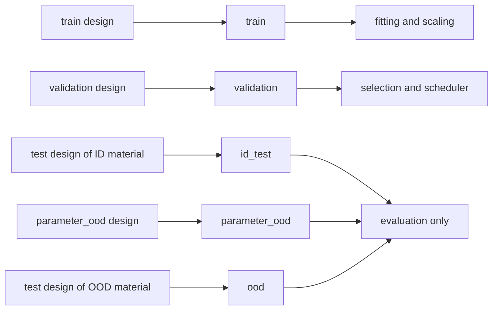

# Datasets

A Dataset is the fixed set of physical cases a model is trained and evaluated on. For both tasks, one Dataset plan requests a number of points from fixed Sobol designs per material and design kind, runs Generation, selects successful cases, fixes the case roles from the design kinds and publishes the tensor payload. Training configurations only reference the published Dataset; run seeds never repartition it.

[Documentation index](README.md)

## Normal workflow

Each task has three plans under `configs/02_datasets/<task>/` (see *The maintained plans*). The examples use the reduced transient plan `configs/02_datasets/transient_drying/lentil_chickpea__ood_kidney_bean.yaml`; every plan runs the same way.

1. Preview the effective plan. The preview writes nothing and starts no solver work; it prints the computed Dataset name (`dataset`) and its `directory` below `storage/`:

   ```bash
   ../runtime/venvs/native/bin/python -m src.datasets.dataset_packages run \
     configs/02_datasets/transient_drying/lentil_chickpea__ood_kidney_bean.yaml --dry-run
   ```

2. Run the same command without `--dry-run` on the login node. It freezes the source (see [Generation](03_generation.md)), submits its own driver job and prints the job as JSON (`status`, `job_id`, `tree_id`, `log_path`):

   ```bash
   ../runtime/venvs/native/bin/python -m src.datasets.dataset_packages run \
     configs/02_datasets/transient_drying/lentil_chickpea__ood_kidney_bean.yaml
   ```

3. Rerun the identical command until it publishes; each run submits a new driver that continues the campaign.
4. Inspect the publication (`inspect` takes the task directory and the Dataset name):

   ```bash
   ../runtime/venvs/native/bin/python -m src.datasets.dataset_packages inspect transient_drying DATASET_ID
   ```

   It lists the ordered Sources, effective settings, the original plan command with its overrides and the commands for an exact rebuild. Use the plain Dataset name in the training configuration (`data.train_dataset`) or with `--train-dataset`; the task comes from the configuration.

Notebooks: [`01_eda_generation_inputs`](../notebooks/01_eda_generation_inputs.ipynb) shows the prepared inputs and failures by parameter while a plan runs; [`02_eda_datasets`](../notebooks/02_eda_datasets.ipynb) shows completed cases and published Datasets.

<details>
<summary>Driver job, log and summary</summary>

- Do not start the command inside an allocation; freezing is refused there. The freeze always includes uncommitted changes of the checkout: they are bound as an exact snapshot ([source snapshots](07_reproducibility_and_validation.md#source-snapshots-and-frozen-trees)), so no option is needed to admit them.
- The driver job runs from the frozen source tree in a fixed modest CPU allocation (2 CPUs, `8G`; `--driver-partition standard` or `long`, `--driver-time 06:00:00`) and writes `runtime/logs/datasets/dataset-TASK-JOB_ID.log`. It runs the COMSOL cases as job steps of its Generation node jobs ([Generation](03_generation.md#campaign-driver)) and assembles the Dataset afterwards; its two CPUs stay free for coordination. Its wall limit is independent of the node jobs and of the physical horizon.
- The driver log shows numbered stage lines (`[n/N] <stage>`, then `... done in <duration>`) and, while cases run, a live board on a state change and one compact line per running case every minute: the state, simulated time, solver step and failure counts and the time since the last update (no percentage, no estimate), and for a failed case its reason and replacement.
- The driver log stays in `runtime/logs/datasets/` and is hard-linked into the Generation campaign's `<campaign>/_record/logs/`, never into the Dataset folder, which is immutable after publication.
- Every case that changes its group first gets one timestamped line `case <material>/<case>: <old> -> <new> (<reason>)`; a failed case whose detail (reason, decision or replacement) changes gets the line `case <material>/<case>: failed (<new>; was <old>)`.
- The log ends with a summary: `DATASET COMPLETE` with the published folder, contents, split and failures, or `STAGED` when cases are still pending, or `FAILED: <stage>: <message>` with the command to run `Next:`. The Dataset and its tensor payload are published once enough cases have succeeded.

</details>

## The maintained plans

A plan names each material with its role and the number of points it takes from each of the material's designs.

<details>
<summary>Plan keys</summary>

The loader accepts exactly these keys:

```yaml
# Role: <one line>. Edit: <one line>.
schema_kind: dataset_plan
task: steady_flow
materials:  # Plan order = name order. Counts per design kind, each a power of two; an OOD material draws from its own test design.
  lentil: {role: id, train: 512, validation: 64, test: 128, parameter_ood: 128}
  kidney_bean: {role: ood, test: 128}
generation:
  seed_base: 9300
  minimum_success_rate: 0.9
  sources_config: configs/01_generation/physical_model/sources.yaml
  # registry_config, common_config, operations_config, bed_fields_config, profile_config, execution_config
```

A material with role `id` needs `train`, `validation` and `test` and may add `parameter_ood`; a material with role `ood` takes only `test`. Every count is an integer power of two (1, 2, 4, …). The domain profile is derived: `reference_range`, or `reference_and_parameter_extension` when any material has `parameter_ood`.

</details>

Counts read Train/validation/test/parameter OOD.

| Plan | Transient (`seed_base` 9200, s = 0.6) | Steady (`seed_base` 9300, s = 0.9) |
| --- | --- | --- |
| `smoke.yaml`: acceptance smoke ([Reproducibility and validation](07_reproducibility_and_validation.md#acceptance-smoke)) | lentil and chickpea 1/1/1/1 each; kidney_bean OOD 2 | same |
| `lentil_chickpea__ood_kidney_bean.yaml`: reduced set (demo size) | lentil and chickpea 32/8/8 each; kidney_bean OOD 16 | lentil and chickpea 512/64/128 each; kidney_bean OOD 128 |
| `lentil_chickpea_kidney_bean__ood_field_pea_rapeseed_sunflower_seed.yaml` (production plan) | lentil, chickpea, kidney_bean 128/16/32/32 each; field_pea, rapeseed, sunflower_seed OOD 32 each | lentil, chickpea, kidney_bean 512/64/128/128 each; field_pea, rapeseed, sunflower_seed OOD 128 each |

The minimum success rates s come from the smokes, whose evidence is in [Failed solves](08_scientific_decisions.md#datasets-and-splits). Names are computed ([Names and identity](#names-and-identity)).

### Fixed designs and case roles

Every material has one design per design kind (`train`, `validation`, `test`, `parameter_ood`) and task; the designs are fixed scrambled Sobol sequences ([Sampling](02_physical_model.md#sampling)). Point i is the same physical case in every plan, and a count N takes points 0 to N − 1: the smoke plan holds the first points of the production designs, and the reduced set is a subset of the production set. The test design of kidney_bean is material OOD in the reduced set and ID-test in the production set.

Case roles follow from the design kinds, not from a random split:



Train keeps the design order, so the first N Train cases of a material are the first N points of its Train design and Train prefixes form a nested learning curve (`data.train_subset`, see *Evaluation Datasets and Train subsets*). Roles apply before the cases are expanded into temporal transitions.

<details>
<summary>Parameter OOD and balance</summary>

A parameter-OOD point moves its allocated eligible OOD unit (one scalar or one coupled record of the profile-active OOD groups, [Generation](03_generation.md)) outside natural support; units are allocated cyclically in point order, so this too is prefix-stable. Both tasks have parameter OOD.

Scrambled Sobol points have their balance properties for power-of-two prefixes, which the counts enforce. Replacements take further points of the same design, so a design with failures holds points 0 to N − 1 without the failed ones plus the next points, and its balance property no longer holds exactly.

</details>

### Failed cases and replacements

Each count is both the number of design points requested and the target number of successful cases of that material and design kind. A terminally failed candidate is replaced as long as the material's success rate can still reach `generation.minimum_success_rate` s; rule, bound and commands are in [Generation](03_generation.md#replacements).

<details>
<summary>Dataset-side summary and the solver-success population</summary>

- Replacement is the next unused point of the same design (N, N + 1, …), ordered by `candidate_position`; it records `parent_failed_case_id`. The one-sided 95 % Clopper–Pearson bound is `beta.ppf(0.95, k + 1, n - k)` (k successes of n decided candidates, 1 while all succeeded); once n ≥ 1 and it falls below s, the material stops (at s = 0.9 two failures without a success: bound 0.78).
- s is one number with 0 < s ≤ 1 per material, part of the authored plan (amendment 1, `registered_by: plan`); it changes neither the Dataset name nor the seeds. Lowering it is `amend-replacements … --material M --minimum-success-rate S --reason TEXT`; a lowering applies to the material as a whole. `fail-case` declares other failures ([Generation](03_generation.md#failures-and-continuation)).
- Without `--max-admission-cases` the admission limit is derived: 238 for the reduced transient plan and 1763 for the reduced steady plan.
- A blocked campaign names the material, k/n, the bound and s, with two ways out: a new Source (`--new-source --revision LABEL`) or `amend-replacements` and the same plan command. Combining the cases of the old and the new Source needs the selection `exact` (see *Case selection*), because `design_order` rejects more than one Source.

The Dataset describes the solver-success population, selected from the sampled design plus its replacements, not the full original design domain. Replacing failures does not undo the selection by success, so the failures are reported rather than hidden. The manifest binds this evidence (`source_outcomes`): per contributing Source and original batch its minimum success rate with every amendment (registrant and reason) and the final k, n and whether the batch stopped, the counts of original-candidate failures per material, and a table of every candidate (origin, target slot, parent failed case, outcome, failure stage, class and reason code). `inspect` prints the original-candidate failure rate per material and k/n against s. Rates and counts belong in any report of results obtained on the Dataset. To see where in the design the failures lie, each completed Source writes `cases.csv` (one row per candidate with its outcome, typed reason, runtime and every sampled parameter), and the section «Failures by parameter» of [Generation-input EDA](../notebooks/01_eda_generation_inputs.ipynb) plots every terminal candidate at its sampled values per material, coloured by reason; both show recorded association, not cause.

</details>

### Case selection

`design_order` takes the requested successes of each material and design kind from the Source alone; `exact` lists source cases explicitly.

<details>
<summary>design_order and exact</summary>

`design_order` chooses from cases that already succeeded. For each material and design kind it requires enough successes, orders them as Generation does (the design's original points by point index, then its replacements by `candidate_position`) and takes the requested number. A Source holds at most as many successes per design as its success target, which a plan sets to the requested count, so the selection takes every success of the Source. No seed takes part: the membership, its order and the case roles follow from the Source alone. `exact` selection instead lists the source cases explicitly and may combine Sources; a Dataset never holds the same physical input twice.

</details>

## Small runs and run options

A small run uses its own plan, such as `smoke.yaml`: its points are the first points of the same fixed designs, so it never needs a count override. Explicit options change execution, or the transient horizon, without editing the plan. Repeat the same complete command, overrides included, to continue a run.

<details>
<summary>Options and example</summary>

The smoke plan with a four-hour horizon on one node job:

```bash
../runtime/venvs/native/bin/python -m src.datasets.dataset_packages run \
  configs/02_datasets/transient_drying/smoke.yaml \
  --duration-hours 4 --node-jobs 1 --max-admission-cases 20 --cores-per-case 8 --dry-run
```

| Option | Effect | Default when omitted |
| --- | --- | --- |
| `PLAN` | Dataset plan YAML | required, no default |
| `--dry-run` | Read-only effective plan; no Source admission, no scientific writes | off: the run submits its driver job |
| `--duration-hours H` | Physical horizon of a transient-drying plan; changes the physical output domain. A steady-flow plan has no horizon and refuses it at plan admission | none: the horizon `time` of `configs/01_generation/physical_model/common.yaml` applies |
| `--revision LABEL` | Appends `__rev-LABEL` to the computed Dataset name, for a deliberately separate Dataset of the same plan; the default Source is reused and nothing is simulated again. The label uses lowercase letters and digits joined by single `-`, `_` or `+` | none: no revision token in the name |
| `--new-source` | Only together with `--revision LABEL` (else exit 2): the Source is `<default Source name>__rev-LABEL` and its cases are simulated afresh with licensed COMSOL. Use it when the producer science changed; the preview then says that the Source is simulated afresh | off: the default Source is reused |
| `--max-admission-cases N` | Distinct fresh solver candidates, recorded and fixed as given; without it the campaign records no cap and derives it from the sum over the original batches of the count plus the failures it tolerates at the batch's current minimum success rate, so it grows when a rate is lowered ([Generation](03_generation.md#replacements)) | none: derived from the plan rates as described |
| `--node-jobs N` | Concurrent node jobs (1 to 4; a per-user cluster-share cap; the COMSOL batch licence counts once per user); with `--cores-per-case` it caps the concurrent cases ([Generation](03_generation.md)) | `run.node_jobs` of `configs/01_generation/execution.yaml` (2) |
| `--cores-per-case N` | CPUs per case | `run.cores_per_case` of `execution.yaml` (4) |
| `--case-timeout-seconds S` | Solver runtime limit (integer seconds) | `run.timeout_seconds` of `execution.yaml` (3600) |
| `--no-retry` | Turns the licence-retry policy off | off: `rules.license_wait.enabled` of `execution.yaml` (`true`) applies |
| `--driver-partition P` | Driver job partition (`standard` or `long`); not part of the Dataset identity | `standard` |
| `--driver-time T` | Driver job wall limit `[D-]HH:MM:SS`; the 2 CPUs and `8G` are fixed; not part of the Dataset identity | `06:00:00` |
| `--continue-with-current-code` | Continue an existing campaign with the current code instead of the source tree it is bound to (recorded as a new execution epoch) | off: an existing campaign continues in its bound source tree |

`inspect TASK DATASET_ID` takes two required arguments and two options: `--storage-root PATH` (default: the project's sibling `storage/`, or `STORAGE_ROOT`) and `--json` (default: off, a readable report; with it the complete inspection evidence as JSON).

Seeds, counts, grid and solver settings stay as authored. The run above is named `lentil-train1-val1-test1-pood1+chickpea-train1-val1-test1-pood1+kidney-bean-ood2__ref-param-ext__sobol-seed-9200__h-4`, so it never collides with the smoke Dataset at the configured horizon.

</details>

## What a Dataset contains

```text
storage/02_datasets/<task>/<dataset>/
  dataset_manifest.json       # ordered Sources, representation, material roles, case roles, payload digests
  dataset.json                # transient: temporal transition index
  transient_pt_shards/        # transient: training payload
    receipt.json              # admission and payload identity, bound by the manifest
    shard_*.pt
  dataset.pt                  # steady flow: tensor payload
storage/02_datasets/.state/   # build locks and the identity registry (identities/)
```

The payload file names are fixed; the Dataset name only names the directory.

<details>
<summary>Manifest, publication and receipt</summary>

The manifest owns the selection, exact Source evidence with each case's design kind and point, the Source outcome evidence (replacement policy and all candidate outcomes), material roles and the case roles derived from them (`case_partition`: `train`, `validation`, `id_test`, `parameter_ood`, `ood`). For transient drying, the transition index enumerates temporal samples of those cases and the PT shards are the training representation with their own receipt. A steady-flow Dataset stores all its cases in one tensor payload.

For both tasks the manifest and the complete payload (index and shards, or the tensor payload) are built and validated in a staging folder under `.state/` and published together in one atomic rename: a Dataset folder is complete or absent, and an interrupted build leaves nothing published. The shards are built before the manifest, which binds the payload digest (`payload_sha256`) and, for transient drying, the digest of the shard receipt (`derived_payload_sha256`, `null` for steady flow); the one manifest validator refuses changed payload or receipt bytes for both tasks. Nothing is added to a published folder afterwards: the Dataset driver's log stays in `runtime/logs/` and the campaign's `_record/logs/`. The receipt records each file's size, hash and file metadata: unchanged files are admitted directly, copied, restored or moved files are re-verified against the recorded hash, and only changed bytes are rejected.

</details>

### Names and identity

The Dataset name is computed from the resolved plan, never authored; identical content under another name is refused. The revision rule is in [Reproducibility and validation](07_reproducibility_and_validation.md#revision-rule).

<details>
<summary>Name format, Source name and identity digest</summary>

The name is `<material>-train<a>-val<b>-test<c>[-pood<d>]` for each ID material (its Train, validation, test and optional parameter-OOD counts) or `<material>-ood<n>` for a held-out material, joined by `+` in plan order, then `__<domain>__sobol-seed-<seed_base>` (`ref-range` for `reference_range`, `ref-param-ext` for `reference_and_parameter_extension`), for transient drying a `--duration-hours` horizon that differs from the one configured in the common config as `__h-<hours>` (`4.5` as `4p5`; the configured horizon belongs to the simulation definition and adds no token), and optionally `__rev-<label>`. A different count, horizon or plan therefore changes the name. The steady production plan is named `lentil-train512-val64-test128-pood128+chickpea-train512-val64-test128-pood128+kidney-bean-train512-val64-test128-pood128+field-pea-ood128+rapeseed-ood128+sunflower-seed-ood128__ref-param-ext__sobol-seed-9300` (207 bytes, below the 255-byte path-component limit; transient 198).

The physical Source name is computed from the plan the same way Generation names an unrevised campaign: `<material>-<n>...` per material in registry order with its design sizes in design-kind order (`-<test>` for an OOD material, `-<train>-<validation>-<test>[-<parameter_ood>]` for an ID material), joined by `+`, then `__<domain>__sobol-seed-<seed_base>` and for transient drying `__h-<hours>` only when the horizon differs from the configured one (`...__h-4` for `--duration-hours 4`), never authored. The Source name is shorter than the Dataset name because Generation appends material, design kind and replacement number to it in its batch locators, which must also fit one path component (production plan, steady: Source name 150 bytes, longest locator 212). A deviating horizon is therefore another Source with the same seeds and needs no revision. `--revision LABEL` names only the Dataset and reuses this Source. With `--new-source` as well the Source becomes that name plus `__rev-LABEL` and owns its own solver runs instead of continuing the default Source. The label changes only the Source name and storage locator: Generation seeds, batch identities and the scientific campaign digest stay those of the plan without it.

Dataset identity under the revision rule:

- The same name with identical content reuses the publication.
- Different content under an occupied name is refused; pass `--revision LABEL` to keep a deliberately separate Dataset (for example after a converter fix). Changed producer science additionally needs `--new-source`, because only that simulates a Source again.
- Identical content under another name is refused (`Identical Dataset content already exists as <task>/<name>; use that name`), so a Dataset exists once. A `--revision` label alone does not make identical content new.

The internal scientific digest binds the ordered Source cases with their design provenance (Generation `seed_base`, design recipe `scrambled_sobol_single_sequence`, design kind, point position and replacement origin of every case, and hence the counts), grid, channel and conversion contracts, material roles and the case roles derived from the design kinds, and the recorded conversion digest. There is no split seed: the same Source cases with the same material roles always give the same membership. The Source's campaign digest binds `seed_base`, the design kinds and counts per material and the design recipe. The converter implementation is recorded evidence: reading a Dataset never compares it with the running converter, and a converter fix that changes the conversion projection is a new Dataset (`--revision`; see [Code identity](07_reproducibility_and_validation.md#code-identity)). Names, file paths and Git HEAD are provenance, not identity. A registry below `02_datasets/.state/identities/` maps each digest to its Dataset directory; an entry whose directory no longer exists is replaced. Physical Sources carry no Dataset roles, and the Source name never contains a role; a revision label appears in the Source name only with `--new-source`. Details are in [Reproducibility and validation](07_reproducibility_and_validation.md).

</details>

### Evaluation Datasets and Train subsets

Every run evaluates `material_ood` (held-out material families, optionally more Datasets via `data.material_ood_datasets`) and `parameter_ood` separately, and `data.train_subset` trains on the first N Train cases per ID material.

<details>
<summary>OOD roles and the Train subset</summary>

Besides validation and ID-test, every run evaluates two separate OOD roles, the same way for both tasks. `material_ood` holds the training Dataset's `ood` cases (held-out material families) plus the `ood` cases of every Dataset listed in `data.material_ood_datasets`; `parameter_ood` holds only the training Dataset's `parameter_ood` cases (its ID materials outside the parameter support). An empty role is not evaluated: it produces no metrics, analysis folder or W&B panel. The run's split records each Dataset of a role as its own part with its identity, cases, membership digest and evaluation assignment ([Reproducibility and validation](07_reproducibility_and_validation.md#runs-and-publication)). For both tasks, a `material_ood` case whose material the Train cases use is rejected (this family-holdout rule does not apply to `parameter_ood`, which holds ID materials by design), a Train, validation or ID-test case from a parameter-OOD design is rejected, and no two roles or parts may share a physical source case (the same case input or simulation). When a run is reopened for inference or artifacts, each split part must match the current manifest's identity and fixed partition (a `material_ood` part holds exactly its Dataset's `ood` cases, the `parameter_ood` part exactly the training Dataset's `parameter_ood` cases).

`data.train_subset` (`null` in both task base configs) trains on all Train cases; a power of two N trains on the first N Train cases of every ID material in stored Train order, the first N points of each Train design. The scalers are fitted on that subset only, the split records `train_subset` and the subset membership, and the run's Dataset directory becomes `<dataset>__train-<N>` (runs and Optuna studies alike), so learning-curve runs on one Dataset never share a directory.

</details>
