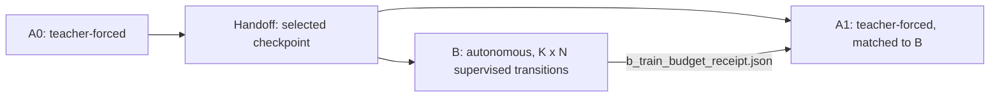

# Training

Training reads a published Dataset and one architecture configuration, fits scaling on the Train cases and writes checkpoints and histories to `storage/03_experiments/`. All training jobs run in the Apptainer image through `scripts/slurm_ml.sh` ([Setup and execution](01_setup_and_execution.md#ml-jobs)).

Notebooks: [`03_component_checks`](../notebooks/03_component_checks.ipynb) measures training-free priors on the reference fields before loss and derivative settings are chosen ([Component checks](06_evaluation.md#component-checks)); [`04_training_pipeline`](../notebooks/04_training_pipeline.ipynb) inspects configurations, data roles, objectives, stage dependencies and saved runs.

[Documentation index](README.md)

## Configurations

Each task has a `base.yaml`, one experiment config per architecture under `experiments/architecture_comparison/` and its Optuna studies under `optuna/`.

<details>
<summary>Configuration files</summary>

| Task | Configurations | Purpose |
| --- | --- | --- |
| Steady flow | `configs/03_learning/steady_flow/base.yaml` | Values every steady experiment and study shares |
| Steady flow | `configs/03_learning/steady_flow/experiments/architecture_comparison/` | `fno_m128x160_h64_l3_p0p1__lr-0p000388`, `uno_m64x64_h32_l7_p0p1_s1-05-05-1-1-2-2_r0p495__lr-0p000532` and their physics-informed twins `pi-fno_m128x160_h64_l3_p0p1__fd__w-0p1-10-10__wu-100__lr-0p000388`, `pi-uno_m64x64_h32_l7_p0p1_s1-05-05-1-1-2-2_r0p495__fd__w-0p1-10-10__wu-100__lr-0p000532` |
| Steady flow | `configs/03_learning/steady_flow/optuna/` | FNO, U-NO, PI-FNO and PI-U-NO searches |
| Transient drying | `configs/03_learning/transient_drying/base.yaml` | The matched A0 → {B, A1} plan and the values every transient experiment shares |
| Transient drying | `configs/03_learning/transient_drying/experiments/architecture_comparison/` | One matched plan per architecture: `fno_m64x80_h64_l3_p0p1__lr-0p000388__a0smp-one-step-transition`, `uno_m64x64_h32_l7_p0p1_s1-05-05-1-1-2-2_r0p495__lr-0p000532__a0smp-one-step-transition`, `rno_m24x24_h16_l3_p0p1__lr-0p000388__a0smp-trajectory__a0rl-32` |
| Transient drying | `configs/03_learning/transient_drying/optuna/` | One A0 study per architecture: `fno_a0_search`, `uno_a0_search`, `rno_a0_search` |

</details>

A config names its task's `base.yaml` with `base:` and sets only what differs from it; its values override the base, and a base cannot name another base. Templates leave `data.train_dataset: null` (select it there or with `--train-dataset`). The resolved configuration saved with each run is authoritative.

<details>
<summary><strong>Config names, chain rules and model contract</strong></summary>

- **Naming rule.** The filename of a config, also of a YAML outside `configs/`, is the config name the loader computes and requires: the model label, then one token per shared, single-stage or A0 leaf the file itself sets. A leaf that no token shows is refused. Every token and part of the label is listed in [Reading a config name](../configs/README.md#reading-a-config-name); the folder below `experiments/` is the family that groups comparable configs.
- **Base changes.** The task base supplies no token, so a change of a base value renames nothing. The model label reads the merged model parameters and the physics switch, so a base change of a model parameter renames every config, which is correct because the model changes. A partly set token that shows several leaves together (`w`, `wu`, a curriculum) is refused.
- **Model label.** The architecture (modes, hidden channels, layers, domain padding `p`, U-NO scalings, plus a token for every model parameter that differs from the model factory default), prefixed `pi-` with the suffix `__fd` (central finite differences on the grid, config value `physical`) or `__spec` (spectral with Fourier continuation) when the physics loss is on. The tokens (physics crop, target weights `w`, warm-up epochs `wu`, loss, data, optimizer, scheduler, run, input, objective and stage settings) follow in a fixed order, for example `pi-fno_m128x160_h64_l3_p0p1__fd__w-0p1-10-10__wu-100__lr-0p000388`. Seed, device, Dataset selection, loader and tracking settings are not named; the epoch budget, k and the scheduler kind are named by the run's seed group ([Results layout](#results-layout)), not by the config.
- **Matched plan files.** The settings a plan file sets for B and A1 are not part of the config name, because the config folder also holds A0: they appear in the pair folder name (`b-a1__rollout-<L>__lr-<x>` plus one token per further B/A1 leaf the file sets, and one per inherited B window stride, window offset or curriculum that differs from what the rollout implies; the stage memory batches add none). Editing B (for example `training.b.lr_scale`) changes only the pair folder, never the config name, so A0 is reused. B's budget follows A0's `budget_epochs`, which the seed group names.
- **Studies.** Every study's experiment section inherits `base.yaml` and states only what differs. A transient A0 study's experiment is the architecture's matched plan; the study trains its A0 alone (`stage_a_only`) and drops B and A1. Teacher-forced A0 and A1 draw no rollout horizon, so only B has a curriculum, its seed, its saved state and its terminal evidence; the loader refuses one in Stage A.
- **Required keys.** `positional_embedding` and `domain_padding` are required model parameters, like every other key a task's `base.yaml` states ([the list](../configs/README.md#keys-a-config-chain-must-state)): the code holds no default for them, and a config that omits one is rejected with its path.
- **Positional embedding.** Both tasks feed `x` and `y` as explicit input channels, so every model sets `positional_embedding: null`: neuraloperator's grid embedding would add a second, periodic grid without endpoint that gives the same physical point different coordinates at stride 2 and at stride 1.
- **Domain padding.** Every model sets `domain_padding: 0.1`, a symmetric zero padding of 10 % per side of the lifted field, because the fields are not periodic and the FFT would otherwise wrap the opposite boundaries around; the RNO carries its hidden state padded from step to step, so the padding region keeps its recurrence. The rationale of both choices is in [Scientific decisions](08_scientific_decisions.md).
- **U-NO channels.** The U-NO sizes its lifting and projection layers as 2 × `hidden_channels` (`lifting_channel_ratio`, `projection_channel_ratio`), like the FNO and RNO, instead of neuraloperator's fixed 256.
- **Precision.** Training runs in float32 without mixed precision: cuFFT's half precision needs power-of-two sizes, which the grids (251 × 401, 126 × 201) are not, and finite-difference physics derivatives in half precision lose the accuracy the loss relies on.
- **Numerics.** One function sets every process numeric control for runs, trials and inference (`configure_numerics` in `src/experiments/experiments_run.py`): float32 throughout (no TF32 in matrix products or cuDNN convolutions) and no cuDNN autotuning, set explicitly so a release cannot change them unnoticed. On an RTX A6000 this costs at most about 7 % time per unit for FNO, U-NO and RNO in stages A0 and B against TF32 convolutions with autotuning; the gradients differ from those with TF32 convolutions by up to 1.5e-3 relative per tensor, the TF32 rounding, against at most 3e-7 between two runs of one setting. Training, trials and both inference paths apply the same settings. Each attempt records its values (`runtime_sessions[].precision`: `tf32_matmul`, `tf32_cudnn`, `cudnn_autotune`).

</details>

### Scaling and grid

Both tasks use one scaling, fitted on the run's Train cases only (a `train_subset` included) and reused unchanged for validation, ID-test, OOD, every stage, resume and inference; a value is encoded as `(value - mean) / max(s, 1e-7)` with the population standard deviation `s`. Steady flow is learned relative to the inlet pressure: with $P$ the case's mean prescribed inlet pressure the network sees $p_\mathrm{in,bc}/P$ and learns $p/P$, $u/P$, $v/P$. Both tasks train on the full 251 × 401 grid (`data.spatial_stride`: required, 1 in both task bases); stride 2 (126 × 201) remains available and a stride that does not tile the grid exactly, such as 4, is refused. Evaluation artifacts always use the full grid ([Evaluation](06_evaluation.md#evaluation-grid)).

<details>
<summary>Scaling statistics, pressure-relative steady flow and paper sentences</summary>

Per channel the scaling holds the mean and `s`, accumulated in one streamed pass in which every Train case weighs one: static fields and material parameters count once per case, and the states of one transient case weigh equally. The training loss and the back-transformation use exactly this scale. A boundary input takes the mean and scale of its state (steady `p_in_bc` those of `p`, transient inlet `T` those of `T`), permeabilities enter as log10 values, and transient increments are divided by the state scale without centering, so zero stays zero. The run's `normalizer.pt` holds this scaling in the same format for both tasks; a normalizer of an earlier format, a steady one without the inlet-pressure reference included, is refused ([Runs and publication](07_reproducibility_and_validation.md#runs-and-publication)).

$P$ is the mean of `p_in_bc` over the inlet cells, the $\Delta p$ of the [steady physics](#steady-flow). The steady `state` statistics are fitted on the quotients per Train case, and $p_\mathrm{in,bc}/P$ is encoded with those of $p/P$. $P$ is derived once per batch from the physical inputs, never fed to the model, and multiplies the decoded outputs back to Pa and m/s. The scaling also keeps the physical state statistics (`physical_state`): checkpoint selection and the other group metrics, the artifact objective and the per-field `normalized_rmse_*` and `normalized_mae_*` of training validation and of the artifacts divide physical errors by these physical Train scales, so their values stay comparable with runs of the earlier representation and W&B shows the artifacts' numbers. Physics loss, metrics, artifacts and plots work on physical values. `src/datasets/preprocessing/dataset_preprocessing_normalization.py` owns the representation, the preprocessing identity names it (`state_reference: mean_inlet_pressure`).

> *Paper sentences.* "Inputs and states were standardized with one scaling shared by both tasks and fitted on the training cases only, in which every training case carries equal weight and the standard deviation is floored at 1e-7, so that no information from held-out cases enters the scaling." "Steady flow fields were learned relative to each case's mean prescribed inlet pressure, by which the linear Darcy–Brinkman problem scales exactly, and transformed back to physical units for the physics loss, the metrics and model selection." "Both tasks were trained on the full 251 × 401 grid through one resolution mechanism; a coarser stride was used only in an explicit stride comparison."

</details>

### Data loss and selection objective

Both tasks train one data loss on Train-scaled states (`loss.data.kind`: `mse` in both maintained bases, or `h1`; `loss.data.weight`: 1.0 there; `src/learning/losses/learning_losses_state.py`). With $E_f$ the physical squared error of field $f$, averaged over every grid point and predicted step, $s_f$ its Train scale and $w_g$ the weight of the task's error term $g$, the MSE is

$$L_\mathrm{MSE}=\sum_g w_g\,\frac{\sum_{f\in g}E_f}{\sum_{f\in g}s_f^2}$$

Checkpoint selection, the plateau comparison schedule, Optuna and the notebook rankings use one objective (`group_objective` in `src/learning/metrics/learning_metrics.py`): with $\bar E_f$ each case's physical squared error averaged over its grid and steps, then equally over the cases of a material and equally over the materials, each term takes its root:

$$J=\sum_g w_g\,\sqrt{\frac{\sum_{f\in g}\bar E_f}{\sum_{f\in g}s_f^2}}$$

<details>
<summary>Weights, H1 variant, selection versus training and paper sentences</summary>

For steady flow $E_f$ and $s_f$ of the MSE belong to the states $f/P$ ([Scaling and grid](#scaling-and-grid)). Steady flow weighs pressure and the velocity vector by ½ each, so velocity enters as $(E_u+E_v)/(s_u^2+s_v^2)$; transient drying weighs `T` and `phi` by ⅓ and `w_surf` and `w_int` by ⅙. The task definitions own groups and weights. Transient predictions stay the previous state plus the predicted scaled increment and are compared with the stored states: under teacher forcing (A0, A1) the state error equals the scaled increment error, in B it accumulates along the rollout.

`kind: h1` adds $\ell^2\sum_g w_g\,\big(\sum_{f\in g}\langle\|\nabla e_f\|^2\rangle\big)/\sum_{f\in g}s_f^2$ with the same terms, $\ell = 1$ m and non-periodic derivatives in metres (central inside, one-sided at the edges) at the grid spacing of the training Dataset's coordinate channels; a run refuses an Evaluation Dataset whose coordinate grid differs from the Train Dataset's.

In $J$, $\bar E_f$ and $s_f$ are always physical, for steady flow too. Validation and, in the artifacts, each held-out role are reduced separately. Training squares errors and selection weighs group RMSEs, so the two share weights and population (and, for transient drying, scales) but need not rank models identically.

> *Paper sentences.* "We minimized reconstructed-state squared errors scaled by training-set variability, assigning equal importance to pressure and vector velocity for flow, and to temperature, humidity and moisture for drying." "The H1 variant adds squared spatial-gradient errors to the same standardized state loss, using nonperiodic physical derivatives and a fixed 1 m length scale, without reference-dependent normalization." "Model selection used a weighted mean of validation group RMSEs of the physical fields under physical training-derived scales and the same population weighting, with materials weighted equally and cases equally within a material; squared errors were used for optimization, for flow on the inlet-pressure-normalized fields."

</details>

### Units per update

Both tasks train through one update path (`train_update_groups` in `src/learning/training/learning_training_loop.py`); only a unit's loss is task-specific. A unit is one Train item: one case (steady flow), one transition (FNO and U-NO in A0 and A1), one window (FNO and U-NO in B) or one whole trajectory (RNO, every stage). One optimizer update averages `training.units_per_update` units (k: 16, the RNO 4), and the run records the unit kind in its sampler state.

<details>
<summary>Sampler, memory batch, weights, telemetry and unit evidence</summary>

- **Sampler.** One resumable sampler (`src/datasets/runtime/dataset_runtime_units.py`) shuffles all Train units of all materials once per epoch and cuts the order into update groups of `training.units_per_update` units (k: 16, the RNO 4); the last group of an epoch is shorter. Every unit appears once per epoch, and a case may appear several times in one group. Every last checkpoint stores the epoch order, the committed group position and the generator, so a run resumes at the next group exactly, with any number of loader workers.
- **Memory batch.** `training.memory_batch` splits a group into microbatches of units of equal length, loaded and backpropagated one after another before the group's single optimizer step (gradient accumulation). Units, weights and the Stage-B curriculum draws are fixed per group before the split, and no model couples the samples of a microbatch, so the memory batch changes only floating-point rounding; it is execution only, outside the config name and the run identity, so a resume may change it, and every attempt records its value in its `summary.json` runtime session (`runtime_sessions[].memory_batch`). A matched plan states one value per stage (`training.a0`, `b` and `a1.memory_batch`) in each experiment file, because B's rollouts need far more memory per unit (FNO 16/1/16, U-NO 16/2/16, RNO 1/1/1); an A0 study takes the A0 value.
- **Weights.** Each unit's loss is averaged over its supervised transitions and grid, multiplied by $w$ = (mean units per Train case) / (units of its case), and the weighted losses are averaged over the planned k, not divided by the sum of the drawn weights. Only the last group of an epoch and an A1's last group, cut to B's remaining transitions ([Receipt](#matched-comparison-a0--b-a1)), divide by their actual unit count (`train/last_group_units`). Every Train case therefore carries the same nominal total weight per epoch, whatever its length (the per-group division gives the units of a shorter last group a larger share, by at most k over its unit count in that one update); for steady flow and the RNO each case is one unit and $w = 1$. One rule weights training, scaling and selection alike over materials and cases: every ID material equally and within it every case equally. The material level comes from the Dataset, whose Train role holds the same number of cases per ID material (a Train role with unequal counts, also one without a case of a declared ID material, is refused, and a `train_subset` takes N of each), so no extra factor enters the loss. Within a case each operation averages over its own time support: training over its supervised transitions as above, scaling over every stored state, the origin included, and the inlet humidity ratio over both endpoints of every transition ([Scaling and grid](#scaling-and-grid)), and selection over every target hour. B adds no weight: each window's loss is its mean over its own drawn horizon and an RNO trajectory averages its windows equally, so a longer horizon counts more only through the curriculum draw.
- **Telemetry.** Every committed update records its units, distinct cases and supervised transitions as one row of `update_work` in the checkpoints, next to the `training_work` counts its rows sum to, so a short last group or a long RNO group stays visible; each training event also logs their means per update since the previous event (`train/units_per_update`, `train/distinct_cases_per_update`, `train/supervised_transitions_per_update`).
- **Unit evidence.** A finished stage (completed or unsuccessful) records `training_units` in `summary.json`: unit kind, Train and full-set units, the full set's supervised transitions N, Train cases, the distinct cases seen (from the epoch order up to the committed position; all Train cases once an epoch completed), k and the last-group rule (`epoch_remainder_mean_over_its_units`, the weighting above).

> *Paper sentence.* "Each optimizer update averaged k training units drawn from one shuffle of all training units per epoch, and unit losses were weighted so that every training case carried the same total weight per epoch, whatever the length of its trajectory; splitting an update into memory batches changed only floating-point rounding."

</details>

### Budget, schedule and validation points

Every stage of both tasks trains against one budget (`src/learning/training/learning_training_budget.py`), and its completed fraction $p$ drives the learning rate, B's curriculum and the validation points. $p$ counts committed optimizer groups only, so a resume restores it exactly.

The budget is K passes over the full Train set (`training.budget_epochs`, `training.a0.budget_epochs` in a matched plan; overridden by `--epochs`). The rate follows a half cosine $\eta(p)=\eta_0\,(1+\cos\pi p)/2$ (`scheduler.kind: cosine`, no warm-up, floor or restart). Every stage validates at the 20 points $j/20$ of its budget, a matched A1 once per validation B ran (replay); ID-test and OOD are never evaluated by training or tuning.

<details>
<summary>Budget, cosine, plateau schedule, eligibility, divergence and paper sentences</summary>

- **Budget.** Steady runs and A0 state `training.budget_epochs` (`training.a0.budget_epochs` in a matched plan): K passes over the full Train set, which the run converts to seen units (K × Train units of the full set) and persists in its budget state. B trains K × N supervised transitions with the same K, N being the full Train set's regular transitions ΣL_i over its trajectories (`training_units.full_set_transitions`), whatever windows its sampling cuts; A1 trains exactly the supervised transitions B committed, from B's receipt, also when B diverged (0 after a divergence in B's first group; an RNO A1 up to one trajectory group more, see [Receipt](#matched-comparison-a0--b-a1)). A Train subset gets the full set's counts, independent of k, so a learning-curve run trains as long as a full one. No stage has a cap that could end it before its budget: only a divergence does. Optimisation seconds are measured and reported, never budgeted, so hardware and node load change no step count. Budget, k and schedule name the run ([Results layout](#results-layout)), so a run never trains to another budget. The maintained 600 (steady) and 100 (A0) passes are starting values until the budget is derived: before the HPO, per task and architecture, a doubling series K₀, 2K₀, 4K₀, … (seeds 9 and 19, each budget its own run with its own cosine) sets K to the smallest budget whose doubling improves the validation objective by less than 10 % in both seeds without additional invalid cases, and the largest of these K is the task's one K for every architecture; after the HPO, each architecture compares K against 2K with its tuned configuration (two seeds), and 2K is used for all final runs if one of them improves by 10 % or more. The 10 % threshold is the proposed, still open one of the research plan.
- **Committed work.** Each checkpoint's budget state and `summary.json` (`terminal_budget`: `unit` `units` or `supervised_transitions`, integer `total`, `units`, `supervised_transitions`, `train_seconds`, `validated_point`, `skipped_points`) sum the committed groups. A budget ends after the group that crosses it, so a stage overshoots by at most one group; this overrun is spent minus `total` in the budget's unit. Only an A1 of transition units (FNO, U-NO) ends exactly: its last group is cut to the remaining transitions, so its overrun is 0. `train_seconds` is the optimisation clock, reported only: the synchronised wall time of each committed group from the device preparation of its draws to after the optimizer step, minus the loader waits; validation, checkpoints and logging lie outside.
- **Cosine.** `scheduler.kind: cosine`, the maintained schedule, sets $\eta(p)=\eta_0\,(1+\cos\pi p)/2$ with $p$ clipped at 1: no warm-up, floor or restart within a stage, and a resume restores $p$ and therefore the rate exactly. $\eta_0$ is `optimizer.lr` for steady runs and A0. B and A1 restart their own cosine at `lr_scale` × A0's start rate; they inherit A0's Adam moments and step counter, never its scheduler state, so at equal `lr_scale` both arms follow the same prescribed rate at equal budget fractions, whatever their validation outcomes (the sweep below may select a different scale per arm). Only `last_checkpoint.pt` stores the scheduler state.
- **Plateau comparison.** `reduce_on_plateau` (`factor` 0.5, `patience` 2 validation points, no floor) exists only for the scheduler comparison and is stepped with the ID objective at the validation points; the loader refuses `factor` and `patience` under the cosine. `scheduler: null` is a constant rate.
- **Validation points.** Every stage validates at the 20 points $j/20$ of its budget ($j = 1,\dots,20$), also mid-epoch; point 20 is the budget end. A matched A1 replays B's validations instead (`replay` in its budget state, B's `b_validations` from the receipt: point and committed supervised transitions of every validation B ran): A1 validates once per recorded B validation, under B's point id, at its first group end at or after B's count, and nowhere else. Both arms therefore validate at the same points, at counts within one A1 group of B's. Each validation becomes a checkpoint candidate only where that arm's own objective is finite (`validation/eligible`), so a point can be a candidate for B and not for A1. Example: B in groups of 5 over 40 transitions validates 8 times, at 5, 10, …, 40, and its A1 in groups of 2 at 6, 10, 16, …, 40, not at its own 20 points; after a B that validated at 10 and 15 and diverged at 20, A1 validates at 10 and 16 and ends at 20 without a validation. One A1 group can reach two recorded counts only when consecutive B validations lie closer than one A1 group, which whole-trajectory units (RNO) allow; with transition units only when the validation spacing K × N/20 is smaller than one A1 group plus one B group (k transitions plus k rollout windows, B validating at the first group end after each point, epoch-tail groups included), which small test budgets reach and production budgets, with spacings of thousands of transitions, do not. Such a group validates once, under the later point, and the earlier point joins `skipped_points` (a plan deviation), as do the points B itself skipped. A group that crosses several points validates once; the points it crossed before the last are recorded as `validation_plan_deviation.skipped_points` in `summary.json`. The steady physics monitor evaluates at the same points, on the validation prefix. ID-test and OOD are never evaluated or used by training or tuning (steady training reads their cases with the whole Dataset payloads but builds loaders only for Train and validation): until configurations and analysis rules are frozen (pilots, studies, shortlist, budget choice) every decision uses validation only, and the held-out roles are evaluated afterwards by the separate artifact step ([Evaluation](06_evaluation.md#build-artifacts)). Checkpoint selection, the plateau comparison and Optuna use the validation points, and the history carries `validation/point` and `budget/progress`.
- **Eligibility.** One rule for both tasks: a validation point is eligible when every case's autonomous trajectory is complete and finite and the objective is finite. The teacher-forced one-step guardrail is a diagnostic and never affects it. Only eligible points become checkpoint candidates and step the plateau scheduler. A point with a non-finite case logs `id/nonfinite_cases` and `validation/eligible` 0 and no metric value; its `objective_history` entry holds a value only when eligible (`null` otherwise) and always `bound_violations`: per state field the ID cases with a finite value outside the physical bounds and the physical hours of each one's first violation (`{}` without any; steady flow always `{}`). Finite values outside physical bounds stay eligible and are logged separately ([Prediction validity](06_evaluation.md#field-metrics-of-both-tasks)).
- **Finite values only.** A metric without a finite value at a point (for example a relative norm whose references lie below their floors) is absent from that point's event, the epoch history, W&B and the selected-checkpoint summary, never recorded as NaN.
- **Divergence.** A non-finite training loss stops the stage before that optimizer step. Its terminal `last_checkpoint.pt` records the divergence, so a resume after a crash finalizes the stage without training on. The run ends `diverged at x % of the budget` with its best eligible checkpoint and lifecycle `completed`; `summary.json` records `training_outcome` (`status` `completed`, `diverged` or `no_eligible_checkpoint`, `budget_progress`, `eligible_points`, `divergence`), admitted by one rule against the terminal budget (its unit and total are the stage's target, K × N for B and the receipt's transitions for A1; complete unless diverged). A stage without an eligible checkpoint, after a divergence or at its budget end, ends with the terminal lifecycle `unsuccessful` (exit code 2, no artifacts), is never resumed and is reported as unsuccessful; its admission validates its last checkpoint like a completed run's and requires its budget to equal the summary's. A divergence in the stage's first group commits nothing and leaves no last checkpoint. Only an A1 bound to such a B's receipt of 0 transitions holds a zero budget total. An A0 that diverged keeps its best eligible checkpoint and is the branch point of B and A1, which start from its Stage-A handoff like after a completed A0; an A0 without an eligible checkpoint (after a divergence or at its budget end) is no branch point: the matched plan stops after it, and the run exits 2 because the requested pair was not trained.

VP1's cosine rose again and again, because `CosineAnnealingLR(T_max=30)` ran back to the start rate periodically over 100 and 500 epochs (Git 69da3c5, af94acb); here the rate is a function of the budget fraction and cannot restart within a stage.

> *Paper sentences.* "Steady runs and A0 were trained for the same number of full passes over the training set for every architecture, counted in seen units, so that architectures were compared at equal data; equal training time is reported only as an additional view." "The self-fed continuation B trained the same number of passes counted in supervised transitions, and its teacher-forced counterpart A1 exactly the supervised transitions B committed, so both arms saw equal supervised data; their optimisation time is reported, not matched. Neural operators are usually trained with fixed epochs (PDEBench follows the original FNO protocol), McGreivy and Hakim (2024) ask for equal runtime when comparing with numerical solvers, not between architectures, and a time budget would mix implementation efficiency, for example the RNO's Python loop over time steps, into the accuracy comparison. The budget was derived rather than fixed: one budget was used for all trials of a study following the Tuning Playbook, candidate budgets grew geometrically as in Successive Halving and Hyperband, and the saturation of the learning curve was checked by comparing a budget with its double." "We prescribed a half-cosine learning-rate schedule over each stage's optimization budget, restarting both continuation arms from the same scaled initial rate while retaining A0's optimizer state, thereby matching prescribed rates at equal budget fractions independently of validation outcomes."

</details>

## Steady flow

Steady-flow models map seven input channels (`x`, `y`, $\log_{10}K_{xx}$, $K_{xy}/\sqrt{K_{xx}K_{yy}}$, $\log_{10}K_{yy}$, `eps_bed`, `p_in_bc`) to $(p, u, v)$ in a single stage; units and transforms are owned by `src/domain/tasks/domain_task_steady_flow.py`. `train` takes the options and defaults of the [matched comparison](#matched-comparison-a0--b-a1) except `--rollout-length`, `--lr-scale` and `--train-stages`, which belong to matched plans:

```bash
./scripts/slurm_ml.sh --gres gpu:v100:1 train \
  configs/03_learning/steady_flow/experiments/architecture_comparison/pi-fno_m128x160_h64_l3_p0p1__fd__w-0p1-10-10__wu-100__lr-0p000388.yaml \
  --train-dataset DATASET_ID
```

<details>
<summary>Configuration sections</summary>

The channels are the coordinates `x` and `y` in metres, $\log_{10}K_{xx}$ and $\log_{10}K_{yy}$ of the diagonal permeability components in m², the cross component $K_{xy}/\sqrt{K_{xx}K_{yy}}$ relative to the geometric mean of the diagonal components, the porosity `eps_bed`, and the inlet pressure `p_in_bc` in Pa; the task definition owns the order and the transforms.

| Section | Meaning |
| --- | --- |
| `data` | `train_dataset` with its fixed Dataset partition, whose `ood` cases form the `material_ood` role and whose `parameter_ood` cases form the `parameter_ood` role, both evaluated, like ID-test, only by the separate artifact step; `material_ood_datasets` whose declared `ood` cases join the `material_ood` role, each kept as its own split part ([Evaluation Datasets](04_datasets.md)); `train_subset` (`null` for every Train case, or a power of two N for the first N Train cases of every ID material) |
| `loss.data` | `mse` or `h1` on the Train-scaled states with the pressure and velocity-vector weights ([Data loss and selection objective](#data-loss-and-selection-objective)); the `physical_relative_h1` metric differentiates at the same grid spacing in physical space and weighs the fields by their group (`p` ½, `u` and `v` ¼ each) |
| `loss.physics` | Three dimensionless terms, each with its own weight and linear warm-up: `momentum_weight` (Darcy–Brinkman momentum residual), `continuity_weight` (cross-section flux balance) and `boundary_weight` (inlet pressure and zero outlet gauge); `derivatives.kind` (`physical`, the default: NeuralOp's `FiniteDiff`; or `spectral`: NeuralOp's `FourierDiff`) and `interior_crop` apply to the momentum term; the maintained physics configs use `physical` derivatives with `interior_crop: 2` (details below) |
| `evaluation.objective` | `normalized_group_macro_rmse` over pressure and velocity groups |
| `training` | `budget_epochs` (600 in the maintained plans); validation and the physics monitor evaluate at its 20 [validation points](#budget-schedule-and-validation-points); the history and the selected checkpoint's `selected/...` metrics hold no held-out role |

Train, validation and ID-test come from the Dataset partition as in both tasks; validation drives checkpoint selection (and the plateau comparison schedule), ID-test is loaded with the Dataset payload but first evaluated by the separate artifact step. Steady-flow runs have a single stage and live directly in their `seed-N__ep-E__k-k__sch-S[__rev-<label>]/` directory (see [Results layout](#results-layout)).

</details>

<details>
<summary><strong>Steady physics: scales, terms, derivatives and weights</strong></summary>

Per case, with zero outlet gauge pressure and flow from the lowest to the highest $y$ (`src/domain/physics/domain_physics_brinkman.py` L21–35 and L253–260):

$$\Delta p=\overline{p_\mathrm{in,bc}},\qquad G=\frac{\Delta p}{L_y},\qquad K_g=\exp\overline{\tfrac12\big(\ln K_{xx}+\ln K_{yy}\big)},\qquad U=\frac{K_g\,G}{\mu},\qquad Q=U\,L_x$$

$\Delta p$ is the mean prescribed inlet pressure in Pa, $L_x$ and $L_y$ are the grid extents in m, $\mu$ is the dynamic viscosity of air in Pa s, and the bar is the mean over the inlet cells (for $\Delta p$) or over the grid (for $K_g$, the geometric mean of $\sqrt{K_{xx}K_{yy}}$). All scales come from the inputs only. The momentum residual is that of COMSOL's Brinkman interface for incompressible flow:

$$\mathbf R=-\nabla p+\nabla\!\cdot\boldsymbol\tau-\mu\,\mathbf K^{-1}\mathbf u,\qquad \boldsymbol\tau=\frac{\mu}{\varepsilon}\Big(\nabla\mathbf u+\nabla\mathbf u^{\mathsf T}-\tfrac23\,(\nabla\!\cdot\mathbf u)\,\mathbf I\Big)$$

The trace term of the stress vanishes for $\nabla\!\cdot\mathbf u=0$. The three dimensionless terms (`domain_physics_brinkman.py` L601–604):

$$\mathcal L_\mathrm{mom}=\Big\langle \frac{R_x^2+R_y^2}{G^2}\Big\rangle_\mathrm{crop},\qquad \mathcal L_\mathrm{cont}=\Big\langle\Big(\frac{q(y)-\bar q}{Q}\Big)^2\Big\rangle_y,\qquad \mathcal L_\mathrm{bnd}=\frac{\overline{(p-p_\mathrm{in,bc})^2}_\mathrm{inlet}+\big(\overline p_\mathrm{outlet}\big)^2}{\Delta p^2}$$

with $q(y)=\int v\,\mathrm dx$ the volume flux through each row (trapezoidal rule) and $\bar q$ its mean over $y$. $\mathcal L_\mathrm{mom}$ is the mean over the interior left after removing `interior_crop` cells from every edge. With impermeable side walls, $\nabla\!\cdot\mathbf u=0$ makes $q$ constant over the height.

- **Why the flux balance.** Pointwise $\nabla\!\cdot\mathbf u$ is not used, because the COMSOL solution interpolated to the regular grid is not pointwise divergence-free, while its cross-section flux balance stays small; the steady component check measures both on the COMSOL solution ([Component checks](06_evaluation.md#component-checks)).
- **Derivatives.** `physical` is second-order central in the interior and third-order one-sided at the non-periodic edges (NeuralOp's `FiniteDiff`); `spectral` is NeuralOp's `FourierDiff` with Legendre Fourier continuation of degree 5.
- **Crop evidence.** With crop 0 the finite-difference momentum term of the exact COMSOL solution is dominated by the two no-slip wall columns (case median over the ten cases of the steady smoke Dataset with `FiniteDiff` in float32: 5.3e-3, against 1.3e-6 with crop 1 and 8.9e-7 with crop 2), because the Brinkman boundary layer (about 0.17 mm) is far below the grid spacing (3 mm), so the loss would mainly push the network to violate the wall values.
- **Starting weights.** Momentum 10⁻¹, continuity 10, boundary 10 make each term equal to the state-MSE data loss at a smooth 1 % field error, rounded to a power of ten, on the states divided by the inlet pressure ([Scaling and grid](#scaling-and-grid)). Measured on the 1024 Train cases of the demo Dataset (`configs/02_datasets/steady_flow/lentil_chickpea__ood_kidney_bean.yaml`; low-mode 1 % perturbation of p, u and v, four seeds, finite differences, crop 2, states scaled with the case-equal Train fit): data MSE 3.8·10⁻⁴; momentum 3.0·10⁻³, flux balance 2.0·10⁻⁵ and boundary 3.8·10⁻⁵ (medians), exact factors 0.13, 19 and 9.9; the two smoke Train cases gave the same powers of ten. The physics terms act on the physically decoded fields, so the division by the inlet pressure left them unchanged and raised only the data MSE (2.9·10⁻⁴ under the earlier physical states, factors 0.095, 15 and 7.5), which kept the same powers of ten. For the unperturbed reference the terms reach at most 7.6·10⁻⁵, 2.4·10⁻⁵ and 4.4·10⁻⁷: the flux balance of the reference itself reaches the median of a 1 % error, so on some cases this term cannot separate a 1 % error from the reference's own discretisation error. The studies search two decades around these values (10⁻³ to 10, 10⁻¹ to 10³, 10⁻¹ to 10³). Repeat the calibration on the production Train set before the physics-informed studies.
- **Standardization and schedule.** Inputs and outputs are standardized per channel with statistics fitted on Train, `p_in_bc` and the outputs after the division by $\Delta p$ ([Scaling and grid](#scaling-and-grid)); the physics terms decode to physical values and are unchanged, because each is already dimensionless per case. The steady Optuna studies run the same cosine over their own trial budget and `deterministic: false` like the experiments, so a selected trial retrains under the schedule shape it was found with.

</details>

## Transient drying

### Matched comparison: A0 → {B, A1}

Every transient experiment is one matched plan, authored in `base.yaml` as `training.mode: matched_a1_b` with the maps `a0`, `b` and `a1`; an experiment file overrides `training.a0` and `training.b`, supplies `training.a1.memory_batch` and may override `training.a1.lr_scale`. The plan trains A0 once, then B and A1, which both continue from A0's selected checkpoint.

```bash
./scripts/slurm_ml.sh train \
  configs/03_learning/transient_drying/experiments/architecture_comparison/fno_m64x80_h64_l3_p0p1__lr-0p000388__a0smp-one-step-transition.yaml \
  --train-dataset DATASET_ID
```

`--train-dataset` is required to run unless the configuration sets it. Further options (defaults in the details): `--epochs`, `--rollout-length`, `--lr-scale`, `--seed`, `--revision`, `--train-stages`, `--resume`, `--continue-with-current-code`. The resource options before `train` are all optional, so the command above runs on a GPU (`--mode gpu`, partition `gpu`, 4 CPUs, 32G, `--gres gpu:rtx6000ada:1`, `--time 04:00:00`); `--mode`, `--partition`, `--cpus-per-task`, `--mem`, `--time` and `--gres` override them one by one ([Setup and execution](01_setup_and_execution.md#ml-jobs)).



Equal supervised transitions are not equal compute: a self-fed B transition costs more than a teacher-forced one, and the continuation rates may be tuned separately (`training_work` and the optimisation seconds in the details report the ratio).

| Stage | Protocol | Budget |
| --- | --- | --- |
| A0 | Teacher forcing. FNO and U-NO learn one-step increments from shuffled reference transitions; the RNO trains teacher-forced on whole trajectories (see below). | `training.a0.budget_epochs` K (100 passes over the full Train set, in seen units) |
| B | Autonomous, self-fed rollouts for all architectures. The curriculum advances through rollout lengths 2 → 4 → 8 → 16 → 32 at budget fractions 0, 0.2, 0.4, 0.6, 0.8. | K × N supervised transitions, N the full Train set's transitions |
| A1 | Teacher forcing like A0, with A0's sampling and no curriculum. It authors only `lr_scale` and `memory_batch`. | B's committed supervised transitions |

<details>
<summary>Options</summary>

The order is A0, then B, then A1. B trains self-fed until it has committed K × N supervised transitions; A1 takes its target from B's actual transitions in `b_train_budget_receipt.json`.

| Option | Effect | Default when omitted |
| --- | --- | --- |
| `CONFIG` or `--resume STAGE_DIRECTORY` | The experiment YAML to start or continue, or one saved stage to continue exactly from its own saved config ([Continue and resume](#continue-and-resume)) | required: exactly one of the two |
| `--train-dataset ID` | Training Dataset | `data.train_dataset`; required when it is `null` |
| `--epochs N` | The one K: A0's passes over the full Train set and B's K × N transitions; it names the seed group (`seed-N__ep-E__k-k__sch-S`), so another budget trains beside the first; steady: the run's budget, named the same way | `training.a0.budget_epochs` (transient), `training.budget_epochs` (steady) |
| `--rollout-length L` | B window length and stride `L`; B's curriculum keeps lengths up to `L` | `training.b.sampling.rollout_length` |
| `--lr-scale X` | Continuation factor for both B and A1 (paired sweep) | `training.b.lr_scale` and `training.a1.lr_scale` |
| `--seed N` | Replicate seed replacing `run.seed` (the replicate runs use 9, 19 and 29): the run lands in its own `seed-N__ep-E__k-k__sch-S` leaf under the same config name and derives its whole seed plan from `N`; a start only, not with `--resume` | `run.seed` |
| `--revision LABEL` | Deliberately separate run `seed-N__ep-E__k-k__sch-S__rev-LABEL` after its science changed, for example code or config content; an identical experiment is never started twice, also not with a revision, except that its own start command replaces a run or stage that ended before its first checkpoint ([Continue and resume](#continue-and-resume)). Rule: [Revision rule](07_reproducibility_and_validation.md#revision-rule) | no revision (`run.revision` of the config) |
| `--train-stages all\|a0,b,a1` | Stages to train; unselected prerequisites must be finished: A0 completed (also diverged with an eligible checkpoint); B finished with its receipt (`--train-stages b` publishes it for a finished B without one), also when it diverged or has no eligible checkpoint, because A1 is its matched counterpart at equal transitions | all three stages (`all`) |
| `--continue-with-current-code` | Switch an existing unit to the current code ([bound source tree](#continue-and-resume)) | off: the unit continues in the tree it last ran in |

With `--rollout-length 4` the curriculum becomes lengths `[2, 4]` at milestones `[0, 0.5]`. Every effective value is saved.

</details>

<details>
<summary><strong>Seeds, windows, RNO and selection</strong></summary>

`run.seed` is the only learning seed. Every run derives its process, model initialization, loader and worker seeds from it, B also its curriculum seed, and records them as `seed_plan` in its summary. Only B draws rollout horizons, so only B has a curriculum and its derived `curriculum_b` seed; teacher-forced A0 and A1 have neither. Replicates with different `run.seed` draw different rollout-length sequences and the same seed reproduces them.

Stage-B rollout windows start every 32 transitions; when that stops short of the trajectory end, one more window ends exactly at the end, so the last transitions are trained too. With 168 transitions the windows start at 0, 32, 64, 96, 128 and 136; the last two overlap by 24 transitions, which therefore count twice in that case (its weight $w$ still makes the case count once). A Train case shorter than the window forms one window over its whole trajectory, and every curriculum horizon drawn for it is capped at its length; it counts like every other case. Each window draws its own horizon and origin; the origins rotate over the three thirds of the window with the draw counter, so small groups reach every third.

**RNO.** The RNO carries a hidden state, so it uses `sampling.mode: trajectory`: each unit is a whole trajectory, and an update draws k = 4 of them. The trainer processes each trajectory's windows of `rollout_length` in temporal order (truncated backpropagation through time) and steps the optimizer once per group. Every window starts from the hidden state the current network reached teacher-forced at this window's start in the same trajectory; that state is detached, so gradients stop at the window start and memory stays that of one window. In A0 and A1 the windows are consecutive and the last one is a shorter rest window, so every transition counts once and cases shorter than one window train too. In B the windows are the end-aligned Stage-B windows above; a teacher-forced pass over the reference window, without gradient, provides the state at each drawn origin and at the next window, so the carried state never contains self-fed errors and gradients stop at the origin. Each trajectory is loaded once per epoch and its windows never mix with other trajectories; a microbatch holds only trajectories of one length. A resume restarts at a group boundary and saves no hidden state. Stateless models cannot use trajectory sampling and the RNO cannot use anything else.

> *Paper sentence.* "The RNO is trained by truncated backpropagation through time on case-balanced losses: each reference trajectory is cut into 32-hour windows, every window starts from the hidden state the current network builds teacher-forced over the preceding hours of the same trajectory, gradients stop at the window start (in B at the sampled rollout origin), all windows of k = 4 trajectories enter one optimizer update, and at inference and checkpoint selection the network runs autonomously from hour 0 carrying only its own hidden state."

The project's RNO deviates deliberately from neuraloperator's: its recurrent cell uses `tanh` as candidate state (the classic GRU candidate) instead of the library's `selu`. SELU is unbounded above, so the hidden state grew about 25 % per step from initialization even with zero input, and the self-fed rollout diverged after tens of epochs. With `tanh` the next hidden state is a convex combination of the previous one and a value in $(-1,1)$, hence elementwise

$$\lvert h_t\rvert \le \max\big(\lvert h_{t-1}\rvert,\,1\big).$$

Parameters and `state_dict` keys are those of the library RNO. Configs state the choice as `model.params.candidate_activation: tanh`; the key is required and no other value is accepted.

**Checkpoint selection.** Every stage and architecture selects its best checkpoint by the same validation error: each validation trajectory is rolled out autonomously from its reference start state to its end, whatever its length, and `normalized_drying_group_macro_rmse` is taken over all predicted states. The RNO carries only its own hidden state in this rollout. Each case is averaged over its grid and predicted steps, then equally over the cases of a material and over the materials before each group root ([objective](#data-loss-and-selection-objective)), so a long trajectory carries no more weight than a short one. The choice is independent of the training sample shape. A0 and B validate at the 20 [validation points](#budget-schedule-and-validation-points) of their own budget and A1 replays B's recorded validations, so both arms validate at the same points, at counts within one A1 group of B's, also when B diverged, even though their epochs take different times; only an A1 group that reaches two of B's counts, possible when consecutive B validations lie closer than one A1 group, validates once and records the earlier point in `skipped_points` (a plan deviation). Whether a point yields a checkpoint candidate is decided per run: only a validation with a finite objective is eligible. A0 and A1 still train teacher-forced; the teacher-forced one-step error over all validation transitions (the RNO with the state built over the reference transitions before each one) is logged as `guardrail/one_step`.

</details>

<details>
<summary><strong>Handoff, GPU type and receipt</strong></summary>

- **Handoff.** B and A1 start from A0's selected best checkpoint through an immutable handoff that restores model, optimizer (Adam moments and step counter), loss and RNG state with a fresh budget and a fresh schedule, and continues only the random stream of A0's sampler at a fresh epoch (the stage's own units, order and position start anew, also when A0's best lies inside an epoch); it carries no scheduler state, and a best checkpoint that does is refused. Like a resume, the handoff runs only in the container A0 was produced in (a native A0 only natively). Only this best checkpoint of a matched A0 carries that training state; every other `best_checkpoint.pt` holds what evaluation needs (model and adapter weights, loss state, identity, best epoch and metric, objective history), and `last_checkpoint.pt` is the only source for continuing a run.
- **Hard link.** The handoff's `best_checkpoint.pt` is a hard link to A0's file (one copy on disk; checkpoints are only replaced by rename, so the snapshot never changes, and a filesystem that cannot link fails the handoff instead of copying). Copy an A0 with `cp -a` or `rsync -aH` to keep the link, because a copy without it becomes a second file.
- **Learning-rate scale.** `training.b.lr_scale` and `training.a1.lr_scale` (default 1) multiply A0's start rate `optimizer.lr`, not the rate A0 ended with: each arm runs its own cosine from that rate over its own budget ([Budget, schedule and validation points](#budget-schedule-and-validation-points)). The factor sets the start rate when a fresh B or A1 starts; a resume restores the arm's own schedule.
- **GPU type.** Budgets count supervised transitions, so A0 may run on any GPU type and a study on any one, which it then binds (the HPO on the RTX 6000 Ada and the V100s). A B/A1 pair binds one GPU model as well, so their reported time ratio compares like with like: B's receipt records the GPU model of its attempts, A1 is admitted only on that model, and a resumed B only on its first attempt's; the refusal comes before the attempt changes the run. The device evidence B's attempts recorded is B's state: evidence that is malformed or names several GPU models refuses B in every admission, also in the recovery check of a failed stage, which compares no running device. Transient final runs use the RTX 6000 Ada (48 GB, three on ICE, one per architecture): it runs B's 32-step rollouts two to three times faster than a V100, and FNO and RNO need more than a 32 GB V100 holds in B. Peak memory per unit in memory at rollout 32 on the full grid, measured on the 48 GB RTX A6000: configured U-NO 10 GiB in B, FNO 24 GiB in B (two units do not fit), RNO 20–21 GiB in A0 and B. The A0 search spaces are cut so that every corner fits one unit in B without gradient checkpointing, which training does not implement. Steady-flow runs use the V100s.
- **Stage records.** Each stage has its own resolved config, history, checkpoints, lifecycle summary and W&B run (job type `stage_a0`, `stage_b` or `stage_a1`, one group per config). Training builds no predictions; the separate artifact step builds them for the selected stages ([Evaluation](06_evaluation.md#build-artifacts)).
- **Receipt.** B stops after the optimizer group that crosses its K × N supervised transitions, mid-epoch, so it may exceed them by one group. A1 of transition units (FNO, U-NO) ends exactly at B's committed transitions: its last group is cut to the remaining ones (3 left at k = 16 train one group of 3). An RNO A1 stops after the group of k = 4 whole trajectories that crosses them, because a trajectory unit is never split, so it may exceed B's transitions by up to one group less one transition. B's immutable receipt `b_train_budget_receipt.json` (digest-bound) records `budget_unit` `supervised_transitions`, B's committed `supervised_transitions`, its reported `train_seconds`, the pair's `device`, B's budget `b_budget_total` (K × N), B's validation schedule `b_validations` (`[point, committed supervised transitions]` of every validation B ran, read from B's admitted history; each count is the work of B's last checkpoint up to that validation's step, each point the one its count reached, min(20, 20 · count // `b_budget_total`), and a B that spent its budget ends with point 20 at its transitions) and B's end: `b_status` (`completed`, `diverged` or `no_eligible_checkpoint`), `b_budget_progress` (committed transitions over `b_budget_total`, 1 once spent) and `b_eligible_points` (at most one per recorded validation); `best_checkpoint_sha256` is `null` exactly when B has no eligible checkpoint. The receipt is written for every one of these ends, so A1 always trains B's actual transitions; a receipt in another unit, without a field or with an altered one is refused. A B that diverged in its first group holds 0; its A1 then runs no update and no validation and ends `no_eligible_checkpoint`. The receipt is the comparison's one source of B's end. B alone publishes it in its leaf, as its completion record, built from B's finished leaf with its saved config, never from a plan's config, and idempotently: every plan that selects B at its B step, whether B trained now or had finished before, and B's `--resume` once B ends; a B that did not finish publishes none. B stays finished when its receipt cannot be published: another receipt in its leaf, or a finished state that refuses the receipt built from it, also by the receipt's own rules, refuses it as B's state, and the job's environment failing the write or the read of B's finished state that builds it (an I/O error, host memory exhausted while B's checkpoints decode) names `--train-stages b`, never a `--resume`, which a finished B refuses. A1 only reads it: its admission, in a plan (also before it accepts a finished A1) and on A1's `--resume`, rebuilds the receipt from B's finished state and compares B's receipt and A1's own copy with it byte for byte, without writing. A B without its receipt refuses A1 with the advice to run `--train-stages b`, which for a finished B only publishes it; a receipt or copy that differs, is a symlink or no regular file refuses A1 as well. A1's started attempt writes only A1's own copy, so an A1 refused before its start changes no run, and a write of the copy that the job's environment fails leaves A1 interrupted, which a rerun continues from its last checkpoint; a fresh A1 that ends there, before its first checkpoint, has no resume state.
- **`training_work`.** Every training stage of both tasks (steady single runs, transient A0, B and A1, Optuna trials) reports `training_work` in `summary.json` and in the W&B run summary (`training_work.optimizer_steps`, `training_work.gradient_predictions`, `training_work.units`, `training_work.update_distinct_cases`), so the compute ratio of B and A1 can be reported beside their equal supervised transitions. `optimizer_steps` counts committed optimizer groups and equals the checkpoint's global step. `gradient_predictions` counts predicted states that entered the training loss with a gradient (the supervised transitions): one per case for steady flow, one per unit and predicted time step for transient drying; no-gradient warm-up passes do not count. `units` counts the committed units and `update_distinct_cases` sums the distinct cases of every update. All four counts continue across resume and are not carried from A0 into B or A1. A stage that ends with an exception after training began (a pruned trial, a failure, an interrupt) reports the counts of its newest durable state, the newest `last_checkpoint.pt` (for an Optuna trial its latest training event), from which a resume continues.
- **Determinism.** Runs are not bit-reproducible: the maintained configs (`configs/03_learning/*/base.yaml`) set `run.deterministic: false`, because strict deterministic CUDA rejects kernels the transient models use (for example `cumsum`). Seeds fix the initialization, the data order and every stage's last optimizer group, not the bits.
- **Resume and workers.** Checkpoints store the sampler's epoch order and committed group position ([Units per update](#units-per-update)), so B and A1 resume mid-epoch at the next group. `data.num_workers` is an upper bound: the loaders use at most as many workers as the job has CPUs (`--cpus-per-task`), and when the cap applies the job log says so once (`data workers 4 of 8 configured (4 CPUs)`); the configuration keeps the configured value.

</details>

### Short runs

`--epochs N` sets the one K of A0 and B; `--rollout-length L` shortens B's windows and curriculum. Sampling, architecture and loss stay as authored. The effective budget is saved with the run; short runs check the workflow, and their accuracy carries no scientific meaning.

<details>
<summary>Example</summary>

```bash
./scripts/slurm_ml.sh --time 00:20:00 train \
  configs/03_learning/transient_drying/experiments/architecture_comparison/fno_m64x80_h64_l3_p0p1__lr-0p000388__a0smp-one-step-transition.yaml \
  --train-dataset DATASET_ID --epochs 2 --rollout-length 4
```

</details>

### Continuation sweep for B and A1

The continuation learning rate of B and A1 is tuned with normal `train` runs, not an Optuna study: Optuna tunes A0 only (see [Optuna and tracking](#optuna-and-tracking)). The sweep gives B and A1 the same scales from the same A0 and budget.

<details>
<summary>Procedure</summary>

1. Copy the selected A0 values into the experiment configuration.
2. Train the shared A0 once:

   ```bash
   ./scripts/slurm_ml.sh --mode gpu --partition gpu --cpus-per-task 4 \
     --mem 32G --time 04:00:00 --gres gpu:rtx6000ada:1 train \
     configs/03_learning/transient_drying/experiments/architecture_comparison/fno_m64x80_h64_l3_p0p1__lr-0p000388__a0smp-one-step-transition.yaml \
     --train-dataset DATASET_ID --train-stages a0
   ```

3. For each scale `X` of a log grid declared in advance, such as 0.1, 0.3, 1 and 3, run B and A1 one after another, never concurrently, because every branch under one A0 is placed and published under that A0:

   ```bash
   ./scripts/slurm_ml.sh --mode gpu --partition gpu --cpus-per-task 4 \
     --mem 32G --time 04:00:00 --gres gpu:rtx6000ada:1 train \
     configs/03_learning/transient_drying/experiments/architecture_comparison/fno_m64x80_h64_l3_p0p1__lr-0p000388__a0smp-one-step-transition.yaml \
     --train-dataset DATASET_ID --lr-scale X \
     --train-stages b,a1
   ```

   Every scale gives one B and one A1 pair with the same budget, in its own pair directory beside the shared A0 (see [Results layout](#results-layout)). The sweep selects on validation only; it builds no test predictions.
4. Per arm, select the scale with the lowest best validation objective (`best_metric` of `normalized_drying_group_macro_rmse` in each stage's summary), with a tie rule declared in advance, before any test evaluation.
5. Author the winners as `training.b.lr_scale` and `training.a1.lr_scale` in the experiment configuration and run the final matched comparison over several seeds as normal `train` runs.

B and A1 then differ in protocol and in their tuned continuation rate. A1 replays B's recorded validations, so both arms validate at the same points; each arm's candidates are its own eligible validations. The selected minimum over a few validation trajectories per material (8 in the reduced plan, 16 in the production plan) stays optimistic. A B that diverges or has no eligible checkpoint still gets its A1; the comparison reports B's status from the receipt and A0's from its own training outcome beside the scores, so a diverged A0 reads `diverged` there.

> *Paper sentence.* "Checkpoints minimized the prespecified validation error over complete, finite autonomous trajectories; finite physical-bound violations were retained and reported separately, non-finite feedback terminated only the affected case, and runs without an eligible checkpoint were reported as unsuccessful."

</details>

### Continue and resume

A finished run is never extended, in either task or any stage. Its budget, k and schedule run its learning rate, curriculum and validation points, so they belong to its identity and name ([Results layout](#results-layout)): another budget, k or schedule is another run beside the first. Only an interrupted run continues, on its full identity; one that ended before its first checkpoint has nothing to continue, and its start command replaces it (No checkpoint yet, below). Rerun the same command for that, or continue one saved stage exactly from its own saved configuration, independent of the authored YAML (`./scripts/slurm_ml.sh train --resume STAGE_DIRECTORY`, resources as above). Pass no scientific overrides on this path. A completed stage, also a diverged one, is refused ("A completed run, also one that diverged before its budget end, is never extended"); an unsuccessful one is never resumed. Both are refused by their status before any check of the job's environment but its Slurm provenance, which every start reads first: no environment makes them resumable.

<details>
<summary><strong>Continuation rules, bound code tree and resume details</strong></summary>

- **Rerun.** An interrupted run continues from its last checkpoint, and a finished run, completed (also one that diverged before its budget end) or unsuccessful, ends at once after it passed the finished-run admission of a matched leaf, `history.json` included, its device admission and its identity binding (only then the line `run already_complete: completed_epoch N  run_dir <path>`); what refuses that admission refuses the rerun with its reason. That admission reads its checkpoints, so another numerical environment than theirs, like a device the job cannot use, ends the rerun by the job's environment: `train` prints `Run not started` and the rerun in a matching allocation, also for a finished stage of a matched plan or A1's prerequisite A0. A rerun repairs the run's identity binding only after that admission and its device admission, or for an interrupted run only once its attempt has restored the last checkpoint and built its start entry, right before its first write; an interrupted run whose identity another existing run directory owns is refused read-only before the writer lease. Another `--epochs`, k or scheduler names another seed group (`seed-N__ep-E__k-k__sch-S`), so it trains beside the first and needs no `--revision`.
- **No checkpoint yet.** Only a checkpoint commits work, also when `history.json` already holds records. A single run or matched stage (never an Optuna trial) whose summary reads `interrupted`, or `running` without an active writer, and that holds no `last_checkpoint.pt` or `best_checkpoint.pt` is therefore replaced in place by its own start command, `train CONFIG` or its plan, when its saved config holds the request's full identity, the recorded training digest included: after a code change such a leaf is not replaced but refused with the `--revision` advice, like other science. One read-only replacement admission decides this for the start, the plan, a failed stage's recovery check, `--resume` and an interrupted run's report, and the start runs it again under the writer lease. It requires every folder below the output root down to the leaf to be a real folder and `config.yaml` and `summary.json` to be regular files, each checked by `lstat` before anything is read through it; every other entry to be a regular file of the run's layout that the replacement removes: the split, normalizer and history, a staged checkpoint (`.<name>.staged`), a temporary that an atomic writer left for one of these files, a checkpoint, the config or the summary, a teacher-handoff manifest only where the saved config writes one, and in A1 the temporary that a killed copy of B's receipt left (`.b-budget-*`); A1's receipt copy, which must equal B's receipt byte for byte, and the `logs/` and `wandb/` folders stay; and no other run directory may own the identity. Anything else (an unknown file, a folder or a symbolic link in the leaf, a folder above it that is no real folder, a config or summary that is no regular file, an A1 copy that is not B's receipt, an identity another directory owns) refuses the replacement as the leaf's state before anything is removed, in the start, the plan and the recovery check alike; a damaged config or a summary without a valid status is left to the admission of an existing run, which refuses it with its reason, other science with the `--revision` advice, an active writer with the advice to wait. The replacement binds the identity to the leaf, the request's config replaces the saved one, the other files go, and a fresh `initializing` summary replaces the old one last, each atomically; B's leaf is never touched. An end by the job's environment before that summary leaves a leaf that the same command replaces again, and `train` prints `next: rerun the same command in a matching allocation, which replaces the run; its leaf may be partly replaced already`. The line `run replaced: previous_status <status>  run_dir <path>` records the replacement in the new job's log; the aborted attempt's log stays under `runtime/logs`. `--resume` continues only from a last checkpoint and refuses such a leaf naming its start command, before it checks the source binding. An interrupted run's report advises `rerun the same command, which restarts the run: no checkpoint saved yet` only when the admission replaces its leaf, otherwise that the rerun restarts it only if its leaf admits that and else names why; an interrupted Optuna trial is advised the rerun that reopens its study for its trials left, since a trial never resumes. A failed matched stage's recovery check offers the replacing rerun.
- **One result per run.** A run's `summary.json` holds its one result: the budget (`terminal_budget`), the work done (`training_work`), the chosen checkpoint (`best_epoch`, `best_checkpoint_sha256`) and the end status `training_outcome.status`: `completed`, `diverged` or `no_eligible_checkpoint` ([Divergence](#budget-schedule-and-validation-points)).
- **Refusals.** If the existing run holds different science (changed config content or Dataset), the start is refused with the list of differences; pass `--revision <label>` for a deliberately separate run ([Revision rule](07_reproducibility_and_validation.md#revision-rule)). Every continuation, whatever the lifecycle status (unfinished resume, `--resume`, recovery of a matched stage), and the replacement of a leaf without a checkpoint (No checkpoint yet, above) first require the run's recorded training digest to equal the running training projection ([Code identity](07_reproducibility_and_validation.md#code-identity)); after a code change a continuation is refused with "finish it in its bound source tree or start a new run with --revision <label>", and a leaf without a checkpoint keeps the `--revision` advice. Completed runs stay readable and evaluable under code changes. An identical experiment that already exists under another config name, family or revision is refused as well: `storage/03_experiments/.state/identities/` binds every experiment identity to one run directory.
- **Training history.** Every run of both tasks (steady runs, A0, B, A1, Optuna trials) writes `history.json` in its run directory, bound to the task, run name and checkpoint identity: `validations` holds one record per validation point, also inside an epoch, with its epoch, global step and all values of its event, and `epochs` one record per completed epoch (and one for a budget end or divergence inside an epoch) with the training values of the epoch's last event. Each event replaces the file atomically before its `last_checkpoint.pt`, so a last checkpoint counts exactly the epochs and validated points before it; records without one commit nothing, and a replacement removes them (No checkpoint yet, above). A resume truncates the records ahead of the restored last checkpoint and refuses a history behind it, with other points, of another identity or missing, and one whose newest counted record does not lie exactly at the checkpoint's global step (step 0 when it counts none) or that holds an uncounted record before it. This check, the recorded training digest, the runtime config against the saved one and the Datasets it pins run read-only before the writer lease, so they create no lock file, and again under the lease. The Datasets pass their loaders' own steps up to the split, below the same storage root (transient drying `paths.storage_root`, steady flow the root of `paths.dataset_root`): each manifest and its binding with its grid digest, the training partition, the declared evaluation Datasets on the Train grid, the role leakage, and the split they rebuild, which must equal the saved one; no payload is opened or rehashed, so a payload's own identity is the saved split's; the attempt then restores the last checkpoint in full (model, optimizer, schedule, loss, adapter, budget, sampler and RNG state) before it marks the run as running or truncates the history. A continuation that ends before its attempt's first write changes nothing in the run and binds no identity; one that ends under the lease, by the restore or because the run changed after the read-only checks, leaves the lease's persistent lock file below `.state/runs/locks`: lease infrastructure, never run content. A continuation that the run's persisted state or its pinned inputs refuse before that write (a missing or unreadable resume file, such as an empty or truncated checkpoint or a config that is no YAML; a writer lock file that is no regular file; a status, history, checkpoint, summary or config that contradicts it, also the request's; a training-digest drift; a Dataset that contradicts the saved split or scaling, whose manifest or other content, such as a payload's or shard's, is malformed (named by the error that read it), or whose folder, manifest or payload exists but is no real folder or regular file, such as a symbolic link, unless an earlier one in the reader's order is absent; a last checkpoint that does not restore; a parent record or A0 that refuses the stage; a B receipt that B has not published or that differs from the one B's finished state rebuilds, or an A1 copy of it that differs; an identity entry that is malformed or another run directory owns; another source tree) is never offered a rerun, because the same command is refused again: a matched stage reports it as not eligible for checkpoint resume (one without a leaf as having none, without a retry), and `train` reports it as `Run continuation refused` without a traceback, an admission refusal (another source tree, an identity another run directory owns) as `Run admission rejected`. A failure of the job's environment before that write (an invalid Slurm provenance, which every start reads first; a device the job cannot use, another GPU type than the pair's, another numerical environment than its checkpoints' or its A0's with an otherwise matching identity, for its own checkpoints the image included, an active writer, a Dataset the job cannot read, such as an absent manifest behind an unavailable mount, an I/O error, also one while an existing run is inspected or its identity bound, CUDA out of memory, host memory exhausted while a checkpoint is decoded) leaves the run unchanged too, and a rerun in a matching allocation continues it. A matched stage that fails or is interrupted, before or in its attempt, gets the advice of a read-only recovery check, which runs the state checks of the stage's admission alone, its pinned Datasets' checks and B's recorded device evidence included (a B with its checkpoint must record its attempts) but no comparison with the running GPU model, its prerequisites' included (A0 for B and A1, for a finished B the receipt it publishes, rebuilt read-only and validated by the receipt's own rules as by its rerun and B's step, and a copy of it already in B's leaf, which must equal it byte for byte, B's published receipt and A1's copy of it for A1): a resumable leaf, whose checks pass, the rerun that continues it, and a leaf without a checkpoint the rerun that replaces it; a finished leaf whose checks pass, or a check that the job's environment ended (such as an active writer, another image or an I/O error, also on the leaf's stat), the rerun of the same command in a matching allocation, the run unchanged, or after a replacement that the job's environment ended midway the rerun that replaces a leaf that may be partly replaced; a stage whose persisted state refuses only that reason; and a stage without a leaf the retry, unless its persisted state refused it. A leaf whose summary records a finished status (completed or unsuccessful) is admitted as finished alone, in the plan and in the recovery check: what refuses that admission refuses the stage with its reason, never left to a continuation's status check. A finished run of either task is admitted only with a valid `history.json` holding exactly the records its last checkpoint counts, or without one (an Optuna trial, or a stage that ended before its first committed optimizer group) its summary's terminal epoch and the validated points of its terminal budget, with the newest record at the run's terminal global step. The history is bound to the producer's checkpoint identity, which `summary.json` records as `checkpoint_identity` for every finished run, so a trial without checkpoints is admitted in any numerical environment. Without a checkpoint, the recorded identity passes the checkpoint identity schema, and its image digest and, for a CUDA attempt, its CUDA build must equal what the runtime session of the attempt that ended the run records; its other numerical environment fields (Python, the package versions, the neuraloperator digest) are provenance recorded once, schema-checked but not independently verifiable. A completed run without a history is refused; only an unsuccessful run that ended before its first committed optimizer group may have none.
- **Summary and W&B.** A resume that only finalizes writes empty `terminal_metrics` into the summary, and a run interrupted before the last observer callback lacks that epoch in W&B; `history.json` is authoritative and W&B only observes.
- **Last checkpoint.** `last_checkpoint.pt` is written after the first training event of a run or stage (a validation point, also mid-epoch, or an epoch end), at every new best, otherwise at most every 30 minutes, and at the end of every stage, so an interrupted run resumes from it and trains the groups since then again (an Optuna trial writes none); an attempt that ends before the first one leaves nothing to resume, and its start command replaces the run (No checkpoint yet, above), also after a failed write of A1's receipt copy at its start; W&B keeps the first attempt's values for those epochs, `history.json` the retrained ones. A new best and its last are first written to `.best_checkpoint.pt.staged` and `.last_checkpoint.pt.staged` and then renamed back to back, so a crash before the renames keeps the previous pair; only a crash between the two renames leaves a best newer than the last, and a rerun refuses that run before training. The next start of the run removes staged leftovers, also those of a write cut off midway. A write that the job's environment fails (an `OSError`, also one that torch reports from inside its archive writer as a `RuntimeError`) after the attempt started, of these checkpoints, of `history.json`, its truncation on resume or A1's receipt copy, ends the attempt `interrupted` like a crash, with the same outcome: each file is replaced atomically, so a last checkpoint written before stays intact, and a rerun continues from it and truncates the history records ahead of it. So does host memory exhausted after the attempt started (a `MemoryError`, such as A1 decoding its best after its terminal last checkpoint). A failure between the two renames is no such interruption: the best newer than the last that it leaves is refused by every resume, so the attempt ends `failed` with that reason, and the publication does not restore the previous pair. The truncation reads `history.json` as the resume admission does: a missing or malformed history is the run's state and fails the attempt, any other failed read (an I/O error) interrupts it like a failed write. An Optuna trial keeps the status its study records.
- **Bound source tree.** A run continues in the code state it last ran with. The launcher reads the source tree of the newest Slurm session among the leaves the job may write and runs the job from that frozen tree, restored from its snapshot when it was pruned; edits in `repo/` since then do not reach it ([Source snapshots and frozen trees](07_reproducibility_and_validation.md#source-snapshots-and-frozen-trees)). Those leaves are an existing steady run, the unfinished stages that `--train-stages` selects of a matched comparison, the one stage of `train --resume STAGE`, and for an Optuna study its own session record plus its existing trials. A completed A0, B or A1 is a read-only prerequisite and never binds the tree: a new B/A1 pair on a completed A0 uses the current code, and the handoff then requires A0's recorded training digest to equal the running training projection. A saved-config resume is only structurally validated by the launcher; the job validates it fully inside the bound tree. A new run, pair or study, a unit that never ran under Slurm, and every `artifacts` job use the current code.
- **Job enforcement.** The job enforces the binding as well: continuing a leaf whose newest Slurm session ran in another tree is refused unless the job was submitted with `--continue-with-current-code`, and so is continuing it interactively, outside `scripts/slurm_ml.sh`. A study records its tree in `study_sessions.json` at creation and at every reopen, before its first trial, so it keeps its tree even if it never ran a trial, and a reopen in another tree is refused the same way.
- **`--continue-with-current-code`** (`train` and `optuna`) switches the execution tree of an existing unit to the current code and nothing else. It is admitted only when the continuation checks pass: the start applies the same checks as any rerun (changed config content or Dataset is refused with the list of differences; use `--revision`), and the recorded training digest must still equal the running training projection, so the switch helps only when the code edits left the task's training projection unchanged. A study compares its complete signature, whose implementation part is its Optuna modules plus the training projection of its task. The switch is recorded per session as `source_transition: explicit` beside the source commit and worktree digest in the run's `runtime_sessions`.
- **A0 budget.** Another A0 budget is a different A0, not a longer one: it trains in its own seed group beside the first, with its own B/A1 pairs. B and A1 sit in the seed group of their A0, whose K also sizes B; B's rollout and the continuation scales name the pair. A completed A0 is reused read-only when B is still missing; every pair starts from A0's handoff in `a0/handoff/`.
- **`--resume` path.** It reads the stage's `config.yaml` and last checkpoint and validates split, scaler, the full config identity (budget, k and schedule included), the recorded training digest against the running training projection, numerical environment (with the exact SIF digest: a run resumes only in the environment and container it was produced in, a native run only natively, while evaluation reads native and container checkpoints alike; a checkpoint that differs only there is the job's environment, any other identity difference the run's state), parent, handoff and the history against the last checkpoint. The parent record, A0 handoff and B receipt (rebuilt from B's finished state; the receipt B published must equal it, and an A1 whose B has none is refused) are checked once, before the writer lease, because they are immutable once published, and like the saved config and a scientific override they refuse the continuation as the run's persisted state; the run's own checks, A1's receipt copy included, run read-only before the lease and again under it, and the attempt restores the last checkpoint in full before its first write (Training history above). A B continued to its end publishes its receipt ([Receipt](#matched-comparison-a0--b-a1)). A checkpoint of the former identity contract, whose resume identity left the epoch budget out, is refused.

</details>

### Inputs, scaling and grid

The input profile `canonical_physics_complete` has 28 ordered channels: current state `T`, `phi`, `w_surf`, `w_int`; coordinates, COMSOL airflow, porosity and spatial material fields; both inlet boundary endpoints of the interval, ambient and startup support; scalar material parameters. Coordinates are explicit channels, so `positional_embedding` is `null` (see [Configurations](#configurations)). Normalized current time can be added as a channel (`temporal.temporal_conditioning.kind: normalized_current_time`); the maintained plans use `none`.

Scaling and training grid are those of both tasks ([Scaling and grid](#scaling-and-grid)); the scaling identity additionally binds the tensorizer.

### Losses and objective

Transient models predict scaled increments of the four state channels and train the state loss of both tasks ([Data loss and selection objective](#data-loss-and-selection-objective)); the transient physics loss is disabled. Checkpoint selection and Optuna use `normalized_drying_group_macro_rmse`, the objective $J$ with the drying weights over every case's complete autonomous rollout:

$$J=\tfrac13\,\big(\mathrm{RMSE}_T+\mathrm{RMSE}_\varphi\big)+\tfrac16\,\big(\mathrm{RMSE}_{w_\mathrm{surf}}+\mathrm{RMSE}_{w_\mathrm{int}}\big)$$

<details>
<summary>Reported components</summary>

Its components carry the four term values and their moisture mean `grain_moisture`. Per-channel normalized and physical RMSE, physical MAE and total grain moisture `w_gr` are reported separately.

</details>

### Results layout

Run and study paths are a pure function of the saved layout (`run.layout`): the task, the training Dataset, the family and name of the config file, the seed, the epoch budget, k, the schedule and an optional revision. Nothing depends on which runs already exist. A run lives in `storage/03_experiments/<task>/<dataset>/<family>/<config_name>/seed-N__ep-<E>__k-<k>__sch-<S>[__rev-<label>]/`; a matched plan adds `a0/` (with `handoff/`) and one `b-a1__rollout-<L>__lr-<X>[__<token>-<value>...]/` pair directory per B/A1 pair.

<details>
<summary><strong>Layout tree, path and run-name rules</strong></summary>

```text
storage/03_experiments/<task>/<dataset>/<family>/<config_name>/seed-N__ep-<E>__k-<k>__sch-<S>[__rev-<label>]/
  a0/                                              # teacher-forced origin, shared by every pair
    handoff/                                       # selected A0 state that every pair starts from
  b-a1__rollout-<L>__lr-<X>[__<token>-<value>...]/          # one B/A1 pair; the tokens show the other B/A1 settings the plan file sets (and inherited B window or curriculum values the rollout does not imply)
    experiment.json                                # identities and relative child links
    b/                                             # autonomous continuation
    a1/                                            # matched teacher-forced continuation
```

`<family>` and `<config_name>` are the config's folder below `experiments/` and its file stem; `<dataset>` is `data.train_dataset`, or `<data.train_dataset>__train-<N>` for a Train subset `data.train_subset: N` (runs and Optuna studies alike; [Datasets](04_datasets.md)). The pair directory names the rollout window `L` and the shared learning-rate factor `X` (`lr-b-<X>__lr-a1-<Y>` when B and A1 differ), always, also for the first pair; B's budget follows the seed group's `E`. Further pairs on the same A0 get their own pair directory and reference the existing A0 (`../a0`) instead of copying it. A different architecture, seed, optimization, input or split gives a different A0. The seed group of every run, steady and transient, names the run's epoch budget `E` (`training.budget_epochs`, a matched plan's `training.a0.budget_epochs`, after `--epochs`), its units per update `k` (`training.units_per_update`) and its schedule `S` (`scheduler.kind` as a name token, such as `reduce-on-plateau`; `constant` without a scheduler) as `seed-N__ep-E__k-k__sch-S`, shared by A0 and every pair; these three leaves are therefore not config-name tokens. Rerunning a name continues an interrupted run ([Continue and resume](#continue-and-resume)); another budget, k or schedule is another run. `--revision <label>` starts a deliberately separate run after its science changed and always comes last (`seed-N__ep-E__k-k__sch-S__rev-<label>`; the same flag exists for `optuna`). Run names follow the paths: `<config_name>__seed-N__ep-E__k-k__sch-S[__rev-<label>][__<pair>]__<stage>`, the stage omitted for steady runs; trials are `<study>__trial-<NNNN>`.

</details>

## Optuna and tracking

```bash
./scripts/slurm_ml.sh optuna \
  configs/03_learning/transient_drying/optuna/fno_a0_search.yaml \
  --train-dataset DATASET_ID
```

W&B tracking runs in mode `online`, `offline` or `disabled`; every maintained config and study uses `online`. Local configs, histories, checkpoints and study storage are authoritative; W&B observes. The resource options default as for `train` ([Matched comparison](#matched-comparison-a0--b-a1)).

<details>
<summary>Options</summary>

| Option | Effect | Default when omitted |
| --- | --- | --- |
| `CONFIG` | The study YAML | required |
| `--dry-run` | Validates the config, search policy, pruning cadence, device policy and semantic signature without creating study files (the Slurm job still writes its logs and frozen source tree) | off: the study runs |
| `--n-trials N` | Limits this invocation to at most N of the trials left of the study's allocation `study.n_trials` | all trials left of `study.n_trials` (30 if the study omits it) |
| `--epochs N` | The budget K in passes over the full Train set (steady `training.budget_epochs`, transient `training.a0.budget_epochs`); every trial trains `study.budget_fraction` of it, and that trial budget names the study (`<study>__ep-E`) | K of the study's experiment, normally `base.yaml`'s |
| `--train-dataset ID` | Training Dataset; changes the study identity | `data.train_dataset`; required when it is `null` |
| `--revision LABEL` | Separate study after its science changed ([Revision rule](07_reproducibility_and_validation.md#revision-rule)) | no revision |
| `--continue-with-current-code` | Switch an existing study to the current code ([bound source tree](#continue-and-resume)) | off: the study reopens in the tree it last ran in |

The resource options are optional as for `train` (`--time` defaults to 04:00:00 for `optuna` as well).

</details>

<details>
<summary>Studies and pruning</summary>

| Study | Trials | Search space |
| --- | ---: | --- |
| `steady_flow/optuna/fno_search` | 30 | Half of K = 600 (300 epochs): modes along Y {32, 48, 64, 96, 128} and X {64, 96, 128, 160}, hidden channels {32, 64}, layers {3, 4}, learning rate, k {2, 4, 8, 16, 32} cases |
| `steady_flow/optuna/uno_search` | 30 | 300 epochs: modes {32, 48, 64} along both axes, hidden channels {16, 32}, 5 or 7 layers, mode ratio 0.4 to 0.6, learning rate, k {2, 4, 8, 16, 32} cases |
| `steady_flow/optuna/pi-fno_search`, `pi-uno_search` | 20 | 300 epochs: every value outside `loss.physics` (architecture, learning rate, k) equal to the supervised twin's experiment (`study.twin_of`); only the three physics target weights (two decades around the starting values), with the physics warm-up fixed at 100 epochs |
| `fno_a0_search` (transient) | 24 | A0 alone (`stage_a_only`) for half of its K = 100 (50 epochs): modes along Y {32, 48, 64, 96} and X {64, 80, 96, 128} (80 is the configured experiment's), hidden channels {32, 64}, 3 layers (not searched), learning rate, k {2, 4, 8, 16, 32} transitions |
| `uno_a0_search` (transient) | 24 | A0 alone for 50 epochs: modes {32, 48, 64} along both axes (a 5-layer U-NO admits at most 126 Y modes on the full grid), hidden channels {16, 32}, 5 or 7 layers, mode ratio 0.4 to 0.6, learning rate, k {2, 4, 8, 16, 32} transitions |
| `rno_a0_search` (transient) | 24 | A0 alone for 50 epochs: modes {16, 24, 32} along both axes, hidden channels {16, 24}, layers {2, 3}, learning rate, k {1, 2, 4, 8, 16} trajectories |

Where a study searches the learning rate, it is log-uniform from 1e-4 to 1e-2; the PI studies fix it to the supervised twin's value. The GPU probes have cut modes, widths and depths per task and architecture by the admission rule each study states: every corner trains within 2 × the cost of the configured architecture (per supervised transition; steady per case) and fits in at most 85 % of the usable GPU memory (transient: B with one unit at horizon 32 on the longest Train trajectory, with warm Adam state and validation, U-NO per depth; steady: a V100). Budgets count units, not seconds, but one study runs on one GPU type: it binds the device model and refuses to reopen on another, where previously feasible candidates could run out of memory. Per task and architecture the program is one study on validation, then the final configuration over replicate seeds 9, 19 and 29 (`--seed`) and one evaluation on ID-test and OOD.

- **Trial budget.** A trial trains `study.budget_fraction` of the experiment's budget K (0.5 in every maintained study) with its own cosine schedule over that budget; the fraction times K must be a whole number of epochs. K, the fraction and the trial budget are part of the study signature.
- **Reports.** Optuna gets the ID objective at the trial's eligible [validation points](#budget-schedule-and-validation-points) with the point index (1 to 20) as its step, so a trial is compared with the others at the same budget fraction. Points a group crossed are missing; a point that is not eligible gets neither a report nor a pruning decision.
- **Pruning.** All studies use TPE sampling and median pruning. A trial can be pruned from its study's start point `n_warmup_steps` on (below 20; point 4, a fifth of the budget, for the transient and supervised steady studies; point 7, the first after the 100-epoch physics warm-up, for the physics-informed ones), only after 5 completed trials that trained (`n_startup_trials`; a repeated trial does not count) and only against at least 5 trials that reported at the same point (`n_min_trials`).
- **Sampler continuation.** Every invocation seeds TPE with a seed derived from `study.seed` and the number of trials the study stores when the invocation opens it, so a reopened study (another Slurm job) continues with new draws instead of repeating its first invocation's, and the same sequence of invocations reproduces the same trials. The code fixes TPE's `constant_liar` off (trials run one at a time, so no proposal steers away from a trial left running) and its random startup at 10 trials. Every trial records that derived seed (`sampler_seed`) and every invocation the stored trial count it derives from (Optuna study attribute `invocation/<id>`, beside its seconds). One invocation runs a study at a time: it holds `study.lock` in the study directory, beside the study's SQLite database (a study config cannot name another storage), from opening the study until its summary is published, and a second invocation of the same study is refused; studies of different names run in parallel.
- **Diverged and ineligible trials.** A trial whose training diverged gets the status `diverged` and is pruned with the violated constraint `diverged`, so it never becomes the best and TPE ranks it behind every feasible trial; its run keeps its own end state (completed with the best eligible checkpoint before the divergence, or unsuccessful). A trial that reached no eligible point gets `no_eligible_checkpoint`, is pruned without a value and stays in the study's counts.
- **Study report.** `study_summary.json` reports the `allocation` (`total` = `study.n_trials`, the `finished`, `pruned` and `failed` trials by their Optuna state, and the trials `remaining`), counts the trials per status (completed, pruned, diverged, no eligible checkpoint, duplicates separately, failures), names the best of the completed trainings and, per trial, the best value so far and its work (`optimizer_steps`, the optimisation seconds `train_seconds` and its k). A duplicate counts for the best with the stored value of a completed training of the same study, so the best survives an owner whose Optuna trial crashed after its run was published; the earlier trial wins a tie. The parameter importance reads only the completed trials that trained. `study_seconds` sums the wall seconds of every invocation that ended; one still running or killed counts in `unrecorded_invocations`.

</details>

<details>
<summary><strong>Study rules and best config</strong></summary>

- **Scope.** The transient studies tune A0 only, one study per architecture. Matched plans are not an Optuna study mode, and the continuation rate of B and A1 is tuned by the [continuation sweep](#continuation-sweep-for-b-and-a1). Studies use the Dataset's split ([maintained plans](04_datasets.md#the-maintained-plans)); ID-test and OOD cases never enter fitting, pruning, checkpoint selection or the objective, and a trial never evaluates them.
- **`best_config.yaml`.** An experiment config on the task's `base.yaml`: the study's authored values that differ from the base, without the study-only `run` and `tracking` sections (device, workflow), and with the best trial's values at their search-space paths. Copy it to `configs/03_learning/<task>/experiments/<group>/<config name>.yaml` to train it with the full budget K (its header names the config name of the best trial, which the loader requires; for a transient A0 study it is the name of the architecture's matched experiment). A steady config trains as written; a transient A0 study's experiment is the matched plan, so its config carries k at the plan level, A0's sampling under `training.a0` and the tuned values, and its header says to transfer them into the architecture's experiment under `configs/03_learning/transient_drying/experiments/architecture_comparison/`, which carries B's rollout sampling and the B and A1 memory batches.
- **Signature.** The study signature binds Dataset, split membership, the trial budget (K, fraction and epochs), the validation points, search space, objective, the effective sampler settings (TPE multivariate, `constant_liar`, `n_startup_trials`) with the Optuna version, the pruner settings and seeds before trials are added; beside it the study records the numerical environment and the device model its trials resolve to (one GPU type per study). Each invocation admits one concrete device (device and model); a trial that resolves another one, such as an `auto` policy falling back to the CPU, is refused before its run exists and ends the invocation. An incompatible study, also one of an earlier signature schema, cannot be reopened.
- **Initialization.** A new study is initialized under its lock in repeatable steps: the study attribute `initialization` is written as `started` with the signature digest, the configured base is enqueued, the semantic metadata is published and the record becomes `complete`. An invocation killed in between leaves a study the next invocation completes; an empty study without the record (killed right after creation) is initialized, while a study without the record that holds trials or attributes, one started for another signature, or one holding anything but its queued base is refused.
- **Base trial and allocation.** A new study enqueues its configured base (the embedded experiment's value of every searched parameter, which the loader requires inside its own search space) as its first, counted trial; every maintained study embeds the configured experiment of its architecture under `experiments/architecture_comparison/` (a U-NO study that searches the depth leaves `uno_scalings` unset, so both depths keep their default schedule, which the 7-layer experiments state). `study.n_trials` is the study's total allocation: every finished, pruned or failed trial counts, and an invocation runs only the trials left (`--n-trials` limits it further), so a rerun never adds a whole block.
- **Physics twins.** A study that searches only `loss.physics` values is the twin of the supervised experiment it names in `study.twin_of` (relative to the study file). The loader resolves that experiment with the same overrides and trial budget and refuses the study unless the experiment is supervised and equals the study's in every scientific value outside `loss.physics`, k included; any other study has no `twin_of` key, not even a null one. For both tasks the study and its dry run (`--dry-run`) bind the same validated Dataset evidence (digests and counts, not locations), so the signature a dry run prints is the one the study records.
- **Trials.** Interrupted trials restart as fresh trials. A trial that an aborted invocation (node loss, SIGKILL) left RUNNING is marked FAIL when the study is next opened under its lock; the study attribute `aborted_trial/<number>` records the reason, its trial directories and the status of each run summary in them. A trial writes only `best_checkpoint.pt` (each new best by one rename) and never a `last_checkpoint.pt`, because it never resumes; the best checkpoint is deleted when the trial's final state is published (a trial killed before that keeps it), and its digest stays in `summary.json`; a selected trial is retrained as a normal run. `train --resume` refuses a trial directory. A trial whose exact experiment already ran (same sampled values, seed and budget) is not trained again. A trial's identity includes its epoch budget, and an ordinary run and a trial never share an identity: only a trial of the same study that completed its budget supplies its stored value, once its run passes the completed-run admission (`history.json` included; a refused owner fails the repeat), the repeat of a diverged trial is pruned with the same violated constraint, and a trial with identical values in a study of another budget trains itself.
- **Budget and revision.** `--epochs` sets the budget K; the trial budget, the study's fraction of K, names the study (`<study>__ep-E`), so another budget is another study beside the first. Give a study with changed science its own `--revision <label>` ([Revision rule](07_reproducibility_and_validation.md#revision-rule)).
- **Lifecycle.** Both tasks run a trial through the same driver and the same run lifecycle as training. A repeated trial is answered from the stored evidence before a device is resolved or a directory allocated. Every trial its invocation finishes gets one status in the Optuna user attribute `terminal_status`, whether or not training had started, and the same status in `summary.json` unless its run ended by its own rule (`diverged` and `no_eligible_checkpoint` keep the run's `completed` or `unsuccessful` with its `training_outcome`): `completed`; `pruned` by the pruner; `diverged` and `no_eligible_checkpoint` (see Studies and pruning above); `nonfinite_pruned` for a non-finite numerical failure that ends training, such as a non-finite physics monitor (the transient one-step view is a diagnostic, never a criterion); `oom_pruned` for CUDA or host allocator exhaustion; `recoverable_failed`; `failed`; `interrupted` for `KeyboardInterrupt` and `SystemExit`; and, without a directory of their own, `duplicate` (Optuna records it complete with the stored value, so TPE learns from it but may propose the point again; the pruner's startup does not count it) and `duplicate_pruned`. The pruned states reach Optuna as `TrialPruned`, the study catches only `RecoverableTrialError`, and every other error ends the invocation.
- **Trial summary.** It has the fields of a run summary (`started_at`, `ended_at`, the attempt totals `elapsed_seconds` and `attempted_train_seconds` with `duration_coverage` once the trial ran, `operational_timing`, `error_type`, `error`) plus `last_validation_point`, `last_validation_epoch`, `last_reported_point`, `last_reported_objective`, `ineligible_points`, `pruning_point` (pruned trials only), `failure_context` (requested and resolved device, failure epoch, last validation point, report and step, CUDA memory counters when CUDA was already initialized; `null` when completed), `sampled_parameters` (search-space names) and `overrides` (config paths). Before the best checkpoint is deleted, an unfinished trial records `best_epoch`, `best_metric`, `best_checkpoint` and `best_checkpoint_sha256` from that file and takes `completed_epoch` and `global_step` from it when they are later than the last validation point (all `null` without a best). The Optuna trial carries the same points, also when its run ended unsuccessful and its summary lacks them, and once it trained its `work`. A reported best without its file is a lifecycle violation; it, and any failure to write the terminal summary, is attached as a note to the original error, which still propagates.
- **Admission.** A completed trial is admitted like a completed run without checkpoints: config, split and normalizer digests, objective, progress and best digest, and in both tasks `history.json`, bound to the checkpoint identity its summary records and ending at its summary's global step ([Continue and resume](#continue-and-resume)); a transient trial additionally needs its completion evidence. Only the comparison of the terminal controller and curriculum with a last checkpoint, which a trial never writes, is skipped. An unsuccessful trial is admitted the same way against its terminal epoch and the validated points of its terminal budget.
- **Study folder.** A study is named after its config file and lives in `storage/03_experiments/<task>/<dataset>/optuna/<study>__ep-<E>[__rev-<label>]/` (`E` is the effective trial `training.budget_epochs`; the SQLite study name carries the directory name) with the database `<study>.db`, `study_summary.json`, `best_config.yaml` (present while a best trial exists; written before `study_summary.json`, which is the commit record: the trial number in the header of the one must equal `best_trial_number` of the other), `study_sessions.json` (the source tree of each Slurm job that created or reopened it) and one directory per trial in `trials/<NNNN>__<model_label>__<name>-<value>.../`. The trial directory shows the zero-padded trial number, the sampled architecture and every sampled value that is not a model parameter, sorted by name with three significant digits.

</details>

<details>
<summary><strong>W&B groups and panel layout</strong></summary>

W&B uses entity `Rinovative-Hub` with project `grainlegumes-pino-airflow` (steady flow) or `grainlegumes-pino-drying` (transient drying). Both tasks share one layout: the group is `<family>/<config>` for training (all seeds, transient stages and B/A1 pairs, so W&B aggregates seeds) and `<family>/<study directory>` for Optuna (the directory carries budget and revision); the job type is `train` (steady), `stage_a0`, `stage_b`, `stage_a1` or `optuna_trial`; the name is the run name (a trial `<study directory>__trial-<NNNN>`); the tag is the model family (`<kind>` or `pi-<kind>`), plus `optuna` for a trial. History keys have one slash.

- **Panel order.** A comparison section (Fields, Physical, Norms; transient also Moisture) is a sequence of pages with one column per quantity and one row, the ID validation series: 3 panels per page in most sections, 4 in steady Fields and 2 in Norms. The order of the names after the slash equals the position order (row-major) under byte-wise, case-insensitive and punctuation-ignoring collation (lower-case labels; the transient temperature panels are named `temperature`). The panel layout therefore holds when W&B sorts panels by name; under first-appearance ordering, the series evaluated less often (validation) appear after the training series. A page needs all quantities of its comparison section, as the maintained configs have them; a config that drops a metric shortens the page, and transient Physical and OneStep series follow the resolved evaluation metrics.
- **Comparison sections.** Fields, Physical and Norms in both tasks; transient also Moisture. Each shows `id_validation-<q>` over the section's quantities `<q>`. Training and Optuna evaluate no OOD part, so their runs log no OOD series; OOD is evaluated only by the explicit artifact step. The W&B label `id_validation` names the validation series of the training run (the ID loader of the validation points); the evaluation artifacts keep `id` for the ID test. Steady Fields compares `p`, `u`, `v` and `velocity` (the normalized RMSE of the velocity vector, `normalized_velocity_vector_rmse`). Norms compare only `relative_h1` and `relative_l2` in both tasks (the metrics `physical_relative_h1` and `physical_relative_l2`, listed when the resolved metrics contain them). The saved W&B view sets the column count per section: two for Norms, four for steady Fields, three elsewhere.
- **Both tasks.** Overview (`objective-id_validation`, `train-loss_total`), Performance (`duration-event|train|validation`, `memory-cuda_peak_gib` on CUDA, `progress-remaining_seconds`, `rate-units_per_second`), Training `budget-progress` (budget fraction, first on the page) and, for trials, Optuna `best_objective`. Every chart uses the committed supervised transitions `supervised_transitions` as its x-axis (steady runs: the seen units, one transition each), the matched budget of B and A1, so B and A1 compare at equal supervised data and validation points that fall mid-epoch keep their order; `Training/optimizer_steps` shows the steps and `Training/optimisation_seconds` the optimisation clock over that axis, and W&B's own step only counts log calls. Curriculum milestones stay at budget fractions.
- **Steady runs add** Training (`learning_rate`, `optimisation_seconds`, `optimizer_steps`, `weight-<term>` of the physics loss), Loss (`data-total`, `data-p`, `data-velocity`, `data-u`, `data-v`, `physics-<term>`: the training-loss terms; `data-p` and `data-velocity` are the two weighted data terms and `data-u` and `data-v` the shares of `data-velocity`, all informational parts of `data-total`), Residuals (`val-<term>`: the validation physics residuals), Fields, Physical and Norms. No section is named after the physics loss; Physical holds the physical-unit errors.
- **Transient runs add** Training (`curriculum-horizon` and `curriculum-progress` for B only, `forward_transitions`, `learning_rate`, `optimisation_seconds`, `optimizer_steps`, `transitions`; the two transition counts are the cumulative model forward and target transitions of the stage), Loss (`data-phi`, `data-temperature`, `data-total`, `data-w_int`, `data-w_surf`: the weighted term contributions of the state loss), Fields, Physical, Norms, Moisture and OneStep (the one-step guardrail `id_validation-one_step-<q>` above the rollout error `id_validation-rollout-<q>`, two rows when all three quantities are configured; fewer quantities share a row in the three-column view). Transient runs have no Residuals section until the transient physics loss exists.
- **Views and summary.** The order of the sections is set once per project in the W&B UI and saved as a view: Overview, Training, Loss, Residuals, Fields, Physical, Norms, Moisture (transient), OneStep (transient), Performance, Optuna, System. System is W&B's own monitor; on CUDA it watches only the GPUs Slurm allocated to the job (`CUDA_VISIBLE_DEVICES`), so a shared node shows no other job's GPU. The keys fix only the order of the panels within a section. History carries what changes during a run; fixed configuration values stay in the config. The terminal summary copies only the `selected/` metrics of series that the history projects; `summary.json` keeps all.
- **Hidden end values.** Every key that is written only to the run summary (`config/*`, `data/*`, `model/*`, `objective/*`, `run/*` including `run/outcome`, the training outcome status, `selected/*`, `task/*`, `terminal/*`, `tracking/*`, `training_work`, `tuning/*` and the summary-only Optuna values `Optuna/trial_number`, `Optuna/state`, `Optuna/pruned`, `Optuna/trial_duration_seconds`) is declared to W&B as a hidden metric before it is written, so W&B makes no panel and no section for it; the values stay in the run table. Only history series keep their summary value (`Optuna/best_objective`).
- **Resume.** A resumed run trains the groups after its last checkpoint again. History is logged without W&B's own step (it only counts calls); `supervised_transitions` in the payload is the x-axis. The training series of a step at or below the restored `last_logged_step` are not sent again. The validation series (every evaluation loader, the physics monitor and the trial's best value; marked `validation` in the schema) are identified by their point index (`validation/point`): a point at or below the restored `last_logged_point` is not sent again, and a new point is sent even at a lower global step. The replayed groups commit the same transitions again, so a resumed session continues the curves on the same axis positions. A replayed point drops only its validation series; the training series of a new step in the same event are still sent. `last_logged_point` sits beside `last_logged_step` in the run's tracking state and is persisted before the point is sent, so a crash in between loses at most that one point and never duplicates it.

</details>

<details>
<summary><strong>Measured clocks</strong></summary>

| Clock | Boundary |
| --- | --- |
| Optimisation clock (`terminal_budget.train_seconds`, reported, never a budget) | Every stage: synchronised wall time of committed optimizer groups from device preparation to after the optimizer step; excludes loader waits, validation, checkpoints and logging ([Budget, schedule and validation points](#budget-schedule-and-validation-points)) |
| `operational_timing` | Checkpoint capture and publication, selected-checkpoint evaluation |
| Attempt wall time (`runtime_sessions[].attempt.elapsed_seconds`) | Monotonic clock from prepared-run entry through terminal work, one per attempt |

Imports, CLI resolution, scheduler wait and observer finalization lie outside these clocks.

- **Attempts.** Each attempt (the first start and every resume) appends one `runtime_sessions` entry to `summary.json` when it starts running: its memory batch, device facts (GPU name, driver `cuda_driver_version` read with `nvidia-smi`, `cuda_build_version` the CUDA release PyTorch was built with, PyTorch version; `null` on CPU), its `precision` after the model build (parameter dtypes, `autocast_dtype`, `null` since training uses no autocast, the TF32 flags and `cudnn_autotune`) and an `attempt` entry written with its terminal status: `elapsed_seconds`, `train_seconds` (the optimisation seconds it computed: committed, trained again after a resume, or in a group an exception ended) and `work_at_start` and `work_at_end` (`training_work` with `train_seconds` at its restored and at its newest durable state).
- **Totals.** `elapsed_seconds` and `attempted_train_seconds` sum the attempts. An attempt killed before its end entry leaves both `null` with `duration_coverage: unknown_attempts`, never a sum that counts it as zero; a refusal before running records no attempt. A summary holds `runtime_sessions` and `duration_contract` from its creation; a resume of a run whose summary lacks them, has another contract or records its attempts in an earlier schema is refused; start a new run with `--revision`.

</details>

## Reading the job log

`runtime/logs/ml/<operation>-<job>.out` carries the progress, `.err` only warnings and errors ([Setup and execution](01_setup_and_execution.md#ml-jobs)).

<details>
<summary><strong>Job log format</strong></summary>

`runtime/logs/ml/<operation>-<job>.out` (`train-<job>.out`, `artifacts-<job>.out`, `optuna-<job>.out`) carries the progress, `.err` only warnings and errors; both are appended, and hard-linked into `logs/` of each run stage or study folder the job wrote, except a file that is empty when the job ends (a Slurm message appended afterwards, such as an out-of-memory kill notice, stays only in `runtime/logs/ml/`).

- **Header.** Three lines: job and resources, source tree with commit and transition, image with its digest prefix (the full digests are in the run summary).
- **Start block.** A four-line block (run, data, model with optimizer, loss and selection), then one `startup` line. Both tasks report the same startup phases and print the same start block and `startup` line: Train cases, items and grid of the training Dataset, the scaler cache state with the fit time, and the model build time.
- **Event line.** One per training event: each of the validation points (also inside an epoch), each epoch end and the budget end, such as `epoch 3 step 1200  45.0% point  9/20  loss 3.215e-02  val 1.234e-02 *best  lr 3.88e-04  13 s  45.0 units/s`. The line names the epoch, the optimizer step, the budget progress and, at a validation point, its index; `val` appears at validation points; loss components share the line when more than one remains besides the total.
- **End line.** Such as `completed after 3 epochs (1290 of 1280 supervised_transitions, 2 min 40 s optimisation)  best epoch 3  <metric> 4.894e+00  total 3 min 14 s (startup 5 s, training 2 min 40 s, validation 12 s, other 17 s)  run <folder>`: the end status, the epochs run, the budget spent of its total (units or `supervised_transitions`) with the optimisation seconds, the best epoch and selection metric, the duration with its parts and the run folder relative to `storage/`. The `train` result line shows the saved end status, also for a finished run that a rerun only reports: `diverged at x % of the budget` for a diverged stage and `unsuccessful: no eligible checkpoint` for a stage without one. The exit code follows the terminal stage, matched or not: 2 for no eligible checkpoint and for a matched plan that stopped before a selected stage; 0 otherwise.
- **Artifacts.** Training builds none; the last line of `slurm_ml.sh train` reads `Post-training artifacts: none, ID-test and OOD are evaluated only by cli_build_artifacts | total ... (startup, training, validation, other)`. When an artifact holds a prediction that is not `VALID` (steady flow: `NONFINITE`; transient drying: `NONFINITE` or `FINITE_BUT_PHYSICALLY_INVALID`, see Prediction validity in [Evaluation](06_evaluation.md#field-metrics-of-both-tasks)), the artifact CLI repeats the `[WARNING]` lines whenever it loads such a cache. Artifact generation prints one line per finished phase and, while a phase runs, a progress line at most once per minute.
- **Failures.** A failure prints its message and its next step: an interrupted run, and a continuation that the job's environment ended before its attempt started, are advised the rerun that continues them (an interrupted trial the rerun that reopens its study, a run without a checkpoint as [No checkpoint yet](#continue-and-resume) says); a failed run never continues and a refused continuation leaves the run unchanged, so both name the reason to resolve and no rerun. Such an end of a continuation prints `next: rerun the same command in a matching allocation, the run is unchanged` in both of its phases: in its admission (the checks before and under the writer lease) `train` prints it below `Run not started: <error>`, and in its attempt, up to the start entry, the run's report prints it with the run folder. A refusal and an end in the admission print no traceback; a traceback follows only for an unexpected exception from the attempt on. An attempt that the job's environment interrupted by a failed write of its own files or by exhausted host memory ([Last checkpoint](#continue-and-resume)) prints none either: the run's report names the reason and the rerun, and a matched stage reports itself interrupted with the advice of its recovery check, with exit code 1.
- **Optuna.** A study prints a start line (with the trial budget and K), one `trial` line per finished trial of either task (`trial   3  pruned@8  val 1.234e-02  2 min 5 s  learning_rate=0.0003`; completed, pruned, diverged, no-eligible and duplicate trials on stdout, failed and interrupted ones on stderr) and an end line with the counts per status and the invocation's and the study's seconds, with the Optuna library logger at WARNING. A pruned trial prints no failure block, only its `trial` line.
- **W&B.** Prints nothing. Its online SDK directory lives on the node-local `TMPDIR` and is copied to `<run>/wandb/` only when the tracking session fails; `offline` mode keeps it in `<run>/wandb/` for `wandb sync`.

</details>
