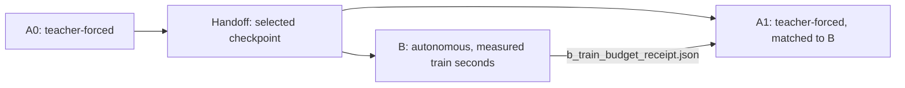

# Training

Training reads a published Dataset and one architecture configuration, fits scaling on the Train cases and writes checkpoints, histories and predictions to `storage/03_experiments/`. All training jobs run in the Apptainer image through `scripts/slurm_ml.sh` ([Setup and execution](01_setup_and_execution.md#ml-jobs)).

Notebooks: [`03_component_checks`](../notebooks/03_component_checks.ipynb) measures training-free priors on the reference fields before loss and derivative settings are chosen ([Component checks](06_evaluation.md#component-checks)); [`04_training_pipeline`](../notebooks/04_training_pipeline.ipynb) inspects configurations, data roles, objectives, stage dependencies and saved runs.

[Documentation index](README.md)

## Configurations

Each task has a `base.yaml`, one experiment config per architecture under `experiments/architecture_comparison/` and its Optuna studies under `optuna/`.

<details>
<summary>Configuration files</summary>

| Task | Configurations | Purpose |
| --- | --- | --- |
| Transient drying | `configs/03_learning/transient_drying/base.yaml` | The matched A0 → {B, A1} plan and the values every transient experiment shares |
| Transient drying | `configs/03_learning/transient_drying/experiments/architecture_comparison/` | One matched plan per architecture: `fno_m64x80_h64_l3_p0p1__lr-0p000388__a0smp-one-step-transition`, `uno_m64x64_h32_l7_p0p1_s1-05-05-1-1-2-2_r0p495__lr-0p000532__a0smp-one-step-transition`, `rno_m24x24_h16_l3_p0p1__lr-0p000388__a0cur-2-4-8-16-32__a0smp-trajectory__a0rl-32` |
| Transient drying | `configs/03_learning/transient_drying/optuna/` | One A0 study per architecture: `fno_a0_search`, `uno_a0_search`, `rno_a0_search` |
| Steady flow | `configs/03_learning/steady_flow/base.yaml` | Values every steady experiment and study shares |
| Steady flow | `configs/03_learning/steady_flow/experiments/architecture_comparison/` | `fno_m128x160_h64_l3_p0p1__lr-0p000388`, `uno_m64x64_h32_l7_p0p1_s1-05-05-1-1-2-2_r0p495__lr-0p000532` and their physics-informed twins `pi-fno_m128x160_h64_l3_p0p1__fd__w-1-1000-100__wu-100__lr-0p000388`, `pi-uno_m64x64_h32_l7_p0p1_s1-05-05-1-1-2-2_r0p495__fd__w-1-1000-100__wu-100__lr-0p000532` |
| Steady flow | `configs/03_learning/steady_flow/optuna/` | FNO, U-NO, PI-FNO and PI-U-NO searches |

</details>

A config names its task's `base.yaml` with `base:` and sets only what differs from it; its values override the base, and a base cannot name another base. Templates leave `data.train_dataset: null` (select it there or with `--train-dataset`); the transient plan also leaves `training.b.train_seconds: null` (set it per experiment or pass `--train-seconds`). The resolved configuration saved with each run is authoritative.

<details>
<summary><strong>Config names, chain rules and model contract</strong></summary>

- **Naming rule.** The filename of a config, also of a YAML outside `configs/`, is the config name the loader computes and requires: the model label, then one token per shared, single-stage or A0 leaf the file itself sets. A leaf that no token shows is refused. Every token and part of the label is listed in [Reading a config name](../configs/README.md#reading-a-config-name); the folder below `experiments/` is the family that groups comparable configs.
- **Base changes.** The task base supplies no token, so a change of a base value renames nothing. The model label reads the merged model parameters and the physics switch, so a base change of a model parameter renames every config, which is correct because the model changes. A partly set token that shows several leaves together (`w`, `wu`, a curriculum) is refused.
- **Model label.** The architecture (modes, hidden channels, layers, domain padding `p`, U-NO scalings, plus a token for every model parameter that differs from the model factory default), prefixed `pi-` with the suffix `__fd` (central finite differences on the grid, config value `physical`) or `__spec` (spectral with Fourier continuation) when the physics loss is on. The tokens (physics crop, target weights `w`, warm-up epochs `wu`, loss, optimizer, scheduler, data and stage settings) follow in a fixed order, for example `pi-fno_m128x160_h64_l3_p0p1__fd__w-1-1000-100__wu-100__lr-0p000388`. Seed, device, Dataset selection, loader and tracking settings are not named.
- **Matched plan files.** The settings a plan file sets for B and A1 are not part of the config name, because the config folder also holds A0: they appear in the pair folder name (`b-a1__budget-<s>s__rollout-<k>__lr-<x>` plus one token per further B/A1 leaf the file sets). Editing B (for example `training.b.train_seconds`) changes only the pair folder (`budget-<s>s`), never the config name, so A0 is reused.
- **Studies.** The A0 studies keep their own single-stage training section and use no base; they restate its shared semantic values, and a test keeps them equal to `base.yaml`.
- **Required keys.** `positional_embedding` and `domain_padding` are required model parameters, like every other key a task's `base.yaml` states ([the list](../configs/README.md#keys-a-config-chain-must-state)): the code holds no default for them, and a config that omits one is rejected with its path.
- **Positional embedding.** Both tasks feed `x` and `y` as explicit input channels, so every model sets `positional_embedding: null`: neuraloperator's grid embedding would add a second, periodic grid without endpoint that gives the same physical point different coordinates at stride 2 and at stride 1.
- **Domain padding.** Every model sets `domain_padding: 0.1`, a symmetric zero padding of 10 % per side of the lifted field, because the fields are not periodic and the FFT would otherwise wrap the opposite boundaries around; the RNO carries its hidden state padded from step to step, so the padding region keeps its recurrence. The rationale of both choices is in [Scientific decisions](08_scientific_decisions.md).
- **U-NO channels.** The U-NO sizes its lifting and projection layers as 2 × `hidden_channels` (`lifting_channel_ratio`, `projection_channel_ratio`), like the FNO and RNO, instead of neuraloperator's fixed 256.
- **Precision.** Training runs in float32 without mixed precision: cuFFT's half precision needs power-of-two sizes, which the grids (251 × 401, 126 × 201) are not, and finite-difference physics derivatives in half precision lose the accuracy the loss relies on.
- **Train seconds rule.** The value of `training.b.train_seconds` is A0's measured optimisation time (`terminal_controller.wall_seconds` in the A0 `summary.json`) of the sweep A0 on the same GPU type, fixed per architecture for all seeds.

</details>

## Transient drying

### Matched comparison: A0 → {B, A1}

Every transient experiment is one matched plan, authored in `base.yaml` as `training.mode: matched_a1_b` with the maps `a0`, `b` and `a1`; an experiment file overrides `training.a0` and `training.b`. The plan trains A0 once, then B and A1, which both continue from A0's selected checkpoint.

```bash
./scripts/slurm_ml.sh --mode gpu --partition gpu --cpus-per-task 4 \
  --mem 32G --time 04:00:00 --gres gpu:rtx6000ada:1 train \
  configs/03_learning/transient_drying/experiments/architecture_comparison/fno_m64x80_h64_l3_p0p1__lr-0p000388__a0smp-one-step-transition.yaml \
  --train-dataset DATASET_ID --train-seconds 600
```

`--train-dataset` and `--train-seconds` are required to run unless the configuration sets them. Further options (defaults in the details): `--epochs`, `--rollout-length`, `--lr-scale`, `--seed`, `--revision`, `--train-stages`, `--artifacts`, `--max-epochs`, `--resume`, `--continue-with-current-code`. The resource options before `train` are all optional ([Setup and execution](01_setup_and_execution.md#ml-jobs)); the examples spell them out.



Equal time is not equal compute: B and A1 differ in protocol, and their continuation rates may be tuned separately (`training_work` in the details reports the compute ratio).

| Stage | Protocol | Budget |
| --- | --- | --- |
| A0 | Teacher forcing. FNO and U-NO learn one-step increments from shuffled reference transitions; the RNO trains teacher-forced on whole trajectories (see below). | `training.a0.max_epochs` (100) |
| B | Autonomous, self-fed rollouts for all architectures. The curriculum advances through rollout lengths 2 → 4 → 8 → 16 → 32 at budget fractions 0, 0.2, 0.4, 0.6, 0.8. | `training.b.train_seconds`, measured; `max_epochs` (200) is an operational cap |
| A1 | Teacher forcing like A0, with A0's sampling, curriculum, evaluation cadence and gradient accumulation. It authors only `max_epochs` (200, an operational cap), `match_to: b.train_seconds` and `lr_scale`. | B's measured seconds |

<details>
<summary>Options</summary>

The order is A0, then B, then A1. B trains self-fed until it reaches `train_seconds`; A1 takes its target from B's actual seconds in `b_train_budget_receipt.json`.

| Option | Effect | Default when omitted |
| --- | --- | --- |
| `CONFIG` or `--resume STAGE_DIRECTORY` | The experiment YAML to start or continue, or one saved stage to continue exactly from its own saved config ([Continue, extend and resume](#continue-extend-and-resume)) | required: exactly one of the two |
| `--train-dataset ID` | Training Dataset | `data.train_dataset`; required when it is `null` |
| `--epochs N` | A0's epoch budget only; it names the seed group (`seed-N__a0ep-E`), so another budget trains beside the first; steady: the run's epochs | `training.a0.max_epochs` (transient A0), `training.epochs` (steady) |
| `--train-seconds S` | B's measured target; A1 matches B's receipt | `training.b.train_seconds`; required when it is `null` |
| `--rollout-length L` | B window length and stride `L`; B's curriculum keeps lengths up to `L` | `training.b.sampling.rollout_length` |
| `--lr-scale X` | Continuation factor for both B and A1 (paired sweep) | `training.b.lr_scale` and `training.a1.lr_scale` |
| `--seed N` | Replicate seed replacing `run.seed` (the replicate runs use 9, 19 and 29): the run lands in its own `seed-N` leaf (transient `seed-N__a0ep-E`) under the same config name and derives its whole seed plan from `N`; a start only, not with `--resume` | `run.seed` |
| `--revision LABEL` | Deliberately separate run `seed-N__a0ep-E__rev-LABEL` (steady: `seed-N__rev-LABEL`) after its science changed, for example code or config content; an identical experiment is never started twice, also not with a revision. Rule: [Revision rule](07_reproducibility_and_validation.md#revision-rule) | no revision (`run.revision` of the config) |
| `--train-stages all\|a0,b,a1` | Stages to train; unselected prerequisites must be complete | all three stages (`all`) |
| `--artifacts selected\|none\|all\|a0,b,a1` | Post-training predictions: every selected completed stage, none, every stage, or the listed stages; a single-stage run accepts `selected` and `none` | `selected` |
| `--max-epochs N` | Operational epoch cap for one selected B or A1 stage; with `--resume` it raises the saved cap of a B, A1 or steady stage. A new steady run sets its epochs with `--epochs`, and A0's epochs are its budget and change only with `--epochs` | `training.b.max_epochs` and `training.a1.max_epochs` (the saved cap with `--resume`) |
| `--continue-with-current-code` | Switch an existing unit to the current code ([bound source tree](#continue-extend-and-resume)) | off: the unit continues in the tree it last ran in |

With `--rollout-length 4` the curriculum becomes lengths `[2, 4]` at milestones `[0, 0.5]`. Every effective value is saved.

</details>

<details>
<summary><strong>Seeds, windows, RNO and selection</strong></summary>

`run.seed` is the only learning seed. Every run derives its process, model initialization, loader, worker and curriculum seeds from it and records them as `seed_plan` in its summary. A0 and A1 share the derived `curriculum_a0` seed (A1 continues A0's teacher-forced curriculum), B uses `curriculum_b`, so replicates with different `run.seed` draw different rollout-length sequences and the same seed reproduces them.

Rollout windows start every 32 transitions; when that stops short of the trajectory end, one more window ends exactly at the end, so the last transitions are trained too. Stage-B origins rotate over the three thirds of the window with the draw counter, so small batches reach every third. A Train case shorter than the window (32 transitions) aborts the start with a clear message; whether to allow partial windows, shorten the window or exclude such cases is decided once the production Dataset shows whether such cases exist. With 168 transitions the windows start at 0, 32, 64, 96, 128 and 136; the last two overlap by 24 transitions.

**RNO.** The RNO carries a hidden state, so it uses `sampling.mode: trajectory`: each item is a whole trajectory, cut by the trainer into the same windows of `rollout_length` in temporal order (truncated backpropagation through time). Every window starts from the hidden state the preceding window of the same trajectory reached at this window's start time (its end, or earlier for the overlapping last window); that state is detached, so gradients stop at the window boundary and memory per optimizer step stays that of one window. Each window is one optimizer microbatch. In B a teacher-forced pass over the reference window, without gradient, provides the state at each curriculum origin and at the next window, so the carried state never contains self-fed errors. Each case ends at its own drying stop, so trajectories may differ in length; a batch only holds trajectories of one length, shuffled anew every epoch. Stateless models cannot use trajectory sampling and the RNO cannot use anything else.

The project's RNO deviates deliberately from neuraloperator's: its recurrent cell uses `tanh` as candidate state (the classic GRU candidate) instead of the library's `selu`. SELU is unbounded above, so the hidden state grew about 25 % per step from initialization even with zero input, and the self-fed rollout diverged after tens of epochs. With `tanh` the next hidden state is a convex combination of the previous one and a value in $(-1,1)$, hence elementwise

$$\lvert h_t\rvert \le \max\big(\lvert h_{t-1}\rvert,\,1\big).$$

Parameters and `state_dict` keys are those of the library RNO. Configs state the choice as `model.params.candidate_activation: tanh`; the key is required and no other value is accepted.

**Checkpoint selection.** Every stage and architecture selects its best checkpoint by the same validation error: each validation trajectory is rolled out autonomously from its reference start state to its end, whatever its length, and `normalized_drying_group_macro_rmse` is taken over all predicted states. The RNO carries only its own hidden state in this rollout. Batches only hold trajectories of one length from one evaluation Dataset, and the metric pools all predicted states, so every state counts equally. The choice is independent of the training sample shape. A0 validates every `evaluation_interval` epochs. B and A1 validate only at epoch ends that crossed a new one of `training.continuation_evaluations` (20) equally spaced points of their measured budget, plus at budget completion, so both arms get the same number of checkpoint candidates and plateau-scheduler steps at the same budget fractions even though their epochs take different times; an epoch that crosses several points validates once. A0 and A1 still train teacher-forced; the teacher-forced one-step error over all validation transitions (the RNO with the state built over the reference transitions before each one) is logged as `guardrail/one_step`.

</details>

<details>
<summary><strong>Handoff, GPU type and budget clock</strong></summary>

- **Handoff.** B and A1 start from A0's selected best checkpoint through an immutable handoff that restores model, optimizer, scheduler, loss, sampler and RNG state with a fresh budget controller. Only this best checkpoint of a matched A0 carries that full training state; every other `best_checkpoint.pt` holds what evaluation needs (model and adapter weights, loss state, identity, best epoch and metric, objective history), and `last_checkpoint.pt` is the only source for continuing a run.
- **Hard link.** The handoff's `best_checkpoint.pt` is a hard link to A0's file (one copy on disk; checkpoints are only replaced by rename, so the snapshot never changes, and a filesystem that cannot link fails the handoff instead of copying). Copy an A0 with `cp -a` or `rsync -aH` to keep the link, because a copy without it becomes a second file.
- **Learning-rate scale.** `training.b.lr_scale` and `training.a1.lr_scale` (default 1) multiply the learning rate restored from A0 together with the plateau floor `scheduler.min_lr`, so the continuation follows A0's schedule shape at another level; the optimizer moments and the plateau history are inherited unchanged. The factor applies only when a fresh B or A1 starts, never on resume.
- **GPU type.** The handoff admits B and A1 only on the GPU model their A0 ran on, and `train_seconds` depends on that GPU; keep one GPU type per architecture for its A0 study, sweep and final runs. Transient work runs on the RTX 6000 Ada (48 GB, three on ICE, one per architecture): it runs B's 32-step rollouts two to three times faster than a V100 and also holds the largest search-space corners (FNO and RNO with batch 4 need 34–39 GB, more than a 32 GB V100). Steady-flow runs use the V100s.
- **Stage records.** Each stage has its own resolved config, history, checkpoints, lifecycle summary and W&B run (job type `stage_a0`, `stage_b` or `stage_a1`, one group per config). Predictions for the selected completed stages are built after training unless `--artifacts` excludes them.
- **Budget clock.** `train_seconds` counts the optimization time of committed optimizer groups and excludes loader waits, validation, checkpointing and artifacts; the crossing group may overshoot the target by at most its own duration, so A1 can exceed B's seconds by at most one optimizer group. B and A1 stop after the optimizer group that crosses the budget, mid-epoch.
- **`training_work`.** Every training stage of both tasks (steady single runs, transient A0, B and A1, Optuna trials) reports `training_work` in `summary.json` and in the W&B run summary (`training_work.optimizer_steps`, `training_work.gradient_predictions`), so the compute ratio of B and A1 can be reported beside their equal time. `optimizer_steps` counts committed optimizer groups. `gradient_predictions` counts predicted states that entered the training loss with a gradient: one per sample for steady flow, one per sample and predicted time step for transient drying; no-gradient warm-up passes do not count. Both counts continue across resume and are not carried from A0 into B or A1. A stage that ends with an exception after training began (a pruned trial, a failure, an interrupt) reports the counts of its last completed epoch boundary.
- **Determinism.** Runs are not bit-reproducible: the maintained configs (`configs/03_learning/*/base.yaml`) set `run.deterministic: false`, because strict deterministic CUDA rejects kernels the transient models use (for example `cumsum`), and the time budget ends B and A1 at a measured, not a fixed, optimizer group. Seeds fix the initialization and the data order, not the bits.
- **`budget_unmet` and workers.** A stage whose epoch, step or time cap ends before its target finishes as `budget_unmet` (exit code 2) and is not a usable prerequisite; raise the cap and resume that run. A B stage that ends `budget_unmet` stops the pair before A1. Checkpoints store the shuffled epoch order and sample cursor, so B and A1 resume mid-epoch; this requires `data.num_workers: 0` and `drop_last: false`, and `base.yaml` authors `num_workers: 0` with `persistent_workers: false` for that reason. `data.num_workers` is an upper bound for the other runs: the loaders use at most as many workers as the job has CPUs (`--cpus-per-task`), and when the cap applies the job log says so once (`data workers 4 of 8 configured (4 CPUs)`); the configuration keeps the configured value.

</details>

### Short runs

`--epochs N` sets A0's epoch budget and `--train-seconds S` B's measured target; `--rollout-length L` shortens B's windows and curriculum. Sampling, architecture and loss stay as authored:

```bash
./scripts/slurm_ml.sh --mode gpu --partition gpu --cpus-per-task 4 \
  --mem 32G --time 00:20:00 --gres gpu:rtx6000ada:1 train \
  configs/03_learning/transient_drying/experiments/architecture_comparison/fno_m64x80_h64_l3_p0p1__lr-0p000388__a0smp-one-step-transition.yaml \
  --train-dataset DATASET_ID --epochs 2 --train-seconds 30 --rollout-length 4 \
  --artifacts none
```

The effective budget is saved with the run. Short runs check the workflow; their accuracy carries no scientific meaning.

### Continuation sweep for B and A1

The continuation learning rate of B and A1 is tuned with normal `train` runs, not an Optuna study: Optuna tunes A0 only (see [Optuna and tracking](#optuna-and-tracking)). The sweep gives B and A1 the same scales from the same A0 and budget.

<details>
<summary>Procedure</summary>

1. Copy the selected A0 values into the experiment configuration.
2. Train the shared A0 once:

   ```bash
   ./scripts/slurm_ml.sh --mode gpu --partition gpu --cpus-per-task 4 \
     --mem 32G --time 04:00:00 --gres gpu:rtx6000ada:1 train \
     configs/03_learning/transient_drying/experiments/architecture_comparison/fno_m64x80_h64_l3_p0p1__lr-0p000388__a0smp-one-step-transition.yaml \
     --train-dataset DATASET_ID --train-seconds 600 --train-stages a0
   ```

3. For each scale `X` of a log grid declared in advance, such as 0.1, 0.3, 1 and 3, run B and A1 one after another, never concurrently, because every branch under one A0 is placed and published under that A0:

   ```bash
   ./scripts/slurm_ml.sh --mode gpu --partition gpu --cpus-per-task 4 \
     --mem 32G --time 04:00:00 --gres gpu:rtx6000ada:1 train \
     configs/03_learning/transient_drying/experiments/architecture_comparison/fno_m64x80_h64_l3_p0p1__lr-0p000388__a0smp-one-step-transition.yaml \
     --train-dataset DATASET_ID --train-seconds 600 --lr-scale X \
     --train-stages b,a1 --artifacts none
   ```

   Every scale gives one B and one A1 pair with the same budget, in its own pair directory beside the shared A0 (see [Results layout](#results-layout)). `--artifacts none` keeps test predictions out of the sweep.
4. Per arm, select the scale with the lowest best validation objective (`best_metric` of `normalized_drying_group_macro_rmse` in each stage's summary), with a tie rule declared in advance, before any test evaluation.
5. Author the winners as `training.b.lr_scale` and `training.a1.lr_scale` in the experiment configuration and run the final matched comparison over several seeds as normal `train` runs.

B and A1 then differ in protocol and in their tuned continuation rate. Their validation sits at the same budget points, so both arms see the same number of checkpoint candidates; the selected minimum over a few validation trajectories per material (8 in the reduced plan, 16 in the production plan) stays optimistic. A pair whose B ends `budget_unmet` has no A1; report its missing evaluations separately instead of treating them as bad scores.

</details>

### Continue, extend and resume

Rerun the same command to continue a run. To continue one saved stage exactly from its own saved configuration, independent of the authored YAML:

```bash
./scripts/slurm_ml.sh --mode gpu --partition gpu --cpus-per-task 4 \
  --mem 32G --time 01:00:00 --gres gpu:rtx6000ada:1 train --resume STAGE_DIRECTORY
```

Pass no scientific overrides on this path. A completed B or A1 stage continues only with a larger operational cap, for example `--max-epochs 24`; matched targets and `lr_scale` stay fixed.

<details>
<summary><strong>Continuation rules, bound code tree and resume details</strong></summary>

- **Rerun.** An interrupted or unfinished run continues from its last checkpoint, a steady-flow run that already finished is extended in place by a larger `--epochs`, and a run that already reached its epochs ends at once (the line `run already_complete: completed_epoch N  run_dir <path>`). A steady run's epochs are not part of its name; a transient A0's budget is (`a0ep-E`).
- **Refusals.** If the existing run holds different science (changed config content or Dataset), the start is refused with the list of differences; pass `--revision <label>` for a deliberately separate run ([Revision rule](07_reproducibility_and_validation.md#revision-rule)). Every continuation, whatever the lifecycle status (unfinished resume, extension of a finished steady run, `--resume`, recovery of a matched stage), first requires the run's recorded training digest to equal the running training projection ([Code identity](07_reproducibility_and_validation.md#code-identity)); after a code change it is refused with "finish it in its bound source tree or start a new run with --revision <label>". Completed runs stay readable and evaluable under code changes. An identical experiment that already exists under another config name, family or revision is refused as well: `storage/03_experiments/.state/identities/` binds every experiment identity to one run directory.
- **Artifacts and W&B.** A run trained by the current command rebuilds its own artifacts, while a reused run only validates them. A resume that only finalizes writes empty `terminal_metrics` into the summary, and a run interrupted before the last observer callback lacks that epoch in W&B; `history.json` is authoritative and W&B only observes.
- **Last checkpoint.** `last_checkpoint.pt` is written after the first epoch and at every new best, otherwise at most every 30 minutes, and at the end of every stage, so an interrupted run resumes from it and trains the epochs since then again (an Optuna trial writes none); W&B keeps the first attempt's values for those epochs, `history.json` the retrained ones. A new best and its last are first written to `.best_checkpoint.pt.staged` and `.last_checkpoint.pt.staged` and then renamed back to back, so a crash before the renames keeps the previous pair; only a crash between the two renames leaves a best newer than the last, and a rerun refuses that run before training. The next start of the run removes staged leftovers, also those of a write cut off midway.
- **Bound source tree.** A run continues in the code state it last ran with. The launcher reads the source tree of the newest Slurm session among the leaves the job may write and runs the job from that frozen tree, restored from its snapshot when it was pruned; edits in `repo/` since then do not reach it ([Source snapshots and frozen trees](07_reproducibility_and_validation.md#source-snapshots-and-frozen-trees)). Those leaves are an existing steady run, the unfinished stages that `--train-stages` selects of a matched comparison, the one stage of `train --resume STAGE`, and for an Optuna study its own session record plus its existing trials. A completed A0, B or A1 is a read-only prerequisite and never binds the tree: a new B/A1 pair on a completed A0 uses the current code, and the handoff then requires A0's recorded training digest to equal the running training projection. A saved-config resume is only structurally validated by the launcher; the job validates it fully inside the bound tree. A new run, pair or study, a unit that never ran under Slurm, and every `artifacts` job use the current code.
- **Job enforcement.** The job enforces the binding as well: continuing a leaf whose newest Slurm session ran in another tree is refused unless the job was submitted with `--continue-with-current-code`, and so is continuing it interactively, outside `scripts/slurm_ml.sh`. A study records its tree in `study_sessions.json` at creation and at every reopen, before its first trial, so it keeps its tree even if it never ran a trial, and a reopen in another tree is refused the same way.
- **`--continue-with-current-code`** (`train` and `optuna`) switches the execution tree of an existing unit to the current code and nothing else. It is admitted only when the continuation checks pass: the start applies the same checks as any rerun (changed config content or Dataset is refused with the list of differences; use `--revision`), and the recorded training digest must still equal the running training projection, so the switch helps only when the code edits left the task's training projection unchanged. A study compares its complete signature, whose implementation part is its Optuna modules plus the training projection of its task. The switch is recorded per session as `source_transition: explicit` beside the source commit and worktree digest in the run's `runtime_sessions`.
- **A0 exception.** A transient A0 is the exception to extension: its epoch budget sets its rollout curriculum and budget controller, so another budget is a different A0, not a longer one. The budget therefore names the seed group (`seed-N__a0ep-E`): another A0 `--epochs` trains in its own seed group beside the first, with its own B/A1 pairs, and needs no `--revision`. The same holds for the stage-A-only Optuna trials. A completed A0 is reused read-only when B is still missing; every pair starts from A0's handoff in `a0/handoff/`.
- **`--resume` path.** It reads the stage's `config.yaml` and last checkpoint and validates split, scaler, the recorded training digest against the running training projection, numerical environment, parent and handoff. A0's epoch count is its scientific budget (its curriculum and budget controller depend on it), so this path keeps it.

</details>

### Inputs, scaling and grid

The input profile `canonical_physics_complete` has 28 ordered channels: current state `T`, `phi`, `w_surf`, `w_int`; coordinates, COMSOL airflow, porosity and spatial material fields; both inlet boundary endpoints of the interval, ambient and startup support; scalar material parameters. Coordinates are explicit channels, so `positional_embedding` is `null` (see [Configurations](#configurations)). Normalized current time can be added as a channel (`temporal.temporal_conditioning.kind: normalized_current_time`); the maintained plans use `none`.

Scaling (`scaling.mode: state_std`) is fitted on Train membership only; training uses the endpoint-preserving view `data.spatial_stride: 2` (251 × 401 source grid → 126 × 201). Evaluation artifacts choose their own grid ([Evaluation](06_evaluation.md#evaluation-grid)).

<details>
<summary><strong>Scaling and the shared normalizer</strong></summary>

Absolute states are deduplicated by state identity; increments are scaled without centering, so zero stays zero. As for steady flow, the run's `normalizer.pt` is the shared scaling artifact: its identity binds the task contract, the training Dataset's manifest and payload identity, the Train membership and the preprocessing (tensorizer, scale mode, spatial view), and it is reused unchanged by every stage, resume and inference ([Reproducibility and validation](07_reproducibility_and_validation.md#runs-and-publication)).

</details>

### Losses and objective

Transient models predict scaled increments of the four state channels. The maintained loss is Huber (`beta: 1`) in scaled-increment space with equal channel weights; MSE and an auxiliary reconstructed-state term are available. The transient physics loss is disabled.

Checkpoint selection and Optuna use `normalized_drying_group_macro_rmse`:

$$J=\tfrac13\,\big(\mathrm{RMSE}_T+\mathrm{RMSE}_\varphi\big)+\tfrac16\,\big(\mathrm{RMSE}_{w_\mathrm{surf}}+\mathrm{RMSE}_{w_\mathrm{int}}\big)$$

Squared errors and valid counts are pooled over the complete Dataset before each field root. Per-channel normalized and physical RMSE, physical MAE and total grain moisture `w_gr` are reported separately.

### Results layout

Run and study paths are a pure function of the saved layout (`run.layout`): the task, the training Dataset, the family and name of the config file, the seed and an optional revision. Nothing depends on which runs already exist.

```text
storage/03_experiments/<task>/<dataset>/<family>/<config_name>/seed-N[__a0ep-<E>][__rev-<label>]/
  a0/                                              # teacher-forced origin, shared by every pair
    handoff/                                       # selected A0 state that every pair starts from
  b-a1__budget-<S>s__rollout-<L>__lr-<X>[__<token>-<value>...]/          # one B/A1 pair; the tokens show the other B/A1 settings the plan file sets
    experiment.json                                # identities and relative child links
    b/                                             # autonomous continuation
    a1/                                            # matched teacher-forced continuation
```

<details>
<summary><strong>Path and run-name rules</strong></summary>

`<family>` and `<config_name>` are the config's folder below `experiments/` and its file stem; `<dataset>` is `data.train_dataset`, or `<data.train_dataset>__train-<N>` for a Train subset `data.train_subset: N` (runs and Optuna studies alike; [Datasets](04_datasets.md)). The pair directory names B's measured budget, the rollout window `L` and the shared learning-rate factor `X` (`lr-b-<X>__lr-a1-<Y>` when B and A1 differ), always, also for the first pair. Further pairs on the same A0 get their own pair directory and reference the existing A0 (`../a0`) instead of copying it. A different architecture, seed, optimization, input or split gives a different A0, and so does a different A0 epoch budget `E` (`training.a0.max_epochs` after `--epochs`), which names the seed group of a transient experiment as `seed-N__a0ep-E`, shared by A0 and every pair. Steady runs keep `seed-N`: their epochs are not part of a name, rerunning a name continues the run ([Continue, extend and resume](#continue-extend-and-resume)) and a larger `--epochs` extends it. `--revision <label>` starts a deliberately separate run after its science changed and always comes last (`seed-N__a0ep-E__rev-<label>`, steady `seed-N__rev-<label>`; the same flag exists for `optuna`). Run names follow the paths: `<config_name>__seed-N[__a0ep-E][__rev-<label>][__<pair>]__<stage>`; trials are `<study>__trial-<NNNN>`.

</details>

## Steady flow

Steady-flow models map seven input channels (`x`, `y`, $\log_{10}K_{xx}$, $\log_{10}K_{yy}$, $K_{xy}/\sqrt{K_{xx}K_{yy}}$, `eps_bed`, `p_in_bc`) to $(p, u, v)$; units and transforms are owned by `src/domain/tasks/domain_task_steady_flow.py`:

```bash
./scripts/slurm_ml.sh --mode gpu --partition gpu --cpus-per-task 4 \
  --mem 32G --time 04:00:00 --gres gpu:v100:1 train \
  configs/03_learning/steady_flow/experiments/architecture_comparison/pi-fno_m128x160_h64_l3_p0p1__fd__w-1-1000-100__wu-100__lr-0p000388.yaml \
  --train-dataset DATASET_ID
```

<details>
<summary>Configuration sections</summary>

The channels are the coordinates `x` and `y` in metres, $\log_{10}K_{xx}$ and $\log_{10}K_{yy}$ of the diagonal permeability components in m², the cross component $K_{xy}/\sqrt{K_{xx}K_{yy}}$ relative to the geometric mean of the diagonal components, the porosity `eps_bed`, and the inlet pressure `p_in_bc` in Pa; the task definition owns the order and the transforms.

| Section | Meaning |
| --- | --- |
| `data` | `train_dataset` with its fixed Dataset partition, whose `ood` cases form the `material_ood` role and whose `parameter_ood` cases form the `parameter_ood` role, both evaluated besides validation and ID-test; `material_ood_datasets` whose declared `ood` cases join the `material_ood` role, each kept as its own split part ([Evaluation Datasets](04_datasets.md)); `train_subset` (`null` for every Train case, or a power of two N for the first N Train cases of every ID material) |
| `loss.data` | `relative_h1` or `relative_l2` in normalized space: NeuralOp's relative norm per case and field, averaged over both (`reduction="mean"`), so the loss weights do not depend on the batch size; `relative_h1` takes finite differences at the physical grid spacing in metres (inferred from the coordinate channels of the training Dataset; central in the interior, one-sided at the non-periodic boundaries); the `normalized_relative_h1` metric uses the same spacing and averages the fields of each case, and a run refuses material-OOD or parameter-OOD cases on another spacing |
| `loss.physics` | Three dimensionless terms, each with its own weight and linear warm-up: `momentum_weight` (Darcy–Brinkman momentum residual), `continuity_weight` (cross-section flux balance) and `boundary_weight` (inlet pressure and zero outlet gauge); `derivatives.kind` (`physical`, the default: NeuralOp's `FiniteDiff`; or `spectral`: NeuralOp's `FourierDiff`) and `interior_crop` apply to the momentum term; the maintained physics configs use `physical` derivatives with `interior_crop: 2` (details below) |
| `evaluation.objective` | `normalized_group_macro_rmse` over pressure and velocity groups |
| `training` | `epochs` (600 in the maintained plans), `evaluation_interval` and `ood_evaluation_interval` (one cadence for both OOD roles; the local history keeps `material_ood/<metric>` and `parameter_ood/<metric>` with `<role>/objective_difference`, and the selected checkpoint adds `selected/<role>/...`) |

Train, validation and ID-test come from the Dataset partition exactly as for transient drying; validation drives checkpoint selection and the scheduler, ID-test stays untouched until evaluation. Steady-flow runs have a single stage and live directly in their `seed-N[__rev-<label>]/` directory (see [Results layout](#results-layout)).

</details>

<details>
<summary><strong>Steady physics: scales, terms, derivatives and weights</strong></summary>

Per case, with zero outlet gauge pressure and flow from the lowest to the highest $y$ (`src/domain/physics/domain_physics_brinkman.py` L20–34 and L224–231):

$$\Delta p=\overline{p_\mathrm{in,bc}},\qquad G=\frac{\Delta p}{L_y},\qquad K_g=\exp\overline{\tfrac12\big(\ln K_{xx}+\ln K_{yy}\big)},\qquad U=\frac{K_g\,G}{\mu},\qquad Q=U\,L_x$$

$\Delta p$ is the mean prescribed inlet pressure in Pa, $L_x$ and $L_y$ are the grid extents in m, $\mu$ is the dynamic viscosity of air in Pa s, and the bar is the mean over the inlet cells (for $\Delta p$) or over the grid (for $K_g$, the geometric mean of $\sqrt{K_{xx}K_{yy}}$). All scales come from the inputs only. The momentum residual is that of COMSOL's Brinkman interface for incompressible flow:

$$\mathbf R=-\nabla p+\nabla\!\cdot\boldsymbol\tau-\mu\,\mathbf K^{-1}\mathbf u,\qquad \boldsymbol\tau=\frac{\mu}{\varepsilon}\Big(\nabla\mathbf u+\nabla\mathbf u^{\mathsf T}-\tfrac23\,(\nabla\!\cdot\mathbf u)\,\mathbf I\Big)$$

The trace term of the stress vanishes for $\nabla\!\cdot\mathbf u=0$. The three dimensionless terms (`domain_physics_brinkman.py` L573–576):

$$\mathcal L_\mathrm{mom}=\Big\langle \frac{R_x^2+R_y^2}{G^2}\Big\rangle_\mathrm{crop},\qquad \mathcal L_\mathrm{cont}=\Big\langle\Big(\frac{q(y)-\bar q}{Q}\Big)^2\Big\rangle_y,\qquad \mathcal L_\mathrm{bnd}=\frac{\overline{(p-p_\mathrm{in,bc})^2}_\mathrm{inlet}+\big(\overline p_\mathrm{outlet}\big)^2}{\Delta p^2}$$

with $q(y)=\int v\,\mathrm dx$ the volume flux through each row (trapezoidal rule) and $\bar q$ its mean over $y$. $\mathcal L_\mathrm{mom}$ is the mean over the interior left after removing `interior_crop` cells from every edge. With impermeable side walls, $\nabla\!\cdot\mathbf u=0$ makes $q$ constant over the height.

- **Why the flux balance.** Pointwise $\nabla\!\cdot\mathbf u$ is not used, because the COMSOL solution interpolated to the regular grid is not pointwise divergence-free (RMS of $\nabla\!\cdot\mathbf u$ 14–145 % of $U/L_y$ with finite differences, median 32 %), while its flux-balance term stays between 1.4·10⁻⁷ and 4.6·10⁻⁶ (the ten cases of the steady smoke Dataset, see [Component checks](06_evaluation.md#component-checks)).
- **Derivatives.** `physical` is second-order central in the interior and third-order one-sided at the non-periodic edges (NeuralOp's `FiniteDiff`); `spectral` is NeuralOp's `FourierDiff` with Legendre Fourier continuation of degree 5.
- **Crop evidence.** With crop 0 the finite-difference momentum term of the exact COMSOL solution is dominated by the two no-slip wall columns (case median over the ten cases of the steady smoke Dataset with `FiniteDiff` in float32: 5.3e-3, against 1.3e-6 with crop 1 and 8.9e-7 with crop 2), because the Brinkman boundary layer (about 0.17 mm) is far below the grid spacing (3 mm), so the loss would mainly push the network to violate the wall values.
- **Starting weights.** Momentum 1, continuity 10³, boundary 10² make each term comparable to the data loss at about 1 % field error. Measured on two reference cases with a smooth 1 % perturbation (16-cell correlation), the terms are about 2·10⁻², 9·10⁻⁶ and 8·10⁻⁵; for the unperturbed reference they stay below 10⁻⁵, 10⁻⁶ and 10⁻⁹.
- **Standardization and scheduler.** Inputs and outputs are standardized per channel with statistics fitted on Train. `scheduler.patience: 20` counts validation checks: with `evaluation_interval: 2` the learning rate drops only after 40 epochs without improvement. The steady Optuna studies use the same plateau floor (`min_lr` 1e-5 from `base.yaml`) and `deterministic: false` as the experiments, so a selected trial retrains under the conditions it was found in.

</details>

## Optuna and tracking

```bash
./scripts/slurm_ml.sh --mode gpu --partition gpu --cpus-per-task 4 --mem 32G \
  --time 04:00:00 --gres gpu:rtx6000ada:1 optuna \
  configs/03_learning/transient_drying/optuna/fno_a0_search.yaml \
  --train-dataset DATASET_ID
```

W&B tracking uses entity `Rinovative-Hub` with project `grainlegumes-pino-airflow` (steady flow) or `grainlegumes-pino-drying` (transient drying), in mode `online`, `offline` or `disabled`; every maintained config and study uses `online`. Local configs, histories, checkpoints and study storage are authoritative; W&B observes.

<details>
<summary>Options</summary>

| Option | Effect | Default when omitted |
| --- | --- | --- |
| `CONFIG` | The study YAML | required |
| `--dry-run` | Validates the config, search policy, pruning cadence, device policy and semantic signature without creating files | off: the study runs |
| `--n-trials N` | Number of additional fresh trials of this invocation | `study.n_trials` of the study config (30 if the study omits it) |
| `--epochs N` | Epoch budget of every trial; it names the study (`<study>__ep-E`) | the study's experiment epoch budget (`training.epochs`) |
| `--train-dataset ID` | Training Dataset; changes the study identity | `data.train_dataset`; required when it is `null` |
| `--revision LABEL` | Separate study after its science changed ([Revision rule](07_reproducibility_and_validation.md#revision-rule)) | no revision |
| `--continue-with-current-code` | Switch an existing study to the current code ([bound source tree](#continue-extend-and-resume)) | off: the study reopens in the tree it last ran in |

The resource options are optional as for `train`.

</details>

<details>
<summary>Studies and pruning</summary>

| Study | Trials | Search space |
| --- | ---: | --- |
| `fno_a0_search` (transient) | 24 | A0 alone (`stage_a_only`) for 40 epochs (the final A0 trains up to 100): modes along Y {32, 48, 64, 96} and X {64, 96, 128, 160}, hidden channels, layers, learning rate, batch size {2, 4} |
| `uno_a0_search` (transient) | 24 | A0 alone for 40 epochs: modes along Y {32, 48} (64 exceeds the 63 Y modes a 5-layer U-NO admits on the 126 × 201 training grid) and X {32, 48, 64}, hidden channels, 5 or 7 layers, mode ratio 0.4 to 0.6, learning rate, batch size {2, 4} |
| `rno_a0_search` (transient) | 24 | As the FNO study, over the RNO's smaller ranges |
| `steady_flow/optuna/fno_search` | 30 | 300 epochs: modes along Y {32, 64, 96, 128} and X {64, 96, 128, 160}, hidden channels {32, 64}, layers {3, 4}, learning rate 1e-4 to 1e-2 (log), batch size {16, 32} |
| `steady_flow/optuna/uno_search` | 30 | 300 epochs: modes {32, 48, 64} along both axes, hidden channels {16, 32, 64}, layers {5, 7}, mode ratio 0.4 to 0.6, learning rate 1e-4 to 1e-2 (log), batch size {16, 32} |
| `steady_flow/optuna/pi-fno_search`, `pi-uno_search` | 20 | 300 epochs: architecture and learning rate fixed to the supervised twin's experiment values; only the three physics target weights (two decades around the starting values), with the physics warm-up fixed at 100 epochs |

Per task and architecture the program is one study on validation, then the final configuration over replicate seeds 9, 19 and 29 (`--seed`) and one evaluation on ID-test and OOD. Optuna reports one step per validated epoch, so pruner steps are epochs, and the pruner interval equals the validation interval (1 for the transient studies, 2 for the steady ones): the transient studies prune from epoch 8, the supervised steady studies from epoch 60 and the physics-informed studies from epoch 100, after 5 startup trials each. All studies use TPE sampling and median pruning.

</details>

<details>
<summary><strong>Study rules and best config</strong></summary>

- **Scope.** The transient studies tune A0 only, one study per architecture. Matched plans are not an Optuna study mode, and the continuation rate of B and A1 is tuned by the [continuation sweep](#continuation-sweep-for-b-and-a1). Studies use the Dataset's split ([maintained plans](04_datasets.md#the-maintained-plans)); ID-test and OOD cases never enter fitting, pruning, checkpoint selection or the objective.
- **`best_config.yaml`.** An experiment config on the task's `base.yaml`: the study's authored values that differ from the base, without the study-only `run`, `tracking` and `training` sections (trial budget, workflow, seeds), and with the best trial's values at their search-space paths. Copy it to `configs/03_learning/<task>/experiments/<group>/<config name>.yaml` to train it with the base budget (its header names the config name of the best trial, which the loader requires; for a transient A0 study it is the name of the architecture's matched experiment). A steady config trains as written; a transient A0 study tunes only A0, so its config carries A0's sampling and curriculum and the tuned values, and its header says to transfer them into the architecture's experiment under `configs/03_learning/transient_drying/experiments/architecture_comparison/`, which carries B's rollout sampling and `training.b.train_seconds` (A0's measured time per architecture).
- **Signature.** The study signature binds Dataset, split membership, budget, search space, objective, seeds and numerical environment before trials are added; an incompatible study cannot be reopened. For both tasks the study and its dry run (`--dry-run`) bind the same validated Dataset evidence (digests and counts, not locations), so the signature a dry run prints is the one the study records.
- **Trials.** Interrupted trials restart as fresh trials. A trial writes only `best_checkpoint.pt` (each new best by one rename) and never a `last_checkpoint.pt`, because it never resumes; the best checkpoint is deleted when the trial's final state is published (a trial killed before that keeps it), and its digest stays in `summary.json`; a selected trial is retrained as a normal run. `train --resume` refuses a trial directory. A trial whose exact experiment already ran (same sampled values, seed and budget) is not trained again. A trial's identity includes its epoch budget, and an ordinary run and a trial never share an identity: only a completed trial of the same study supplies its stored value, and a trial with identical values in a study of another budget trains itself.
- **Budget and revision.** `--epochs` sets the trial epoch budget and names the study (`<study>__ep-E`), so another budget is another study beside the first; `--n-trials` only limits the trials of one invocation. Give a study with changed science its own `--revision <label>` ([Revision rule](07_reproducibility_and_validation.md#revision-rule)).
- **Lifecycle.** Both tasks run a trial through the same driver and the same run lifecycle as training. A repeated trial is answered from the stored evidence before a device is resolved or a directory allocated. Every finished trial gets one status, in `summary.json` and in the Optuna user attribute `terminal_status`, whether or not training had started: `completed`; `pruned` by the pruner; `nonfinite_pruned` for a non-finite objective or, in transient drying, one-step guardrail; `oom_pruned` for CUDA or host allocator exhaustion; `recoverable_failed`; `failed`; `interrupted` for `KeyboardInterrupt` and `SystemExit`; and, without a directory of their own, `duplicate` (the stored value is reused) and `duplicate_pruned`. The pruned states reach Optuna as `TrialPruned`, the study catches only `RecoverableTrialError`, and every other error ends the invocation.
- **Trial summary.** It has the fields of a run summary (`started_at`, `ended_at`, `elapsed_seconds` with `duration_coverage`, `operational_timing`, `error_type`, `error`) plus `last_reported_epoch`, `last_reported_objective`, `pruning_epoch` (pruned trials only), `failure_context` (requested and resolved device, failure epoch, last report and step, CUDA memory counters when CUDA was already initialized; `null` when completed), `sampled_parameters` (search-space names) and `overrides` (config paths). Before the best checkpoint is deleted, an unfinished trial records `best_epoch`, `best_metric`, `best_checkpoint` and `best_checkpoint_sha256` from that file and takes `completed_epoch` and `global_step` from it when they are later than the last report (all `null` without a best). A reported best without its file is a lifecycle violation; it, and any failure to write the terminal summary, is attached as a note to the original error, which still propagates.
- **Admission.** A completed trial is admitted like a completed run without checkpoints: config, split and normalizer digests, objective, progress and best digest, and for transient drying the completion evidence and `history.json`; only the comparison of the terminal controller and curriculum with a last checkpoint, which a trial never writes, is skipped.
- **Study folder.** A study is named after its config file and lives in `storage/03_experiments/<task>/<dataset>/optuna/<study>__ep-<E>[__rev-<label>]/` (`E` is the effective trial `training.epochs`; the SQLite study name carries the directory name) with the database `<study>.db`, `study_summary.json`, `best_config.yaml` (present while a best trial exists; written before `study_summary.json`, which is the commit record: the trial number in the header of the one must equal `best_trial_number` of the other), `study_sessions.json` (the source tree of each Slurm job that created or reopened it) and one directory per trial in `trials/<NNNN>__<model_label>__<name>-<value>.../`. The trial directory shows the zero-padded trial number, the sampled architecture and every sampled value that is not a model parameter, sorted by name with three significant digits.

</details>

<details>
<summary><strong>W&B groups and panel layout</strong></summary>

Both tasks share one layout: the group is `<family>/<config>` for training (all seeds, transient stages and B/A1 pairs, so W&B aggregates seeds) and `<family>/<study directory>` for Optuna (the directory carries budget and revision); the job type is `train` (steady), `stage_a0`, `stage_b`, `stage_a1` or `optuna_trial`; the name is the run name (a trial `<study directory>__trial-<NNNN>`); tags are the model family and `optuna`. History keys have one slash.

- **Panel order.** A section is a sequence of pages of six panels in a 3 × 2 grid, and the order of the names after the slash equals the position order (row-major, page after page) under byte-wise, case-insensitive and punctuation-ignoring collation (lower-case labels; the transient temperature panels are named `temperature`). The panel layout therefore holds when W&B sorts panels by name; under first-appearance ordering, the series evaluated less often (validation and OOD) appear after the training series. A page needs all three quantities of its comparison section, as the maintained configs have them; a config that drops a metric shortens the page, and transient Physical and OneStep series follow the resolved evaluation metrics.
- **Comparison sections.** Steady Fields, Physical and Norms; transient Fields, Physical and Moisture. They have one page per configured OOD part: `material-id-<q>` and `material-ood-<q>` (page 1), `parameter-id-<q>` and `parameter-ood-<q>` (page 2), over three quantities `<q>`, so ID sits directly above its OOD series; an unconfigured OOD part drops its page, ID is shown on each page that is kept, and without any OOD part each comparison section shows `id-<q>` alone.
- **Both tasks.** Overview (`objective-id|material|parameter`, `train-loss_total`, `transfer_gap-material|parameter`), Performance (`duration-epoch|train|validation`, `memory-cuda_peak_gib` on CUDA, `progress-remaining_seconds` (steady) or `progress-wall_seconds` (transient), `rate-samples_per_second`) and, for trials, Optuna `best_objective`.
- **Steady runs add** Training (`learning_rate`, `loss_data`, `optimizer_steps`, `weight-<term>` of the physics loss), Physics (`train-<term>`, `val-<term>`), Fields, Physical and Norms.
- **Transient runs add** Training (`curriculum-horizon`, `curriculum-progress`, `forward_transitions`, `learning_rate`, `optimizer_steps`, `transitions`; the two transition counts are the cumulative model forward and target transitions of the stage), Loss (`data-phi`, `data-temperature`, `data-total`, `data-w_int`, `data-w_surf`, `state_aux`), Fields, Physical, Moisture and OneStep (per role the one-step guardrail `<role>-one_step-<q>` above the rollout error `<role>-rollout-<q>`).
- **Views and summary.** The order of the sections is set once per project in the W&B UI and saved as a view: Overview, Training, Loss (transient) or Physics (steady), Fields, Physical, Moisture (transient) or Norms (steady), OneStep, Performance, Optuna, System. The keys fix only the order of the panels within a section. History carries what changes during a run or compares ID with OOD; fixed configuration values stay in the config. The terminal summary copies only the `selected/` metrics of series that the history projects; `summary.json` keeps all. The summary carries `data/train_dataset` and `data/ood_datasets`.

</details>

<details>
<summary><strong>Measured clocks</strong></summary>

| Clock | Boundary |
| --- | --- |
| Matched `train_seconds` | Wall time of committed optimizer groups, including batch preparation and device completion; excludes loader waits, validation and publication |
| CUDA optimizer-device seconds | Sum of device events; neither process wall time nor utilization |
| `operational_timing` | Checkpoint capture and publication, selected-checkpoint evaluation |
| Attempt wall time | Monotonic clock from prepared-run entry through terminal work; accumulates across resume |

Imports, CLI resolution, scheduler wait and observer finalization lie outside these clocks.

</details>

## Reading the job log

`runtime/logs/ml/<operation>-<job>.out` carries the progress, `.err` only warnings and errors ([Setup and execution](01_setup_and_execution.md#ml-jobs)).

<details>
<summary><strong>Job log format</strong></summary>

`runtime/logs/ml/<operation>-<job>.out` (`train-<job>.out`, `artifacts-<job>.out`, `optuna-<job>.out`) carries the progress, `.err` only warnings and errors; both are appended, and hard-linked into `logs/` of each run stage or study folder the job wrote, except a file that is empty when the job ends (a Slurm message appended afterwards, such as an out-of-memory kill notice, stays only in `runtime/logs/ml/`).

- **Header.** Three lines: job and resources, source tree with commit and transition, image with its digest prefix (the full digests are in the run summary).
- **Start block.** A four-line block (run, data, model with optimizer, loss and selection), then one `startup` line. Both tasks report the same startup phases and print the same start block and `startup` line: Train cases, items and grid of the training Dataset, the scaler cache state with the fit time, and the model build time.
- **Epoch line.** One per epoch, such as `epoch   3/50  loss 3.215e-02  val 1.234e-02 *best  lr 3.88e-04  13 s  45.0 samples/s`. `val` appears on the epochs that evaluate; loss components share the line when more than one remains besides the total.
- **End line.** Such as `completed after 3 of 100 epochs (train_seconds budget 10 s)  best epoch 3  <metric> 4.894e+00  total 3 min 34 s (startup 5 s, training 2 min 40 s, validation 12 s, other 17 s)  run <folder>`: the epochs run of those allowed, why training stopped (`epoch budget` or the measured `train_seconds` budget), the best epoch and selection metric, the duration with its parts and the run folder relative to `storage/`. A stage that hits an operational cap before its budget reports `budget_unmet after N epochs (operational cap)`.
- **Artifacts.** After the artifacts, the last line of `slurm_ml.sh train` reads `Post-training artifacts: completed (cpu) | total ... (startup, training, validation, artifacts, other)`. When any prediction is not `VALID` (steady flow: `NONFINITE`; transient drying: `NONFINITE` or `FINITE_BUT_PHYSICALLY_INVALID`, see Prediction validity in [Evaluation](06_evaluation.md#transient-protocols-and-metrics)) it reads `completed with invalid predictions (valid 0 of N)`, the exit status stays unchanged, and the artifact CLI repeats the `[WARNING]` lines whenever it loads such a cache. Artifact generation prints one line per finished phase and, while a phase runs, a progress line at most once per minute.
- **Failures.** A failure prints its message and how to continue; a traceback follows only for an unexpected exception.
- **Optuna.** A study prints a start line, one `trial` line per finished trial of either task (`trial   3  pruned@8  val 1.234e-02  2 min 5 s  learning_rate=0.0003`; completed, pruned and duplicate trials on stdout, failed and interrupted ones on stderr) and an end line, with the Optuna library logger at WARNING. A pruned trial prints no failure block, only its `trial` line.
- **W&B.** Prints nothing. Its online SDK directory lives on the node-local `TMPDIR` and is copied to `<run>/wandb/` only when the tracking session fails; `offline` mode keeps it in `<run>/wandb/` for `wandb sync`.

</details>
