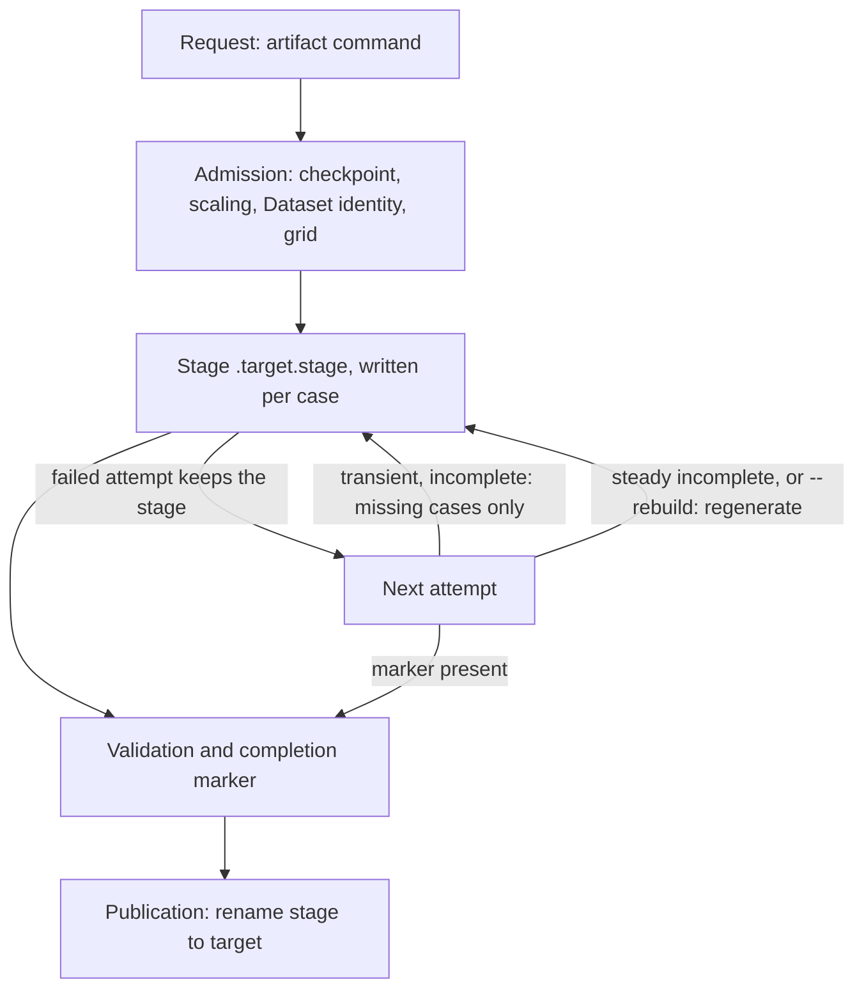

# Evaluation

Evaluation works on saved evidence. An explicit artifact step writes reference and predicted fields for a completed run; the notebooks discover runs, load validated artifacts and show compatible views. Opening a notebook never trains, runs inference or builds missing artifacts.

[Documentation index](README.md)

## Notebooks

Notebooks 01–06 are the workflow; `notebooks/xx_plot_standard.ipynb` is a development reference ([Plot catalog](#plot-catalog)). Scientific cells need a compute-node kernel ([Setup and execution](01_setup_and_execution.md#notebooks-on-compute-nodes)). The notebooks resolve `STORAGE_ROOT`, scan `03_experiments/` once and build their selectors from persisted run records. Runs without usable artifacts stay visible with the exact command that creates them.

<details>
<summary><strong>Notebook list</strong></summary>

| Notebook | Use |
| --- | --- |
| `notebooks/01_eda_generation_inputs.ipynb` | Prepared Generation inputs before COMSOL: parameters, fields, schedules, design coverage, failures by parameter |
| `notebooks/02_eda_datasets.ipynb` | Completed cases and Datasets of both tasks: states, static fields, schedules, target attainment, solver timing |
| `notebooks/03_component_checks.ipynb` | Training-free component priors and physics checks on the COMSOL reference fields of one Train or validation membership ([Component checks](#component-checks)) |
| `notebooks/04_training_pipeline.ipynb` | Training configurations, data roles, objectives, stage dependencies and saved runs (inspection only) |
| `notebooks/05_eval_single_model.ipynb` | One saved run |
| `notebooks/06_eval_comparison_models.ipynb` | Two or more compatible saved runs |
| `notebooks/xx_plot_standard.ipynb` | Development reference: every control and plot sub-type on synthetic inputs ([Plot catalog](#plot-catalog)) |

</details>

<details>
<summary><strong>Compute device and memory</strong></summary>

`evaluation_compute_device` (`auto`, `cpu`, `cuda`, `cuda:N`; default `auto`) applies only to the transient aggregate error maps (mean and standard deviation); artifact building has its own `device_policy` ([Build artifacts](#build-artifacts)). Discovery, tables, plotting and single-case maps run on CPU. `auto` uses the GPU whenever a Slurm GPU allocation is visible, otherwise the CPU, and falls back to the CPU after a CUDA out-of-memory or allocation failure, named under the figure; an explicit CUDA request checks the visible device and never falls back. The probe of 2026-11-09 on one RTX 6000 Ada measured the GPU faster from one case on (4 CPU threads, four float64 channels on 251 × 401, transfer included): 1 case 4.7 ms CPU against 2.8 ms GPU, 16 cases 123.8 ms against 56.3 ms.

Notebook admission verifies artifact, manifest, frame, provenance and output structure with the Parquet digest, for both tasks; each case payload is verified against its recorded digest when its case is first opened, before any byte is parsed, so an unopened payload is never hashed. A payload's digest is cached per process and reused while its path and file identity (device, inode, size, modification time) are unchanged; a changed file, such as a rebuild at the same path, is hashed again. Run admission checks both checkpoints through the same cache but hashes the best checkpoint again on every admission. Sequence arrays are decompressed only when their case is requested and kept in a bounded LRU cache; aggregate views load all admitted records. Closing a workspace clears its caches.

</details>

## Build artifacts

Artifacts evaluate the held-out roles: `analysis/id` holds the ID test, the other folders the OOD roles. Training and Optuna never build or evaluate them, and no training metric names them. This explicit call is their only evaluation, made once configurations and analysis rules are frozen; until then every decision uses validation only ([Training](05_training.md#budget-schedule-and-validation-points)).

```bash
./scripts/slurm_ml.sh artifacts --run-dir RUN_DIRECTORY --split id --split material_ood
```

`--split id|material_ood|parameter_ood` names each held-out role the call releases (`id` is the ID test) and is repeated for several; it is required, and a call without it is refused. `artifacts` resources default to gpu mode, partition `gpu`, 4 CPUs, 32G, `gpu:rtx6000ada:1` and time 02:00:00; an explicit resource option wins ([ML jobs](01_setup_and_execution.md#ml-jobs)). Incomplete or older artifacts are rejected; `--rebuild` recreates the exact target.

<details>
<summary><strong>Options and defaults</strong></summary>

Exactly one of `--run-dir`, `--task` and `--runs-root` is required.

| Option | When omitted |
| --- | --- |
| `--run-dir DIR` (repeatable) | required unless `--task` or `--runs-root` is given: the exact current run directory; an Optuna trial directory is refused |
| `--task TASK` | required unless `--run-dir` or `--runs-root` is given: the task's folder below `storage/03_experiments/` is the discovery root; selects all evaluable runs, skipping Optuna trial runs |
| `--runs-root DIR` | required unless `--run-dir` or `--task` is given: a directory of runs or one run directory, same discovery |
| `--run-name NAME` (repeatable) | every evaluable run below the root; narrows the selection; refused together with `--run-dir` |
| `--split` | required, no default: no role is evaluated unless named; each role at most once; a role a selected run does not have is refused before any inference below the same `--run-dir` or discovery root; repeated `--run-dir` roots are built in turn |
| `--dataset-root DIR` | `storage/02_datasets` (the Dataset lifecycle area), independent of the run and output paths |
| `--device auto\|cuda\|cpu` | the launcher refuses it and passes `cuda` in gpu mode (strict, never falls back) or `cpu` in cpu mode; called directly, `cli_build_artifacts` defaults to `auto` (CUDA when usable, otherwise CPU) |
| `--rebuild` | off: initial generation needs none; on: regenerates and atomically replaces the exact selected targets |
| `--one-case`, `--case-id CASE_ID` (repeatable) | off: all cases; either one makes the build bounded ([Single-case debug artifacts](#single-case-debug-artifacts)) |
| `--output-root DIR` | none; required for a bounded build and refused without one |

Instead of `--run-dir`, `--task` or `--runs-root` selects all evaluable runs below a discovery root. Only completed runs are evaluated: discovery skips a run that is `interrupted` or ended `unsuccessful` (no eligible checkpoint) with one `[SKIP]` line and continues (exit 0 when nothing else fails), while a run named by `--run-dir` or `--run-name`, or an Optuna trial directory given directly, is refused; any discovery, inference, generation or publication failure exits 1. Before any case is predicted, the service admits checkpoint, scaling artifact, Dataset identity and the requested grid for the architecture. A non-finite prediction does not stop the build in either task: every case is classified and published with its validity document (see Prediction validity under [Field metrics of both tasks](#field-metrics-of-both-tasks)).

</details>

<details>
<summary><strong>Staged finalization and resume</strong></summary>



Both tasks build a target in one deterministic sibling stage, `.<target>.stage` (for example `analysis/.id.stage`). A failed attempt keeps it; `--rebuild` clears it. A stage that already carries its completion marker is not generated again: the next attempt writes the timing block, admits the stage with the same role validator as a cache hit and publishes it. Artifacts record the analysis digest of their producer (`producer.analysis_sha256`); a complete target or complete stage with another analysis digest than the running code is refused with the `--rebuild` hint, while reading an artifact never compares it with the running code ([Code identity](07_reproducibility_and_validation.md#code-identity)). An incomplete stage resumes per case in the transient task, where each completed case manifest binds role, checkpoint, normalizer, protocol, grid, summary, NPZ digest, timing and validity, so a restart reconstructs reused rows from their NPZ and computes only missing cases. The resume descriptor binds the analysis digest and the timing hardware, so a partial stage started with another analysis digest or on other hardware is refused with the `--rebuild` hint instead of mixing cases computed by different analysis code or timed on different devices. A complete bounded (scoped) stage is reused only when its persisted `selected_case_ids` equal the request's cases and its analysis digest equals the running one, otherwise it is refused and its directory must be deleted (bounded generation takes no `--rebuild`). The roles of one run always share one analysis producer: no build path generates a missing role beside a published role of other analysis code without `--rebuild`, and the refusal comes before any inference. A `--rebuild` must name every role of other analysis code with `--split`, otherwise the run is refused before inference with the command that names all of them; it publishes the run's rebuilt roles together, all or none, once every stage is validated, so a failed role leaves every target as it was and its siblings' validated stages unpublished. One run-wide lock serializes the artifact builds of a run, so two concurrent builders cannot both pass this check. The notebook preparation only reads published roles as evidence: it never generates, rebuilds or replaces one, and refuses a missing or incompatible role with the artifact command that builds exactly that role. An incomplete steady stage is generated again as a whole target, because its batched inference and runtime comparison are measured over the whole target in one warmed session. Finalization reconciles membership, writes provenance, timing and summaries, publishes the marker and removes the private resume metadata.

Publication renames the complete stage to the target. A new target appears in that one atomic rename. Replacing an existing target, after `--rebuild`, takes two renames: the old target moves to `.<target>.backup.<random>`, the stage takes the target name, and the backup is then deleted; if the second rename fails, the old target is moved back. A rebuild of several roles of one run renames them in turn; when one rename fails, every role this call already published is moved back to its stage and its backup back to its target; the rollback attempts every target and names any it could not restore. Readers take no lock: a read of several roles of one run whose analysis producers differ (a crash between renames, or a read during a publication) is refused with the command that rebuilds every role read, and may be retried. Roles of one producer from two builds (a hard crash during a first build or a same-code rebuild) are read, because each role is bound to the run's checkpoint, configuration, normalizer and Dataset, so they are the same evaluation. The next build of a run that still holds a `.<target>.backup.<random>` refuses and names it; the backup is never removed automatically. Between the two renames the target is briefly absent. A reader at that moment fails with a missing-artifact error and never sees a mix of old and new content. After a hard crash in exactly that window the target is missing, the completed stage is still in place and the previous artifact lies under its backup name: delete the backup directory by hand (or move it back to keep the old target), then running the artifact command again publishes the stage. An atomic exchange (`renameat2` with `RENAME_EXCHANGE`) is not used, because its support on the filesystem through which the compute nodes mount `storage/` is unverified.

</details>

### Single-case debug artifacts

A bounded build for the UI and for debugging takes one transient run, `--one-case` (the first saved case) or repeated `--case-id CASE_ID` (exact cases), exactly one held-out role `--split id|material_ood|parameter_ood` (`id` is the ID test; there is no default) and a new `--output-root` that lies outside the run directory and does not contain it. It takes no `--rebuild`, is never canonical and is never published to W&B.

```bash
./scripts/slurm_ml.sh artifacts \
  --run-dir RUN_DIRECTORY --one-case --split id \
  --output-root /workspace/storage/evaluation_debug/DEBUG_NAME
```

## Evaluation grid

Artifacts of both tasks are always built and read on the full canonical 251 × 401 grid, whatever the training stride; there is no option to choose another grid. Both tasks train on the full grid by default (`data.spatial_stride: 1`); stride 2 is only for the stride comparison. Both tasks publish under `analysis/id`, `analysis/material_ood/<dataset>` and `analysis/parameter_ood/<dataset>`; `analysis/id` holds the ID-test membership.

<details>
<summary><strong>Grids, folders and case files</strong></summary>

| Grid | Shape |
| --- | --- |
| Canonical source grid, artifact grid and default training grid | 251 × 401; transient model input `[B, 28, 251, 401]`, output `[B, 4, 251, 401]` |
| Training and scaling grid of the stride-2 comparison | 126 × 201 |

Channel-wise scaling broadcasts to the artifact grid. Each architecture must support the full grid: FNO and RNO need their retained modes to fit the axes, U-NO every resampling level; a transient model trained on a different resolution additionally needs a passing exact-output probe of the loaded checkpoint. Reference and prediction share one grid digest over indices, coordinates, field order and extent; every metric uses the full evaluation grid. An artifact whose spatial identity records a grid stride is refused by the schema check.

Every role folder holds its case table as `artifacts.parquet` plus `npz/` and the provenance marker, so the Dataset name appears only as the folder. Both tasks build one artifact per non-empty OOD role over all of its parts, in split order: `analysis/material_ood/<dataset>` covers the material-OOD parts and `analysis/parameter_ood/<dataset>` the training Dataset's parameter-OOD cases; an empty role gets no folder. One material-OOD source gives `analysis/material_ood/<dataset>/artifacts.parquet` under its Dataset ID; several give one combined table `analysis/material_ood/combined_ood__<digest>/artifacts.parquet`, the digest taken over the ordered Dataset IDs, not one folder per Dataset. Every row names its `source_dataset_id`, and the provenance `dataset` block binds every part (`source_dataset_ids`, `source_identities`, `case_ids_by_source`, `membership_digests`). Before any case is predicted, each part's current Dataset identity is checked against the identity saved in the split; a changed part is refused. Optuna trial runs get no artifacts in either task.

In both tasks every per-case NPZ is named by the Dataset package case ID, for example `lentil__case_0003__fe83e052fbf2.npz`: material, the campaign-local case number as in `01_generation/…/materials/lentil/case_0003`, and a short digest that keeps cases of different campaigns apart. The `case_index` stored inside steady files stays the one-based Dataset position.

</details>

## What a transient artifact stores

Per ID case one NPZ bundle (`<package case id>.npz`) holds the reference states over every stored hour and, per distinct prediction chain, the predicted states over every hour after the chain's origin plus the computed-prefix flag. This takes about 0.95 GB per ID case at 168 hours instead of 4.1 GB, and every hour remains available for browsing and animations.

<details>
<summary><strong>Chains, integrity and size</strong></summary>

A chain starts at one-step, rolling or autonomous origins: about one per stored hour, about 170 chains per case at 168 hours. The first state of a chain equals the reference state at its origin and is taken from there on load; chains that are bit-identical, such as the full autonomous rollout and the rolling origin at hour 0, are stored once and shared by their records. The writer checks before publishing that every record rebuilds bit for bit from the stored arrays. Metrics, validity documents and summaries are computed from in-memory predictions before writing and stored in the Parquet index. Predicted and reference increments (state differences) and the non-finite and physical-invalid masks (recomputed with the current validity rule) are derived on load. The raw scaled network outputs are not stored; regenerate them from the checkpoint if needed. Smoke of 2026-11-09: 159 chains and 0.89 GB for a case of 157 hours, 146 chains and 0.82 GB for 144 hours.

</details>

## Field metrics of both tasks

Both tasks form the per-field metrics from one set of case statistics and reductions in `learning.metrics.metrics` (`field_statistics`); the artifacts and the notebooks call `field_metric_values`, training validation its metric accumulators over the same reductions. In both tasks `normalized_rmse_<f>` and `normalized_mae_<f>` are the physical RMSE and MAE divided by the physical Train scale, in training validation as in the artifacts, so W&B and the notebooks show the same number; steady flow never takes them from its encoded states ($p/P$, $u/P$, $v/P$ standardized). Every case contributes float64 sums per physical field (element count, squared and absolute error, reference square, and the H1 count, error and reference energies), and every metric is formed from these sums. Each case enters with its mean over its grid points and, in transient drying, its time points; cases weigh equally within a material and materials equally within the role.

- **Primary, per field:** `physical_rmse_<f>`, `physical_mae_<f>`, `normalized_rmse_<f>`, `normalized_mae_<f>` (the physical values divided by the Train-only physical output scale); RMSE takes its root after the case and material mean.
- **Secondary, per field:** `physical_relative_l2_<f>`, `physical_relative_h1_<f>`, the relative norm $r$ of each case $c$ and field $f$ with $n$ points, averaged equally over the supported cases of a material and then over the $M$ materials $m$ of the role, each role separately:

$$r_{c,f}=\sqrt{E_{c,f}/R_{c,f}},\quad E_{c,f}=\sum_i(\hat y_i-y_i)^2,\quad R_{c,f}=\sum_i y_i^2,\qquad \bar r_f=\frac1M\sum_{m}\frac1{\lvert C_m\rvert}\sum_{c\in C_m}r_{c,f}$$

- **Summary values** weigh the output groups equally. The objective combines the squared errors of each group before its root ([Training](05_training.md#data-loss-and-selection-objective)); `physical_relative_l2` and `physical_relative_h1` average the field ratios within their group and then the groups, because a plain field mean would count the velocity group and the two moisture compartments twice.

A reference whose RMS $\sqrt{R_{c,f}/n}$ lies below the field's floor makes that value unavailable and counted, never zero and never stabilized with an epsilon.

<details>
<summary><strong>Definitions, near-zero references and ranking</strong></summary>

The relative norms use the energies $E$ and $R$ of their norm: L2 sums $f^2$ over the full grid. H1 sums $f^2+\ell^2\lvert\nabla f\rvert^2$ with $\ell=1\,\mathrm m$ over the interior without the two outermost cells at every edge; the gradient is taken in metres with central differences on the full grid, so no one-sided stencil enters the interior, and there is no time derivative. Each case and field gets √(E/R) from its error energy E and reference energy R. Transient drying forms the horizon value from each case's energies summed over its post-origin time points before dividing. Its time curve (`relative_norms_over_physical_time`) forms √(E/R) per case of the full autonomous rollouts at each point of the drying phase, the panel's default, or with the hours choice at each exact physical time (both rules under «Time windows and counts» below). It reports the cases and the supported cases at each point; a non-finite predicted state stops the case's rollout, so it lowers the supported cases from that time on; its earlier times still count.

A relative norm needs a reference. When a case's reference RMS over the norm's domain (√(R/n)) falls below the field's floor, its value is unavailable and counted (`<metric>_unavailable_cases`). A material without any supported case makes the role value unavailable, and so does an unavailable field in a summary value. In the transient horizon a temporarily unavailable state still adds its energies to the case's sums; the horizon value's availability is checked on those sums.

| Field | Floor (reference RMS) | Reason |
| --- | --- | --- |
| `p` | 1 Pa | The base inlet pressure follows the target velocity, p̄ = v̄·μ·L_y/κ̄, and spans roughly 20 Pa (κ̄ 3·10⁻⁸ m², v̄ 0.05 m/s) to about 1 kPa (κ̄ 4·10⁻⁹ m², v̄ 0.30 m/s), more in OOD (estimate), so a reference below 1 Pa has practically no driving pressure |
| `u`, `v` | 10⁻⁴ m/s | 0.1 mm/s; mainly guards the transverse component of a nearly uniform flow |
| `T` | 1 K | References in kelvin lie near 300 K, so the floor is never reached; relative T errors stay secondary (3 K at 300 K are 1 %) |
| `phi` | 10⁻³ | 0.1 % relative humidity, below any humidity the drying air carries |
| `w_surf`, `w_int` | 0.1 kg/m³ | Grain water at the drying target is about 98 kg/m³ (lentil: 0.135 wet basis at 630 kg/m³ dry bulk density); the floor marks a practically empty compartment |

The floors are declared in the task definitions (`reference_floors`) and recorded in each artifact's `metric_evidence`.

Relative error maps and distributions divide by the reference RMS of the field over the case (or the shown map), never per pixel; below the field's floor (a vector magnitude takes its largest component floor) that case or map has no relative value, is counted and shown as unavailable, never stabilised. RMSE takes its root after the case and material mean, whereas a relative norm divides within each case first, so the two can rank runs differently; both are reported.

> *Paper sentence.* "For each physical field and evaluation role, we report secondary relative L2 errors on the full grid and relative spatial H1 errors on the two-cell-cropped interior, using derivatives in metres and length scale 1 m; ratios are formed per case at each reported time or from summed post-origin energies over the declared horizon, then averaged equally within materials and equally across the role's declared materials, with reference norms below predefined field-specific thresholds reported as unavailable with counts."

</details>

<details>
<summary><strong>Prediction validity</strong></summary>

Both tasks follow one rule. Values are never clamped, filtered or imputed; validity documents keep per-channel counts (finite, non-finite, NaN, +inf, −inf) and the first invalid coordinate. Metrics that need complete finite support report required, computed, finite and non-finite counts instead of a value; the role's `normalized_group_macro_rmse` is such a metric and is never averaged over the valid cases alone. Whenever the artifact step generates or loads a role with invalid predictions it prints `[WARNING] artifact completed with invalid predictions | valid=… | finite_but_physically_invalid=… | nonfinite=…` and one `[WARNING] invalid prediction case` line per case; the training end line is described in [Training](05_training.md).

Both tasks present an unavailable metric the same way and never raise for it while showing it. Tables show `unavailable (F finite of R required values)` in place of a number; the comparison scoreboard draws no bar and the Pareto and capacity views no point for it, and they name the counts at the tick, in a "Not plotted" note or in the legend. Per-case value plots and quantiles leave out non-finite cases, which the warning above names. A transient summary group (frame, material, mode, horizon, scope) with any non-finite predicted value reports these counts instead of its error metrics and is never reduced over its finite records alone; its frame then has no pipeline degradation entry.

Steady flow classifies each case as `VALID` or `NONFINITE` from its physical `p`, `u`, `v` prediction. It defines no physical range, so it has no `FINITE_BUT_PHYSICALLY_INVALID` class. A `NONFINITE` case keeps its NPZ arrays unchanged (prediction, error and residual fields may hold NaN or ±inf); its Parquet row keeps the element counts and stores NaN for every other metric, so a missing value never reads as zero. The document names the first non-finite channel and grid index `[y, x]`. The writer recomputes the document from the stored prediction, and cache hits and reads bind the checked bytes: admission checks the payload set and the Parquet digest, and each case payload is verified against its recorded digest when the case is first opened (before any byte is parsed); any disagreement is refused.

In transient drying a prediction is `VALID`, `FINITE_BUT_PHYSICALLY_INVALID` or `NONFINITE`. A finite state is physically invalid where `T` leaves [0, 2000] K, `phi` leaves [0, 1.10] or `w_surf` or `w_int` is negative; the 2 × 2 node blocks at the four corners of the evaluation grid are excluded from the physical-invalid count of every channel (non-finite values there still count). The COMSOL reference itself exceeds `phi` = 1 slightly: the evaporation source `max(w_surf − w_eq, 0)` allows no re-wetting and the vapour equation has no condensation sink, so humid air cooling over colder grain is not bounded by saturation. In the transient smoke of 2026-10-30, 2 of 6 cases exceeded 1 in the interior, at most 1.048, only in the first 3 h and never above 1.10; in the smoke of 2026-11-09 none of 10 cases did (maximum 0.936 outside the corner blocks). This is an accepted model limitation and is re-checked on the production data. The reference also has an inlet-corner singularity (`phi` 5.6 at the corner node, −0.64 at its wall neighbour). The persisted validity contract carries these bounds and `excluded_corner_block`. The plausibility diagnostics are separate: they count `phi` outside the strict unit interval [0, 1] without tolerance or corner exclusion, as an informative supersaturation count. Physical bounds are diagnostics only: a finite state outside them is fed back, counted and reported, never stopped or clamped. An autonomous rollout, in training validation and in artifacts alike (`autonomous_rollout` in `src/learning/transient/learning_transient_rollout.py`), stops only the affected case at its first non-finite increment or state, keeps that step as evidence and leaves the case's later steps uncomputed; other modes and cases continue. Training validation logs per state field `bounds/<field>/violating_cases` and, when at least one case violates, `bounds/<field>/first_violation_hours` (aggregates derived from the per-case evidence: the count of violating validation cases and the earliest first violation over them, with the same bounds and corner exclusion), and keeps in the point's `objective_history` entry `bound_violations` (per state field and violating ID case, the physical hours of its first violation), beside the eligibility of the point ([Training](05_training.md#budget-schedule-and-validation-points)). Artifacts keep per record and per case summary each channel's own first violation (`first_bound_violation`: rollout step, transition and physical time, `null` without one) beside the overall `first_invalid`.

</details>

## Steady case metrics

Each steady Parquet row stores the per-field sums (`physical_<sum>_<f>`) and, derived from them, `physical_rmse_<f>`, `normalized_rmse_<f>` and the case's group-weighted `physical_relative_l2` and `physical_relative_h1` (NaN when a field of the case is below its floor). On load the role values are recomputed from the sums and the stored per-case values are checked against them. The table also holds:

- `physical_velocity_vector_rmse`, `normalized_velocity_vector_rmse` and `physical_rmse_speed_magnitude`: RMSE of the velocity vector (in m/s and scaled) and of |u| (in m/s) on the full grid.
- `momentum_residual_mse`, `flux_balance_mse`, `pressure_inlet_mse`, `pressure_outlet_mean_square` and `pressure_boundary_mse`: the dimensionless training terms ([Training](05_training.md#steady-flow)) with physical finite differences for every run; the momentum term on the `EVAL_PAD` interior, the flux balance over every row, the boundary terms on the full inlet and outlet edges.

## Transient protocols and metrics

Three protocols: teacher-forced one-step (each step starts from the reference state), the full autonomous rollout (the model feeds its own prediction from the first state to the end) and rolling origins (autonomous rollouts from early, middle and late reference states). Fixed horizons are 1, 2, 4, 8, 16, 32, 64 and 128 transitions; `full` uses every available transition, and a horizon longer than a case is recorded as unsupported.

The central metric is `normalized_drying_group_macro_rmse` with the checkpoint's Train-only scaling and weights `T = 1/3`, `phi = 1/3`, `w_surf = 1/6`, `w_int = 1/6`; it reduces like checkpoint selection in every table, ranking and pipeline comparison ([Data loss and selection objective](05_training.md#data-loss-and-selection-objective)). The per-field metrics of every summary group follow [Field metrics of both tasks](#field-metrics-of-both-tasks).

<details>
<summary><strong>Protocol details, reductions and drying target</strong></summary>

Every result keeps elapsed physical time and both cumulative and endpoint reductions. The RNO starts every case from its own initial hidden state. For one-step records and rolling origins it carries the state a teacher-forced pass builds over the case's reference transitions up to that step, as in training; the full autonomous rollout carries only its own state from the first transition (`recurrent_state_policy: teacher_forced_reference_prefix`).

The objective and the normalized channel errors reduce like checkpoint selection: each case enters with its mean squared error over its records, cases weigh equally within a material and materials equally, and each channel takes its root after the mean; a summary group (material, mode, horizon, scope) applies the same rule to its own cases. Total grain moisture and bulk moisture errors follow the same rule: each case enters with its mean over its states (bulk moisture over its states with a valid bulk value), and a material without such a state makes the bulk value unavailable. Reports add total grain moisture, bulk dry- and wet-basis moisture over the full grid (trapezoidal weighting as in Generation), target status, plausibility and stability diagnostics, and the number of contributing cases. The overview shows a missing value with its counters, as steady flow does.

Only the full autonomous record carries the reference drying-target evidence from Generation, including the irregular exact-stop time. Final-gap errors pair reference and prediction only at the same physical time. Every record's target evidence also carries `target_moisture_wb`, the case's target moisture (wet basis); an artifact payload without it is refused and rebuilt with `--rebuild`.

</details>

## Comparisons

The comparison notebook selects an ordered set of saved runs with a shared material set and Dataset. Runs must agree on task, Dataset membership, objective, evaluation protocol and artifact grid, and their artifacts must carry the same `producer.analysis_sha256`; frames of different or missing analysis producers are refused (steady flow and transient sessions alike). The transient summary ranks runs by the selection objective of their cumulative full autonomous rollouts, and a run with an unavailable case is not ranked; the steady summary lists the role's `normalized_group_macro_rmse` aggregate per run without ranking. Both reduce cases equally within a material and materials equally before the root. In steady views exact case membership is checked per dataset, a role together with the materials of its choice, so two materials of one run can be shown separately; each cut of a loaded run is bound once in that run's session, so redraws reuse its caches. Architecture, seed and stage stay separate visible attributes.

<details>
<summary><strong>Controlled training-stage comparison and airflow-to-drying pipeline</strong></summary>

A matched set (A0/B/A1) is admitted when it shares the exact A0, architecture, Dataset, split, scaling, initial checkpoint and B receipt. B versus A1 is the protocol comparison at equal supervised transitions; B versus A0 includes the additional post-handoff training. The x-axis is the committed post-handoff supervised transitions. A diverged B or A1 is admitted with its best eligible checkpoint and the signed difference actual - planned, negative only after a divergence. Every arm reports its end (`training_status`, budget progress, eligible points; B's from its receipt, A0's and A1's from their own training outcome) in the performance column `training_status`; the comparison plot shows each arm without a result as one status line (arm, status, budget progress, eligible points) read from the admitted comparison. A B or A1 without an eligible checkpoint has no artifact: its selected run (lifecycle `unsuccessful`) enters only the comparison, from its validated terminal summary and the receipt in its leaf, with an unavailable result; a B's receipt must be the one its admitted end builds, and every B and A1 arm must name the selected A0's handoff manifest; a B left out of the selection enters from A1's receipt when the receipt records no eligible checkpoint of B. A0 alone may then carry the artifacts, for example after a B that diverged in its first group and its A1 of 0 transitions.

The airflow-to-drying pipeline view compares three conditions: A uses COMSOL airflow and COMSOL drying (reference), B the drying surrogate on COMSOL airflow, C the drying surrogate on airflow predicted by a steady-flow operator. It reports B/A (drying surrogate error), C/A (complete pipeline error) and C/B (airflow substitution). C needs a compatible steady-flow checkpoint, normalizer, task and case mapping, which the artifact step does not select yet (a later step of the research plan): every transient artifact records `c_available: false` with these reasons, so C/A, C/B and the transient speed-ups of the complete surrogate pipeline (the process speed-up among them) are unavailable and the view states the reason.

</details>

## Views

Steady-flow views cover overview and scoreboards, global and spatial error, architecture and capacity, error decomposition, physical consistency, spectral fidelity, metadata sensitivity, sample inspection, outliers and runtime. Their physical-consistency residuals use the same physical finite-difference derivatives for every run, independent of the derivative a run was trained with: the dimensionless training terms ([Training](05_training.md#steady-flow)), that is momentum residual maps divided by Δp/L_y, the cross-section flux balance as a per-case value and a mean profile over the height, and the pressure-boundary mismatch divided by Δp².

Transient views reuse the same workspace with case, physical-time, channel and scale controls. Display rules shared by all views and the GIF export:

- **Channels:** T, φ, w_surf, w_int and w_gr are selectable where a run stores them; before any view chose channels, a transient view (EDA and evaluation alike) checks T, φ and w_gr; afterwards a view starts from the retained choice.
- **Error maps:** the signed error (prediction − reference, in the quantity's display unit) is the default kind; absolute, normalized and, for steady flow, relative error stay selectable. Display stride (`Full`, `2`, `4`, `Auto`; default `Auto`) only thins the drawn map.
- **State scale:** in the transient sample viewer "Lock color scale" is on by default, the steady sample overview always locks, and the steady pressure/velocity comparison has its own "Pred/GT scale" choice that starts at Independent; locked, reference and prediction share the reference's 5th to 95th percentile scale, drawn in 9 to 13 round discrete bands (steady and transient alike), with arrows at an end that values pass. A transient channel's scale follows each frame or is fixed over all stored times ("Fixed over time" checkboxes, default fixed for every channel but the moisture fields); one note line under the title names the shared scale and nothing else.
- **GIF export:** "Export GIF" renders every stored time with all viewer settings (channels, error kind, "Lock color scale", "Fixed over time", display stride) and writes the matching note line; the `fps` field next to it takes an integer 1 to 10, default 3, at 100 dpi. Error scales and fixed-over-time state scales stay fixed over all frames.
- **Units:** grain moisture is shown as wet-basis moisture in % (`% w.b.`, differences in `pp`) and φ in `% RH`; training, metrics and artifacts keep water densities in kg/m³ and φ as a fraction, and the conversion happens only for display.
- **Labels:** every plot quantity label follows one style from one field table, set with `analysis.presentation.field_labels.set_label_style("symbol" | "name" | "name_symbol")`; the default is `"symbol"`. A label starts with a capital letter, a colour bar carries its unit, and a title carries no metric number.
- **Steady flow plots:** round discrete levels; `u` and `v` use the `turbo` colormap, `p` keeps its own, and the title names the model by its display name (PI-U-NO).
- **Notebooks:** no `ipywidgets.Output`; a view's slot swaps plain widget children, and outputs and warnings of views stay in the kernel log.
- **Layout:** the time navigator shows only the selected time, and every transition plot names the transition per case in its panel title («lentil · case 3 · 5 h → 6 h»); histogram grids label «Counts» once per row at the left margin.

<details>
<summary><strong>Transient figures</strong></summary>

| Figure | View |
| --- | --- |
| `sample_gt_vs_prediction` | Sample viewer with case, channel, physical time and scale lock |
| `error_over_physical_time` | Error over drying phase and hours |
| `error_vs_rollout_horizon` | Temporal rollout |
| `relative_norms_over_physical_time` | Relative norms over drying phase and hours: relative L2 and H1 per field with the supported cases at each point |
| `endpoint_cumulative_error` | Global error |
| `final_state_drying_summary` | Temporal rollout with censored and unavailable counts |
| `airflow_substitution` | Runtime, with the airflow pipeline evidence |
| `runtime_boundary_ratios` | Runtime with the declared measurement boundary |
| `accuracy_runtime_comparison` | Runtime trade-off, paired by case |
| `matched_stage_compute` | Controlled training-stage comparison |

</details>

<details>
<summary><strong>Time windows and counts</strong></summary>

In hours, aggregate maps and time summaries use only cases that have the selected exact physical time and show the count `n(t)`, the cases with a stored time at that hour, the same for every state; bands need at least two contributors, and a non-finite value voids that state's score at that time and is marked with an x on the state's own row. Over several cases the trajectory, error and relative-norm views default to the drying phase (a single case stays in hours), and the aggregate maps and the parity plot offer it beside their default hours: over τ = t / t_end, with t_end a case's last stored hour, every reached case contributes at each of the 20 points τ = 0.05, …, 1.00 its stored state nearest to τ (the origin included, ties to the earlier state, nothing interpolated), so `n(τ)` is the same at every point. Censored and unknown cases are counted, not pooled, and stay in the hour views; every phase view states t_end min–max and median with these counts, and Dataset EDA offers no phase for published Datasets, which carry no completion evidence. In hours, the mean and the error over time are drawn in time windows: one window for a run below 72 h, else the first 24 h in hours, the middle in whole days and the last 24 h in hours, with hour windows of at least 12 h ticking every 6 h from their start (shorter ones have automatic ticks). When the cases' durations differ, the last window aggregates by hours before each case's end (each case's end is its last stored time, at most one interval before its exact stop); every stored hour of a case then lies in exactly one window, with half-open bounds: the first is [0, 24] h on the clock, the middle (24 h, end − 24 h] and the last (the later of end − 24 h and 24 h, end], so a boundary hour at 24 h or 48 h belongs to the earlier window, a 40 h case enters the last window after hour 24 and a case under 24 h appears only in the first (a window may start a fraction of an interval after its edge). The grain-moisture mean also carries one line per distinct wet-basis target moisture of the shown cases. Labels, units, Celsius conversion, colours and orientation come from the presentation layer shared with EDA.

</details>

<details>
<summary><strong>Error modes and display stride</strong></summary>

The case overviews of both tasks offer the **signed error** (prediction − reference, in the quantity's display unit: °C, % RH, percentage points for moisture, Pa, m/s), the default and recommended kind, plus absolute and normalized absolute error. The steady views call the absolute error **MAE** and add **Relative [%]**. The steady mean error maps show the signed kind as the mean of prediction − reference over the selected cases, on the same symmetric blue-white-red percentile scale with arrows.

Relative [%] is $100\,\lvert\hat y-y\rvert/\mathrm{RMS}(y)$ with the reference RMS over the shown map, unavailable below the field's floor, as above; there is no epsilon. The normalized absolute error is `abs(prediction - reference) / s`, that is $\lvert\hat y-y\rvert/s$, with the saved physical Train scale `s` = max(σ, floor) of the field, the scale that checkpoint selection uses (`output_scales` of the saved normalizer for steady flow, the `state` group of the saved scaling for transient); `w_gr`, which selection does not use, takes the `grain_moisture` group. Its weighted mean is `sum(weight * error) / sum(weight)`. It is a diagnostic, independent of Celsius/Kelvin offsets, and requires the same field, unit, Dataset and scaler across compared models.

**Display stride** (`Full`, `2`, `4`, `Auto`) only thins the drawn map after all errors, statistics and colour bounds are computed on the full grid. `Auto` (the default) uses stride 2 above a longest axis of 400 points and 4 above 800.

</details>

<details>
<summary><strong>Field-map colour scales</strong></summary>

`src.analysis.presentation.field_maps` defines all scientific field maps: a data-derived continuous field has one colour per band through one `BoundaryNorm`, shared by contours, images and colourbar ticks: 9 to 13 round bands when linear, 11 geometric bands when log-positive; a locked round scale (all state and error scales of the Evaluation maps) keeps its 9 to 13 bands. Scale kinds are linear positive, linear signed (neutral interval around zero), log positive (geometric boundaries), absolute, signed and relative error, categorical and constant. Locked comparisons share all their boundaries; values outside them set the colourbar extension.

The transient sample viewer (`sample_gt_vs_prediction`) and the steady case overview ("Sample GT vs Prediction") follow one display rule, with the same title over every panel of a column and one metric only: each error map carries a small line directly above it with its mean |e| over all finite cells of the field (independent of the display sampling), three significant digits, in the bar's unit and power of ten ("mean |e| = 0.23 Pa", "mean |e| = 15 × 10⁻⁵ m/s" under a bar in [10⁻⁵ m/s]; the normalized error "mean |e|/σ_train = 0.31", a map without finite errors "mean |e| n/a"); no other panel carries a metric:

- **State scale:** by default (the transient viewer's lock toggle on; the steady overview has no toggle) reference and prediction share the reference's colour scale in every frame, the 5th to the 95th percentile of the reference's finite displayed values (after the display conversion); the prediction never sets the colours, and arrows on the colour bar mark values outside (in the transient GIF a state bar draws an arrow at an end when any frame has values beyond that end of its own scale, and then in every frame, so the bar never moves; the viewer's single frame draws only its own, those of all times once any field is fixed over time). With the toggle off (transient viewer only) each panel gets its own 5th to 95th percentile scale. A degenerate percentile range falls back to the reference's own full range, a constant reference to a padded reference-only scale. The "Fixed over time" checkboxes (one per channel, shared by the GIF export) leave T and φ fixed and the wet-basis moisture X_wb per frame by default. A fixed field's scale is the 5th to 95th percentile of the pooled displayed values of the reference (of the prediction itself with the toggle off); with any fixed field the viewer builds its norms over all stored times (once per case and setting), so the viewer frame equals the GIF frame at that time: the error scale, its arrows, the state arrows and the decimals and the mean line's power of ten are those of all times; the steady and the transient (viewer and GIF) state maps are drawn discrete, on 9 to 13 round bands covering the percentile range tightly (one colour per band of the field's colormap, a `BoundaryNorm`; with the toggle on the prediction uses the reference's bands, off its own). The bands are the candidates of step m × 10^k with m in 1, 2, 2.5 or 5 that reach the upper end from the largest step multiple at or below the lower end; the one with the smallest covered span wins, a tie goes to the count nearest 11, then to the larger step (case 42 pressure, 16.25 to 304.9 Pa: 13 bands of 25 Pa from 0 to 325 Pa). In the steady overview the velocity components u and v use the `turbo` colormap, p keeps its own; the overview can show the velocity magnitude |u| in place of u and v (`fields=("p", "U")`), on its own colormap with the same streamlines.
- **Error scale:** the signed error is symmetric, ±max(|5th percentile|, |95th percentile|) of the signed error, on a blue-white-red colormap with a neutral centre band; the absolute and the normalized error (`|e|/σ_train`, σ_train = the saved Train scale max(σ, floor)) run from 0 to the 95th percentile. The levels are round (the same step candidates and choice as the state bands, 9 to 13 bands; the magnitude scales start at 0, the signed one has an odd count of 9, 11 or 13 bands) and errors beyond them get arrows; in the transient viewer they are black. The GIF fixes the error scale per quantity over the whole rollout.
- **Note line:** one small line directly under the figure title reads "Colour scales: 5th–95th percentile; prediction uses the reference scale; arrows mark values outside"; it names the reference scale only where the scale is shared (lock toggle on), and says nothing about times or which fields are fixed over time.
- **Tick labels:** every map colour bar writes exactly the decimals its round step needs (step 25 or 50: none, 2.5: one, 0.25 or 0.01: two; for a signed bar those of the band width; at most 3, constant for that bar over all GIF frames: the decimals the finest frame needs, a frame with a degenerate percentile range counted with its full range). An error bar (centred on 0) whose step would need more than 3 decimals writes its ticks as multiples of a power of ten and names the factor in its unit (`[10⁻⁴ m/s]`), also fixed per bar over all frames. A steady state bar carries a factor only when its largest magnitude lies outside [10⁻³, 10⁴) (the factor follows the size of its values, never its step); a transient state bar never carries one and refuses such a field with a `ValueError`. A state bar shows at most 3 decimals (the most its frames need, over all GIF frames; for a field fixed over time those of its pooled scale), and a frame or map whose round step is finer than that is near-uniform and is widened symmetrically about its centre to 11 steps of the last decimal, so it shows few colours; a constant frame keeps one tick at its value. State bars label their band boundaries; the absolute and normalized error runs from 0 to its round 95th percentile with its boundaries labelled; the signed error has an odd count n of bands (9, 11 or 13) of width w (n/2 × w at least the percentile reach), the white band centred on 0, and labels the band centres 0, ±w, ±2w and so on.
- **Label style:** every quantity label of the EDA, evaluation and generation-input plots (axis, colour-bar and panel-title text) follows one style from one field table, chosen with `analysis.presentation.field_labels.set_label_style(style)` (`label_style()` reads it). The default `"symbol"` writes formula symbols (`T [°C]`, `φ [%]`, `X_wb,surf [%]`, `nRMSE(T) [-]`), `"name"` writes names with the percent basis in the unit (`Temperature [°C]`, `Relative humidity [% RH]`, `Surface moisture [% w.b.]`, `Temperature nRMSE [-]`), and `"name_symbol"` writes both (`Temperature T [°C]`, `Relative humidity φ [%]`). Water densities read as wet-basis moisture where the dry bulk density is known and as water content in kg/m³ elsewhere; differences are `pp` in every style and dimensionless units `[-]`. Channel controls, table headings and running text keep their names and the basis in the unit whatever the style.
- **Names:** a label starts with a capital letter ("Grain moisture", "Surface moisture", "Internal moisture"); running text keeps lower case. A title names a model by its display name, such as PI-U-NO for a U-NO trained with physics loss terms, not by the run's configuration name.

</details>

## Plot catalog

`notebooks/xx_plot_standard.ipynb` is the development reference of the plot and control standard, not a workflow step: part 1 shows every control (`src.analysis.ui.catalog`), part 2 every plot sub-type drawn by its real builder on small synthetic inputs (`src.analysis.catalog`), one tab per base type and one view per sub-type. `tests/analysis/test_analysis_catalog.py` draws every entry once. A new plot gets an entry `<base type>_<NN>` in the catalog module of its subsystem (`analysis_catalog_evaluation`, `_transient`, `_inputs` or `_checks`); a figure that fits no base type gets an `own` entry.

Every builder follows the same rules:

- **Series style:** colour = model (the architecture's colour, one shade per run for up to two runs of an architecture, above that one colour per run and «colour = run» in the note); line style and bar hatch = role (ID, material OOD, parameter OOD); marker = material. A single run is coloured by material. Views that give every model its own row of panels and draw all channels in one panel (spectral fidelity, metadata sensitivity) colour by channel instead.
- **Legend:** inside the only panel of a single-panel figure, else one column right of the panels for the series they share, groups stacked; a key inside a panel only where its entries differ from the other panels; none on maps, matrices and tables, whose colour bars carry the scale.
- **Units:** a colour scale's unit appears only at its colour bar, as `[unit]` through `field_labels.display_unit`; titles and row labels name the quantity without a unit. Axis labels of lines, scatters and histograms carry their own unit.

<details>
<summary><strong>Catalog entries (65)</strong></summary>

| Entry | Sub-type | Builders |
| --- | --- | --- |
| `map-grid_01` | Single-case field atlas | `generation_input_plot_atlas.field_atlas` |
| `map-grid_02` | Fields x datasets | `eda_plot_transient.plot_spatial_field_comparison` |
| `map-grid_03` | Backend residual maps | `component_checks_plots.plot_residual_maps` |
| `map-grid_04` | Mean or spread of errors x models | `evaluation_plot_error_behavior.plot_mean_error_maps` |
| `map-grid_05` | Steady sample overview | `evaluation_plot_samples_outliers.plot_sample_prediction_overview` |
| `map-grid_06` | Permeability and error overlay | `evaluation_plot_samples_outliers.plot_permeability_error_overlay` |
| `map-grid_07` | Pressure and velocity comparison | `evaluation_plot_samples_outliers.plot_pressure_velocity_comparison` |
| `map-grid_08` | Transient sample states | `evaluation_plot_transient.plot_state_maps` |
| `map-grid_09` | Aggregate transient error maps | `evaluation_plot_transient.plot_aggregate_error_maps` |
| `map-plus-lines_01` | Basic two-case comparison | `generation_input_plot_spatial.basic_comparison` |
| `map-plus-lines_02` | Multi-field two-case comparison | `generation_input_plot_moisture.moisture_comparison` |
| `map-plus-lines_03` | Transient snapshots with context | `eda_plot_transient.plot_state_snapshot_comparison` |
| `map-plus-lines_04` | Residual CDF and maps | `evaluation_plot_physical_consistency.plot_brinkman_residual` |
| `map-plus-lines_05` | Residual map and flux profile | `evaluation_plot_physical_consistency.plot_spatial_residuals` |
| `time-series_01` | Operating schedules | `generation_input_plot_boundaries.schedule_comparison` |
| `time-series_02` | Dataset trajectories | `eda_plot_transient.plot_state_trajectory_summary` |
| `time-series_03` | Component-check time histories | `component_checks_plots.plot_sorption_residuals` |
| `time-series_04` | Reference and predicted trajectories | `evaluation_plot_transient.plot_state_trajectory_summary` |
| `time-series_05` | Error over drying phase | `evaluation_plot_transient.plot_error_over_physical_time` |
| `time-series_06` | Horizon error | `evaluation_plot_transient.plot_horizon_error` |
| `time-series_07` | Training performance over compute | `evaluation_plot_transient.plot_training_performance_vs_compute` |
| `time-series_08` | Training curves | `evaluation_plot_training.plot_training_curves` |
| `time-series_09` | Study curve | `evaluation_plot_training.plot_study_curve` |
| `line-relationship_01` | Residual versus spatial distance | `component_checks_plots.plot_edge_profiles` |
| `line-relationship_02` | Derivative difference by boundary band | `component_checks_plots.plot_derivative_difference` |
| `line-relationship_03` | Error versus target magnitude | `evaluation_plot_error_behavior.plot_error_vs_target_magnitude` |
| `line-relationship_04` | Metadata sensitivity | `evaluation_plot_sensitivity_capacity.plot_metadata_error_trends` |
| `line-relationship_05` | Learning curve | `evaluation_plot_training.plot_learning_curve` |
| `line-relationship_06` | Break-even | `evaluation_plot_training.plot_break_even` |
| `distribution_01` | Outcome histogram | `generation_input_plot_overview.outcome_parameter_distributions` |
| `distribution_02` | Dataset metadata histograms | `eda_plot_case_statistics.plot_meta_statistics` |
| `distribution_03` | Dataset field-value distributions | `eda_plot_case_statistics.plot_field_value_distributions` |
| `distribution_04` | Global error distributions | `evaluation_plot_error_behavior.plot_global_error_metrics` |
| `distribution_05` | Physical-consistency distributions | `evaluation_plot_physical_consistency.plot_physical_consistency_cdf_grid` |
| `scatter-parity_01` | Outcome strip | `generation_input_plot_overview.failures_by_parameter` |
| `scatter-parity_02` | Reference residual terms | `component_checks_plots.plot_reference_terms` |
| `scatter-parity_03` | Perturbation sensitivity ranges | `component_checks_plots.plot_sensitivity` |
| `scatter-parity_04` | Model accuracy/physics or capacity trade-off | `evaluation_plot_run_summary.plot_accuracy_physics_pareto`, `evaluation_plot_sensitivity_capacity.plot_capacity_accuracy` |
| `scatter-parity_05` | Mean field bias | `evaluation_plot_error_behavior.plot_mean_field_bias` |
| `scatter-parity_06` | Predicted versus reference channels | `evaluation_plot_transient.plot_predicted_vs_reference_channels` |
| `scatter-parity_07` | Endpoint versus cumulative error | `evaluation_plot_transient.plot_endpoint_vs_cumulative` |
| `scatter-parity_08` | Target time and runtime comparisons | `evaluation_plot_transient.plot_target_time`, `evaluation_plot_transient.plot_accuracy_runtime_comparison` |
| `scatter-parity_09` | Paired template comparison (NV5) | `generation_input_plot_template.template_comparison` |
| `bar-compare_01` | Reference momentum decomposition | `component_checks_plots.plot_term_decomposition` |
| `bar-compare_02` | Relative model scoreboard | `evaluation_plot_run_summary.plot_relative_comparison_scoreboard` |
| `bar-compare_03` | Boundary error decomposition | `evaluation_plot_error_behavior.plot_boundary_error_decomposition` |
| `bar-compare_04` | Pressure boundary summary | `evaluation_plot_physical_consistency.plot_pressure_boundary_summary` |
| `bar-compare_05` | Transient channel error | `evaluation_plot_transient.plot_channel_error` |
| `bar-compare_06` | Pipeline and speed-up bars | `evaluation_plot_transient.plot_pipeline_degradation`, `evaluation_plot_transient.plot_timing_speedups` |
| `matrix_01` | Metadata correlation | `evaluation_plot_sensitivity_capacity.plot_metadata_error_heatmap` |
| `spectral_01` | Isotropic curves | `eda_plot_spectral_analysis.plot_isotropic_spectral_summary` |
| `spectral_02` | Directional curves | `eda_plot_spectral_analysis.plot_directional_spectral_case` |
| `spectral_03` | Position-frequency images | `eda_plot_spectral_analysis.plot_vertical_spectral_evolution` |
| `spectral_04` | Retained-mode error | `component_checks_plots.plot_mode_curves` |
| `spectral_05` | Demand, prediction and error | `evaluation_plot_spectral_fidelity.plot_spectral_demand_prediction_error` |
| `spectral_06` | Transfer ratio | `evaluation_plot_spectral_fidelity.plot_spectral_transfer_ratio` |
| `table_01` | Generation case and Dataset information | `generation_input_plot_overview.case_context`, `generation_input_plot_overview.parameters`, `generation_input_plot_overview.field_summaries`, `generation_input_plot_overview.dataset_cases_parameters`, `generation_input_plot_overview.dataset_field_summaries` |
| `table_02` | Boundary comparison | `generation_input_plot_boundaries.boundary_comparison_table` |
| `table_03` | Component checks | `component_checks_summary.summary_table` |
| `table_04` | Training inspection | `experiments_notebook_support.prepare_run_inspection_tables` |
| `table_05` | Steady evaluation summary | `evaluation_plot_run_summary.plot_run_summary_table` |
| `table_06` | Transient evaluation summary | `evaluation_panel._transient_summary_table` |
| `own_01` | Completion target | `eda_plot_transient.plot_completion_target_analysis` |
| `own_02` | Published tensor dispatch | `eda_plot_case_statistics.plot_published_tensor` |
| `own_03` | Flux balance | `evaluation_plot_physical_consistency.plot_flux_balance` |

</details>

## Component checks

`notebooks/03_component_checks.ipynb` runs before training and gives cheap, training-free priors for small model components, next to the physics checks of the reference fields; the service is `src.analysis.component_checks`. It reads only published Datasets and their admitted source `case.h5` files, trains nothing and writes nothing. Every check reads one membership of the Dataset partition, `train` (the notebook default) or `validation`, filtered before any case limit; ID-test and OOD roles are refused, and every table names its Dataset, membership and cases. A check yields a prior for an ablation or a candidate range, never a decision.

<details>
<summary><strong>Checks per task and summary criteria</strong></summary>

| Task | Checks |
| --- | --- |
| Steady flow | Derivative backends (`physical`, `spectral` with Fourier continuation) against exact derivatives of manufactured non-periodic fields per edge band, crop and precision; the physics-loss cost per backend and device (forward plus backward at the training batch, node-specific, not persisted); the dimensionless training terms of the COMSOL solution per backend, interior crop and precision; the momentum split into pressure, viscous and drag parts, with the ⅔(∇·u) trace part shown separately; the pointwise divergence variants removed from the loss; residuals by distance to the edges; finite-difference against spectral derivatives; the floor and the 1 % smooth-error sensitivity per crop; the ratio of each term under controlled smooth, noisy, scaling and offset errors; the truncation error of each output field under the Fourier modes a spectral layer keeps, with domain padding 0 and 0.1 |
| Transient drying | The same truncation floors for states and increments at the training stride; the bilinear full-grid floor of the stride views 1 and 2 under the runtime's endpoint rule (stride 4 does not tile 251 × 401 and is listed as refused); scaled-increment statistics of the transient scaling fitted on the membership (quantiles, exact zeros, loss shares under the group weights of the state loss) and the stored time steps; grain water, pore-gas vapour, evaporation and advective boundary fluxes from the stored fields against the COMSOL global series; closure of the grain, gas and total water balance; pointwise sorption residuals; inlet rows against the schedule; reference values outside the evaluation validity rule; which balance terms the Dataset and artifacts do not persist |

A summary table applies the proposed criteria (named constants in `component_checks_summary.py`, open while the component-check decision criteria are open) to the results computed so far. Fourier floors are priors only: the networks truncate lifted features, not the raw fields. Analytic operator checks stay in `tests/domain/`. The notebook needs a compute-node kernel; the physics checks alone took about 35 s and 1.7 GB on the smoke Datasets, the new sections are not yet measured.

</details>

## Timing and speedup

Both tasks report a speed-up as Σ COMSOL time / Σ surrogate time over the paired cases, those that have both clocks; the solver time (`Solution time`) and the total COMSOL process time are separate speed-ups, where the transient process speed-up needs the wall time of the complete surrogate pipeline and stays unavailable until that pipeline exists. A case without a COMSOL clock is not paired and is counted as unavailable, never as zero; a speed-up without any paired case is unavailable. Benchmarks record warm-up, precision, batch size, surrogate hardware (device, GPU or CPU) and, per case from the Generation timing, the solver host and its requested cores.

<details>
<summary><strong>Measurement boundaries and per-task timing</strong></summary>

| Measurement | Boundary |
| --- | --- |
| `drying_no_prepared_rollout_wall_seconds` | Wall interval of a prepared rollout request, cold or warm as recorded; excludes Dataset, checkpoint, context and request construction |
| Model-only time | Model calls only; excludes validation, transfer, scaling and reconstruction |
| COMSOL `Solution time` | Steady and transient study phases parsed from the solver log |
| COMSOL process and case execution | Broader wall-clock boundaries of the case job |

> *Paper sentence.* "The speed-up of both surrogates was the sum of COMSOL solver times divided by the sum of surrogate times over the paired cases, reported separately for solver time and, for the steady-flow surrogate, total process time together with the batch size and the hardware of surrogate and solver."

- **Steady flow:** the artifact step reads each case's COMSOL times through its Dataset manifest from the Generation evidence. It pairs them with the synchronized, warmed forward of the case's loader batch, divided equally among the batch's cases (`solver_speedup`, `process_speedup`). The steady Runtime section shows both speed-ups with their paired and unavailable counts, the sums, the batch size and both hardware records.
- **Transient drying:** cold time, raw warmed repetitions and payload identity are recorded per component. Speed-ups that combine different boundaries are labelled component-composed, and missing components stay unavailable with their reason.
- **Work per stage:** beside the runtime table of both tasks, one row per completed stage (steady, A0, B, A1) read from its `summary.json` by `analysis.evaluation.run_discovery.stage_work_row`: its end status (`training_outcome.status`: `completed`, `diverged` or `no_eligible_checkpoint`); architecture and trainable parameters; optimisation, total and attempted seconds with their coverage; device, driver, CUDA build and precision, joined over the attempts that computed optimisation seconds (an attempt without its value as `unavailable`); optimizer steps, supervised and forward transitions; unit kind, seen, Train and full-set units, seen and Train cases, k, memory batch; budget, its unit and the overrun ([Training](05_training.md#units-per-update)); and the inference seconds per case (steady: the mean batch-amortized forward; transient: the mean over cases of each case's median model-call seconds of the drying rollout). A value the run or artifact does not record reads `unavailable`, never 0.

Every artifact of both tasks carries a required `timing` block in `artifact_provenance.json`, outside scientific identity: the runtime comparison (`report`, whose speed-ups are recomputed from its cases on admission), the transient component availability and the operational snapshot of the build (phases, forward calls, reused cases). It is written into the stage before validation, so a timing failure publishes nothing; an artifact without it is refused with the `--rebuild` hint. The `producer` block records `analysis_sha256`, the digest of the analysis projection that built the artifact. Runtime provenance records device (on CUDA with GPU name and `cuda_build_version`, the CUDA release PyTorch was built with), PyTorch version, precision, inference batch size and the executing frozen source tree (`source_tree_id`, provenance only) for both tasks. Transient role admission binds every timing report case to its component evidence (the generator's complete field set with a finite non-negative materialization duration) and to its sequence record identity (PT payload identity).

</details>

## Export and tracking

Selecting a view creates no file. **Export PDF** saves the selected figure into the repository's `notebooks/` folder, named by plot and UTC timestamp; an existing file is never overwritten. The export is refused, with a message in the panel status, in a frozen source tree or when `notebooks/` is missing or a symlink. Artifacts, their provenance and their summaries stay local: the artifact step sends nothing to W&B. The W&B run holds what training sends (run configuration, tags, history curves of the training events with validation at the 20 budget points, terminal summary) plus the system metrics and run metadata the W&B SDK records itself ([Training](05_training.md)).

## Inference

Loading a run's weights for inference or artifacts requires its recorded model digest to equal the running model projection ([Code identity](07_reproducibility_and_validation.md#code-identity)). A completed transient run loads without opening its Dataset:

```python
from src import learning

transient = learning.inference.transient
context = transient.load_transient_inference_context(run_dir=run_dir, device="cuda")
```

`predict_transient_step` takes one physical interval; `rollout_transient_autonomous` takes a validated interval sequence and feeds its own reconstructed states back. Both support FNO, U-NO and RNO. Inputs are both boundary endpoints, startup support, exact times and `dt`, and the COMSOL reference airflow or a compatible external airflow. Defaults when omitted: `device` `"cpu"` (`load_transient_inference_context`), `precision` `"float32"` (the only supported value), `evaluation_spatial_shape` none (the checkpoint's training grid), `airflow_source` none (the task's `comsol_reference`; `"external"` needs `external_airflow`, default none).

### Steady airflow on transient cases

A completed steady run predicts the airflow of one successful Generation case of either task, for example as the external airflow of a transient case; the run loads once without a split or Dataset, and each case is admitted through the Generation catalog and converted by the steady Dataset builder's own conversion. Required arguments: `device_resolution` of `load_steady_model` has no default; `storage_root` of `predict_case_airflow` defaults to the central resolution.

<details>
<summary><strong>Call, result and refusals</strong></summary>

```python
steady = learning.inference.context.load_steady_model(run_dir=run_dir, device_resolution=learning.device.resolve_device("auto"))
case = learning.inference.airflow.predict_case_airflow(steady, task="transient_drying", source_name=source, material_family="lentil", case_id="case_0001")
```

`case.reference` (COMSOL), `case.prediction` and `case.error` (prediction − reference) are finite CPU float32 tensors `[3, Y, X]` in the order u, v, p, in m/s and Pa; `case.prediction.unsqueeze(0)` is one batch item of `external_airflow`. `case.relative_l2` is the relative L2 per field with the steady task's reference floors (`None` below a floor). A case whose coordinate grid or stationary conditioning (`T_flow_ref`, `p_ref`, `p_out`) differs from the run's Train Dataset, or whose prediction is non-finite, is refused. Like the artifacts, the airflow is on the full canonical grid whatever the training stride ([Evaluation grid](#evaluation-grid)); a consumer selects its own grid. The service runs no transient model, chains no rollout and writes no file.

</details>
