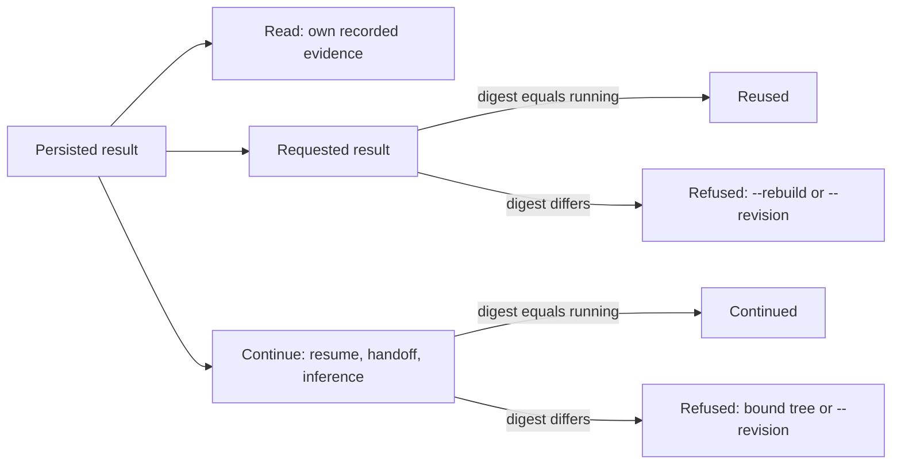

# Reproducibility and validation

Every Source, Dataset and run records its exact inputs, code and environment, and can be inspected and rebuilt from retained evidence. This guide explains those identities, the rebuild path and how to choose software checks for a change.

[Documentation index](README.md)

## Identity

| Object | Identity binds | Provenance only |
| --- | --- | --- |
| Source | Resolved physical configuration, seeds, case and input identities, COMSOL template, recorded producer digest, numerical environment | Readable Source name, storage path |
| Dataset | Ordered Source cases with their design provenance (seed base, design recipe, design kind, point), grid, channel and conversion contracts, material roles and case roles, recorded conversion digest | Dataset name, directory, file names, Git HEAD, selection method, recorded environment |
| Run | Resolved scientific and training configuration, exact Dataset membership (with its Train subset), seed, recorded producer digests (`training_sha256`, `model_sha256`) | Output paths, tracking settings, Git provenance |
| Optuna study | Dataset, Train subset and role membership, budget, search space, objective, seeds, numerical environment | Study storage location |

Content hashes identify bytes and detect drift; they do not replace the explicit compatibility contracts. Ordinary reads never rewrite admitted evidence. Documents carry `schema_kind` where a reader can receive the wrong file; formats have no version. An incompatible change is a new contract: old data is rejected by its key sets and identities and is regenerated.

### Revision rule

**Same name, changed science: add `--revision LABEL` to the command you run. It never changes seeds, never makes identical science new, and never re-simulates a Source unless you also pass `--new-source` to the Dataset run.** The same name never holds different content: different content under an existing name is refused. Identical content never exists twice: Datasets and runs are bound to their identity in `02_datasets/.state/identities/` and `03_experiments/.state/identities/`.

| Unit | Command | Effect of `--revision LABEL` | Default when omitted |
| --- | --- | --- | --- |
| Source (campaign without Dataset) | `./scripts/generation run` | `run --revision LABEL` names the Source `SOURCE_NAME__rev-LABEL` beside the existing one; a campaign config may author the same label as its optional key `revision`; there is no free Source label | no revision, or the config's `revision` key |
| Dataset | `python -m src.datasets.dataset_packages run` | Appends `__rev-LABEL` to the Dataset name; the default Source is reused and nothing is simulated again | no revision |
| Dataset with new Source | `--revision LABEL --new-source` | The Source becomes `<default Source name>__rev-LABEL` and its cases are simulated afresh with licensed COMSOL; `--new-source` only together with `--revision` (else exit 2) | `--new-source` off: the default Source is reused |
| Run | `train` | Deliberately separate run `seed-N__a0ep-E__rev-LABEL` (steady `seed-N__rev-LABEL`); an identical experiment is never started twice, also not with a revision | no revision |
| Study | `optuna` | Its own study; the study directory carries budget and revision | no revision |

<details>
<summary><strong>Label grammar, effects and refusals</strong></summary>

- The label uses lowercase letters and digits joined by single `-`, `_` or `+`.
- It changes no seed, batch identity or campaign digest; the plan records it with the other overrides. It changes only the Source name and storage locator.
- Use it when the producer science changed (for example the producer code or a converter fix). A Dataset plan run names the Source `SOURCE_NAME__rev-LABEL` only with `--revision LABEL --new-source`; `--revision` alone names just the Dataset.
- The unit's own refusals and messages: [Datasets](04_datasets.md#names-and-identity) (`Identical Dataset content already exists as <task>/<name>; use that name`), [Training](05_training.md#continue-extend-and-resume).

</details>

### Code identity

A persisted result is evidence of the code that produced it. Code identity uses conservative syntax-tree hashes of declared code projections, and three operations never mix:

1. **Reading** a persisted result (historical admission) compares it only with its own recorded evidence and the recorded identities of its inputs, never with the running code. Compatible code changes never waive the schema, task, Dataset, grid, numerical-environment or integrity contracts.
2. **Requested-result freshness:** asking a command for a result that is already in place, complete or as a complete stage, requires the recorded producer digest to equal the running projection; otherwise the command refuses with its rebuild remedy: `--rebuild` for artifacts, `--revision <label>` for runs and Sources.
3. **Execution continuation:** extending persisted computation or using persisted computational state (resume, extension, the A0 handoff to B and A1, loading weights for inference and artifacts, a partial transient artifact stage, a frozen Generation campaign) requires the recorded digest of the continued computation to equal the running projection.



Composite signatures keep their complete comparison (Optuna study signature, Generation campaign digest, checkpoint identity). The third-party numerical environment (neuraloperator digest, container image) keeps its own comparison at execution boundaries. The frozen source tree is execution binding and provenance only; `--continue-with-current-code` switches it and waives none of these checks.

<details>
<summary><strong>Projections, recorded digests and consequences</strong></summary>

Each owning module declares its projection with `common.code_identity.CodeProjection` (directories, files, a filename filter for the other task, exemptions with reasons, composition); nothing is discovered at run time:

- Generation input and Source producers, and the conversion code of each Dataset view.
- Model projection per task (`learning.training.checkpoint.MODEL_PROJECTIONS`): what prediction from saved weights runs (model construction, tensorization, scaling application and their contracts).
- Training projection per task (`TRAINING_PROJECTIONS`): includes the model projection and adds loss, loop, curriculum and handoff.
- Analysis projection per task (`analysis.artifacts.contracts.ANALYSIS_PROJECTIONS`): includes the model projection and adds metrics, validity and artifact production.
- Optuna study projection: its own modules plus the training projection of the study's task.

Each projection also hashes the `__init__.py` of every member's package and of every parent package up to `src/__init__.py`, because an initializer decides which module an alias or lazy name dispatches to. Comments, docstrings and formatting are ignored. The shared run and configuration loaders and the Dataset reproduction module are hashed in full, so an unrelated change inside them can refuse a continuation. CLI and documentation modules are excluded.

The digests are recorded where the result is written: the `producer` section of a run's `config.yaml` (`training_sha256`, `model_sha256`; stamped when the configuration is resolved, refused when authored), `producer.analysis_sha256` in the artifact provenance, `producer.model_sha256` in the scaling envelope (also bound by its cache key), the conversion digest in the Dataset manifest and `producer_identity.source_implementation_sha256` in the Generation plan.

Consequence: after an edit to the loss, completed runs stay readable and evaluable and their artifacts stay valid, but resuming or extending such a run is refused ("finish it in its bound source tree or start a new run with --revision <label>"). After an edit to the model code, loading the run's weights is refused as well.

`tests/data/test_code_projections.py` keeps every projection complete: each static import of each member must be a member, shared infrastructure (`INFRASTRUCTURE_MODULES` and `INFRASTRUCTURE_DIRECTORIES`), an exemption with a stated reason, or the other task's dispatch path. Package aliases are resolved through the runtime bindings of the package initializer (a TYPE_CHECKING-only alias never overrides them), and a name that an initializer binds to different modules at runtime fails the suite as a contradictory alias. A new scientific dependency therefore fails the suite until it is added to the projection or exempted. A projection digest says whether the code behind a recorded result is the running code; the exact executed bytes are bound separately by the source snapshot and the frozen tree, and a refusal leaves historical results intact because their exact producing source stays the reproduction authority.

</details>

## Source snapshots and frozen trees

Every executing command (`./scripts/generation run` and `inputs` without `--dry-run`, which is off by default, and `python -m src.datasets.dataset_packages run`), also from a clean checkout, captures its snapshot and restores it once into the read-only source tree `runtime/sources/COMMIT12-FINGERPRINT12/`. Drivers, node jobs, case steps and ML jobs run from that tree, so later edits in `repo/` do not reach submitted work. Uncommitted changes are always admitted: the snapshot records them exactly.

<details>
<summary><strong>Snapshot content, trees, leases and verification</strong></summary>

**Snapshot.** A snapshot records the base Git commit, a binary-capable diff of tracked changes, non-ignored untracked bytes, safe links and the permission inventory. Recovery needs the base Git objects plus that diff and payload. The tracked COMSOL templates `simulation/steady_flow/steady_flow_template.mph` and `simulation/transient_drying/transient_drying_template.mph` recover from the commit or the diff; the Source also records template path and hash, raw plan content and the physical mapping. Runtime environments, scientific storage and ignored files are outside the snapshot. Environment records describe Python, packages, platform, COMSOL module and locks; regeneration needs a compatible provisioned environment.

Identical commit and fingerprint reuse one snapshot, stored as `storage/source_snapshots/COMMIT12-FINGERPRINT12/` (the first twelve hexadecimal digits of each); `snapshot.json` keeps the full commit and fingerprint. A different snapshot under the same short name fails closed. Sources and cases reference it.

**Pruning.** `scripts/source_fingerprint.py --prune-snapshots STORAGE RUNTIME/sources` cleans up orphaned source snapshots: it only reports them by default and deletes them with `--apply`. A snapshot counts as orphaned when no `.json`, `.jsonl`, `.yaml` or `.yml` record under storage contains its folder name or full fingerprint, no tree of that name exists in `runtime/sources`, no job of the user is queued and none ran in the last 24 hours, nothing under the snapshot or in `runtime/sources` changed within 24 hours, and its `snapshot.json` is valid and names its folder; anything it cannot check deletes nothing. `hygiene` runs it in quiet phases.

**Freezing.** The restored tree holds the commit's files plus the recorded diff and untracked bytes, without `.git`, directories without write bits. `./scripts/generation run` and the Dataset command submit their drivers as their own Slurm jobs that run from that tree ([Datasets](04_datasets.md)), and `inputs` runs its Slurm input step from it. The controller, Dataset assembly, Slurm workers, node jobs and case steps therefore never run live code; configurations are read from the tree. Freezing runs only on the login node: the three commands start there, and inside a Slurm allocation they stop with "Freeze the source on the login node", so compute nodes never run the capture and archive Git commands. Read-only commands (`status`, `--dry-run`, `cancel`, `fail-case`, `amend-replacements`) stay in the live checkout and leave no snapshot or tree. The `Source:` line the Generation commands print on stderr states whether the snapshot carries uncommitted changes (`snapshot carries uncommitted changes` or `snapshot is clean`).

**Continuation.** An existing campaign continues in the tree of its latest execution epoch, which is restored from its snapshot when it was pruned; a new campaign uses the current code. `--continue-with-current-code` (on `run` and the Dataset command; off by default) continues an existing campaign with the current code instead: the driver job runs from the current tree, and the campaign admits the switch only when no job of the campaign is queued or running and records it as a new execution epoch. A change to the producer implementation changes the campaign identity and is never admitted by this switch: finish the campaign in its bound source tree or start a new Source with `--revision <label>` ([Code identity](#code-identity)).

**Leases and verification.**

- Each submitted job leases its tree (`runtime/sources/.leases/TREE/JOB_ID`): node jobs and the Generation and Dataset driver jobs under the job ID `sbatch` returned. A lease that fails after a successful submission only prints one warning; the job ID is still recorded and the tree stays protected by its 24-hour recency.
- A launcher deletes trees that no queued or running job leases and that nobody used for 24 hours, and an unanswered `squeue` deletes nothing. A deleted tree is restored from its snapshot and base commit when needed.
- Parallel launches that freeze the same commit and fingerprint share one snapshot and one tree: the process that loses the publication race accepts the identical result, and different content under the same name fails closed.
- The tree is checked against its snapshot without Git: `scripts/source_fingerprint.py --verify-tree TREE STORAGE/source_snapshots` (bytes, links, permissions and membership).

**Tree mode.** A process running from a tree is in tree mode (`SOURCE_TREE_ID` set). It requires explicit `PROJECT_ROOT` (equal to `RUNTIME_ROOT/sources/SOURCE_TREE_ID`), `STORAGE_ROOT` and `RUNTIME_ROOT`, infers no sibling default and never calls Git. Compute nodes need no Git: `scripts/generation_node.sh` and `scripts/generation_prerequisites.sh` verify the tree before any project Python runs and again after the command, compare the snapshot's commit and fingerprint with `GENERATION_GIT_COMMIT` and `GENERATION_SOURCE_SHA256`, and require `GENERATION_NATIVE_VENV` to be `RUNTIME_ROOT/venvs/native` with an executable `python`. The Python publication guard repeats the verification in-process. A Dataset built inside a tree binds the admitted snapshot instead of capturing another. Workers also verify the tree before publication.

**ML jobs.** `scripts/slurm_ml.sh` jobs run the same way: only the launcher uses `repo/` and Git; the worker verifies the tree against its snapshot without Git before the container starts, and each runtime session records the source commit, worktree digest, source tree, image digest and `source_transition`. A run, pair or study continues in the tree it last ran in unless `--continue-with-current-code` switches it (the digest checks of [Code identity](#code-identity) still apply; [Training](05_training.md#continue-extend-and-resume)).

**Producer identity.** Physical identity binds the recorded producer digest and the numerical environment. The producer implementation is the declared Generation input projection (sampling, fields, schedules, materials, vocabulary) for input reuse and the Generation source projection (the input projection plus case admission, solver invocation, export conversion and acceptance policy) for the Source identity; both are declared in `generation_contracts_source.py`. Comment or documentation edits and Dataset roles leave it unchanged; a change inside the producer's implementation invalidates cached inputs. The Git commit is not part of input-batch identity: it stays in the input manifest as provenance, and reusing a batch keeps and reports its original commit. Continuing a frozen campaign requires its recorded Source projection digest to equal the running one, otherwise it is refused with "finish it in its bound source tree or start a new Source with --revision <label>"; `--continue-with-current-code` switches the execution tree only and does not waive this check, and inspection of a campaign stays unguarded.

</details>

## Runs and publication

Runs persist their full effective configuration, seeds, case split (`split_indices.pt`), Train-only fitted scaling (`normalizer.pt`), selected checkpoints and runtime evidence. Rerunning a run continues it after validating the saved scientific and continuation contract and its recorded training digest against the running code ([Code identity](#code-identity)); a completed run stays readable and evaluable after code changes. A duration can only stay equal or increase where the workflow allows it, and an identical experiment never runs twice. A0, B and A1 keep their handoff and matched-time contracts ([Training](05_training.md)).

<details>
<summary><strong>Split schema, normalizer and published evidence</strong></summary>

Both tasks persist one split schema (`experiment_case_split`). Its shared core binds the task contract, the run's `train_subset`, the training Dataset's fixed case partition and its digest, and for the training Dataset and every OOD Evaluation Dataset the manifest identity (Dataset ID, manifest digest, channel contract digest, ordered cases) plus the identity its payload states (steady flow: content fingerprint and grid; transient drying: index digest and configured horizon). Train (the whole Train role or its `train_subset` prefix per ID material), validation and ID-test carry ordered case IDs and a membership digest; the `material_ood` and `parameter_ood` roles each list their parts, and every part keeps its own Dataset identity, declared cases (`ood` for material OOD, the training Dataset's `parameter_ood` for parameter OOD), membership digest and evaluation assignment, whose `role` names the OOD role. The only task extension is the transient item expansion (tensorizer selection, Train and evaluation sampling, spatial view). One admission reads every saved split: resume, artifacts, inference and completed-run validation. A run replays a saved split only when it equals the split rebuilt from the current Dataset manifests, so a split of another manifest digest or partition is refused.

`normalizer.pt` is one envelope for both tasks (`train_scaling_artifact`): the task's fitted state and its identity, which binds the task contract, the training Dataset's manifest and payload identity, the Train membership digest and the preprocessing specification. Scaling is fitted on the run's Train membership only, a `train_subset` included. Identical identities share one cache entry under `03_experiments/.state/scaling_cache/`, keyed by the identity digest and the run's recorded model digest (`producer.model_sha256`, the model projection of its task) and published atomically under a lock, so changed model code refits once per Dataset instead of reusing an entry, while a loss-only change reuses it. The envelope records the model digest and a cache read validates key against envelope; `normalizer.pt` keeps a data-only identity and a completed run stays admissible after code changes. An entry whose identity differs from the expected one is refused, never refitted silently. Resume, the B/A1 handoff and completed-run validation admit the saved artifact under the identity derived from the saved split, the same way for both tasks. Split files, normalizers, manifests and studies of earlier contracts are not read; rebuild the Dataset or start a new run instead.

A published result keeps the exact source snapshot or release, resolved configuration, Source and Dataset evidence, experiment bundles and required software and model dependencies.

A Source keeps its machine evidence in reserved `_record/` folders (plan, selected pool and execution ledger at campaign level, reservation, decision and attempts per case), and Dataset inspection and rebuild read each case through its storage-relative locator `01_generation/TASK/SOURCE_NAME/materials/MATERIAL/case_NNNN/result/case.h5` and the plan at `_record/campaign_plan.json`. Driver, node-job and helper logs stay in `runtime/logs/` and are hard-linked into the campaign's `_record/logs/` (never into a published Dataset folder, which is complete and immutable once it is renamed into place, while the driver keeps appending to its log); the links are evidence for readers, not part of any identity or hash ([Logs](03_generation.md#logs)). Snapshots, frozen trees and leases: [Source snapshots and frozen trees](#source-snapshots-and-frozen-trees).

</details>

## Inspect and rebuild a Dataset

Inspect the publication, restore the producing source into a new empty directory (Git index and history stay untouched), and rebuild from there into new verification storage with the original storage as a read-only Source root:

```bash
# 1. Inspect: snapshot, base Git object, ordered Source cases, model and dependency evidence available?
../runtime/venvs/native/bin/python -m src.datasets.dataset_packages inspect TASK DATASET_ID

# 2. Restore the producing source (verified tree without Git metadata, recorded permissions and internal links)
../runtime/venvs/native/bin/python scripts/source_fingerprint.py . \
  --restore /absolute/storage/source_snapshots/COMMIT12-FINGERPRINT12/snapshot.json \
  /absolute/empty-recovered-source

# 3. Rebuild from the recovered source
cd /absolute/empty-recovered-source
env -u PROJECT_ROOT /absolute/project/runtime/venvs/native/bin/python -m src.datasets.dataset_packages rebuild \
  /absolute/original-storage/02_datasets/TASK/DATASET_ID/dataset_manifest.json \
  --storage-root /absolute/original-storage \
  --output-directory /absolute/new-verification-output
```

`inspect` prints this sequence with the actual manifest, snapshot and dependency paths. `rebuild` freezes the manifest's ordered Sources, verifies source bytes, permissions and the recorded Python and dependency versions, and checks Dataset identity and payload bytes before publishing. It runs no COMSOL and leaves the original publication unchanged; mismatching bytes stay unpublished with a failure-evidence path. The output references the original Source root. Missing Source bytes require the normal Generation workflow with the retained configuration, raw inputs and exact model, inside Slurm.

<details>
<summary>Options</summary>

| Command | Option | Default when omitted |
| --- | --- | --- |
| `inspect` | `TASK`, `DATASET_ID` | required (`steady_flow` or `transient_drying`, and the Dataset ID) |
| `inspect` | `--storage-root PATH` | the `STORAGE_ROOT` environment variable, else `<repository parent>/storage` |
| `inspect` | `--json` | off: the text report with the restore sequence; on: the complete evidence as JSON |
| `source_fingerprint.py --restore` | `SNAPSHOT_JSON`, `DESTINATION` | required positionals after `REPOSITORY` |
| `rebuild` | `MANIFEST` | required |
| `rebuild` | `--storage-root PATH` | required: the retained original storage |
| `rebuild` | `--output-directory PATH` | required: a new empty directory outside source and dependency storage |

</details>

## Choosing checks

Start with the checks for the changed contract, then cross the nearest persisted boundary. Format, lint, type and notebook checks run on the login node; a few focused unit-test files without the `integration` marker can run there with capped threads. Integration and lifecycle tests, broader selections and the full suite run inside a CPU allocation; GPU lifecycle checks need a typed GPU allocation.

```bash
../runtime/venvs/native/bin/python -m ruff check src tests scripts/check_notebooks.py scripts/check_package_install.py
../runtime/venvs/native/bin/python -m ruff format --check src tests scripts/check_notebooks.py scripts/check_package_install.py --exclude '*.ipynb'
../runtime/venvs/native/bin/python scripts/check_notebooks.py
../runtime/venvs/native/bin/python -m mypy src
../runtime/venvs/native/bin/python -m basedpyright --pythonpath ../runtime/venvs/native/bin/python
OMP_NUM_THREADS=2 MKL_NUM_THREADS=2 OPENBLAS_NUM_THREADS=2 \
  ../runtime/venvs/native/bin/python -m pytest -q -p no:cacheprovider TEST_FILES
srun --partition=standard --cpus-per-task=4 --mem=16G --time=00:30:00 \
  ../runtime/venvs/native/bin/python -m pytest -q -p no:cacheprovider TEST_NODES
```

The full CPU suite (`-m "not real_data" tests`, about 9 minutes with 4 CPUs) is for an unresolved cross-subsystem risk, inside an allocation. `real_data` tests need `RUN_REAL_DATA_TESTS=1` and an explicit `STORAGE_ROOT`. Fake-solver and numerical checks establish wiring; real COMSOL execution, physical validity and scientific acceptance need their own evidence. The [quality workflow](../.github/workflows/quality.yml) runs the same static checks and the CPU suite in CI.

<details>
<summary><strong>Checks by changed contract</strong></summary>

| Change | First checks | Protected boundary |
| --- | --- | --- |
| Values in maintained `configs/` | [Maintained configs](../tests/experiments/test_maintained_configs.py) | Every learning config, Dataset plan and the documented matched command still pass their loaders; current values are not frozen |
| Source planning, candidate decisions, raw admission | [Generation fake pipeline](../tests/generation/test_generation_fake_pipeline.py) | Full design, successful and failed decisions, replacement, HDF5 and timing admission with only the solver substituted |
| Dataset identity, provenance, manifest | [Dataset reproduction](../tests/datasets/test_dataset_reproduction.py), then [transient training lifecycle](../tests/integration/test_transient_training_lifecycle.py) | Conflict, traversal and corruption checks; immutable Source identity and persisted reopen |
| Experiment membership, scaling, loader | [Split admission and leakage](../tests/datasets/test_split_admission.py), [transient runtime split](../tests/datasets/test_runtime_transient_training.py), [data pipeline](../tests/experiments/test_data_pipeline_validation.py) (steady flow; it refuses a transient request, whose group scaling the transient loaders admit), [configuration semantics](../tests/experiments/test_config_semantics.py), then the CPU lifecycle node | Resolved roles, leakage rejection, Train-only scaler identity, PT and physical view parity |
| Optuna trial lifecycle | [Optuna lifecycle](../tests/experiments/test_optuna_lifecycle.py), then the one-trial studies in the [steady-flow](../tests/integration/test_steady_flow_lifecycle.py) and [transient](../tests/integration/test_transient_training_lifecycle.py) lifecycle tests | One terminal record per outcome for both tasks, best evidence bound before the best is deleted, dry-run signature equal to the recorded one, completed trial admitted without patches |
| A0/B/A1, checkpoint, budget | [Matched budget and resume](../tests/experiments/test_transient_matched_a1_b.py), [training lifecycle](../tests/integration/test_transient_training_lifecycle.py) | Recovery arithmetic and `budget_unmet` states; on a GPU also training, measured B time, matched A1, shared A0, checkpoint, inference and offline tracking |
| EDA or evaluation | [Transient artifacts](../tests/analysis/test_transient_evaluation_artifact.py), [matched artifacts](../tests/analysis/test_transient_matched_artifacts.py), affected EDA tests | Saved membership, evaluation relation, grid, time, units, error support, artifact admission |

Source-specific failures add [transient timing and units](../tests/generation/test_generation_transient.py), [runtime retention and cancellation](../tests/generation/test_generation_runtime.py), [source selection and input bytes](../tests/generation/test_generation_campaign_selection.py).

The smallest cross-boundary CPU check publishes Sources through a fake solver, publishes a Dataset, reopens PT and physical views and checks partition and scaling:

```bash
../runtime/venvs/native/bin/python -m pytest -q \
  tests/integration/test_transient_training_lifecycle.py::test_transient_package_pt_runtime_and_scaling_lifecycle
```

</details>

### Acceptance smoke

After every infrastructure change, the two smoke plans `configs/02_datasets/steady_flow/smoke.yaml` and `configs/02_datasets/transient_drying/smoke.yaml` run the whole real chain with licensed COMSOL: Generation, Dataset publication and training. They run like any other plan ([Datasets](04_datasets.md#normal-workflow)); their content is frozen, so an acceptance can bind them by hash.

<details>
<summary><strong>Smoke plan content</strong></summary>

Each plan takes one Train, one validation, one test and one parameter-OOD point of lentil and chickpea and two test points of kidney_bean as material OOD, ten cases per task. These are the first points of the same fixed designs that the reduced and production plans use ([Datasets](04_datasets.md#fixed-designs-and-case-roles)), so the smoke exercises every case role, parameter OOD for both tasks and the design seeds of the production sets.

</details>
